# Matrix

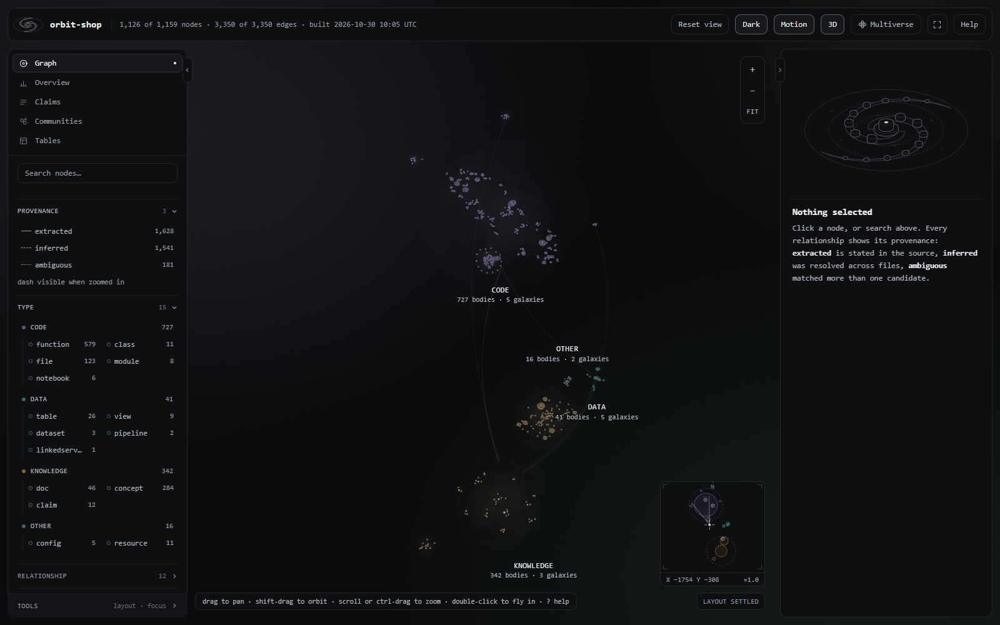

**Turn any folder into a knowledge graph you can query from the terminal and fly through in the browser.**

[](https://github.com/Archit3115/matrix/actions/workflows/ci.yml)
[](https://github.com/Archit3115/matrix/actions/workflows/codeql.yml)
[](LICENSE)


Matrix indexes the code, notebooks, SQL, docs and notes in a folder into a graph where every edge says
how it was obtained. You get a query CLI, a Markdown wiki and report, an FTS5 search index, and
`graph.html`: one offline file that renders the graph as a 3D universe. It is built to plug into
[Claude Code](https://claude.com/claude-code), so the assistant queries the graph before it opens files and the graph
rebuilds itself after each turn that changed something.

---

## Use it anywhere

Matrix is a general-purpose tool. Nothing in it is tied to a particular person, company, machine or project.

- **No assumptions** about language, domain, company or project layout. Matrix walks whatever folder you give it and
  extracts structure from every file type it understands. See [what gets parsed](#what-gets-parsed).
- **Any user, any machine, any folder.** Point it at a single repo, a monorepo, a notes vault, a whole drive, or
  several of these at once, each kept as its own *universe*.
- **Local only and offline.** Matrix calls no model and no cloud service. The graph page loads nothing from the
  network, and the optional engine binds to `127.0.0.1` only.
- **Install anywhere.** One command installs Matrix into any target folder. Every path is computed at install time,
  so nothing is hard-coded to a user or a location.
- **Per-user registry.** Each person keeps their own list of universes in `$MATRIX_HOME/scopes.json` (by default
  `~/.claude/matrix`). Every install on the machine shares that list, and other users never see it.

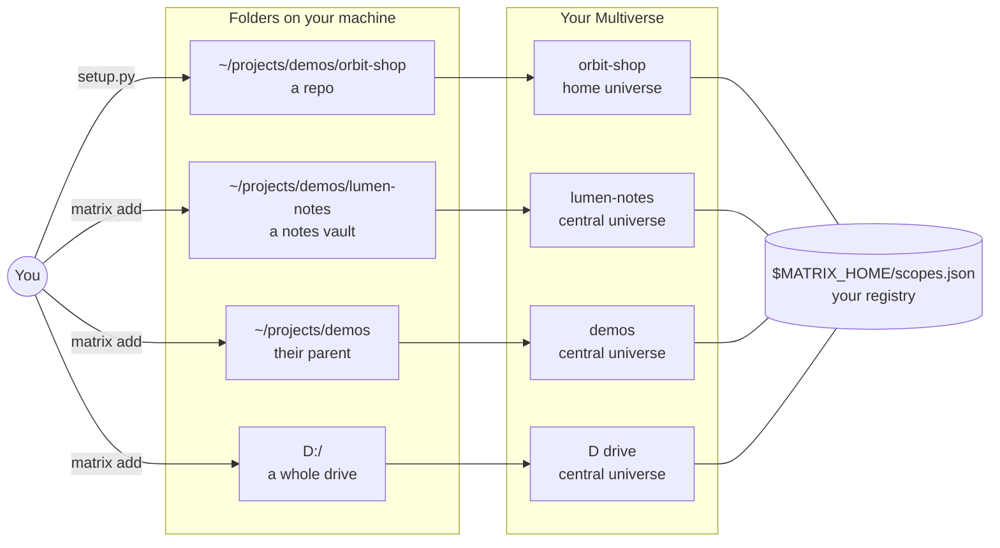

---

## Built for LLMs and agents

Matrix exists so that a coding agent spends its context on the task, not on finding its way around.

- **Query first, read last.** One `query.py` call answers *where is X*, *what touches Y* or *how does A reach B*,
  with a `file:line` pointer on every line. The agent opens only the lines it will change.
- **Provenance on every edge.** `EXTRACTED`, `INFERRED` or `AMBIGUOUS` tells the agent what it can act on and what
  it must verify first.
- **Small by design.** Capped lists (`-l`, default 20), one line per node, `... N more` when cut, and `--json` for
  machines. On this repository, `explain build_db` prints about 450 bytes; learning the same callers by reading
  means opening three files, about 71 KB.
- **Pre-digested areas.** `INDEX.md` and one wiki article per community, which the indexer heads with *"Read the
  article, not the source files."*
- **Starts every session oriented.** A `SessionStart` hook injects a brief of about 15 lines; a `Stop` hook rebuilds
  only what changed, so the next turn sees fresh structure.
- **Instructions as code.** A marker-delimited `CLAUDE.md` block and a `/matrix` skill, written idempotently and
  backed up, with every path filled in at install time.
- **Deterministic and local.** Stable ids, sorted output, no model calls, no network beyond a `127.0.0.1` engine.
- **Not tied to one agent.** It is a CLI plus Markdown and JSON, so any agent that can run a command can use it.

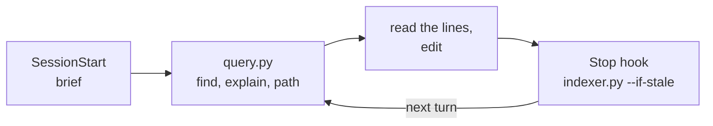

Read [docs/FOR-AGENTS.md](docs/FOR-AGENTS.md) for the design, the patterns, and the full catalog of what an agent
gets out of the box.

---

## What it is, and why

When an assistant or a new teammate meets an unfamiliar codebase, the first hour goes on questions like *where does
this live*, *what touches it* and *how does A reach B*. Answering them by grepping and opening files is slow, and it
uses up context. Matrix answers them from a prebuilt graph, and it is honest about how sure each answer is:

| Provenance | Meaning | How to treat it |
|---|---|---|
| `EXTRACTED` | Stated in the source: an import, a definition, a `CREATE VIEW`, a `[[wikilink]]`. | Reliable. |
| `INFERRED` | Resolved across files by the indexer: a bare call name with a single candidate, or prose that names a symbol defined elsewhere. | Usually right. Verify before acting. |
| `AMBIGUOUS` | Several candidates matched, so Matrix kept up to four of them and flagged the edges. | A lead, not a fact. |

Everything is deterministic. Python is parsed with its own `ast` module and everything else with small structural
parsers. No model is called and nothing leaves the machine.

### What gets parsed

| Files | What Matrix extracts |
|---|---|
| `.py` | Classes, functions, imports, call sites and inheritance (via `ast`). SQL found in string literals. A regex fallback handles files that will not parse. |
| `.ipynb` | Code cells as Python, Markdown cells as headings. |
| `.sql` | `CREATE TABLE / VIEW / PROCEDURE / FUNCTION` definitions, plus `FROM / JOIN` reads and `INTO / UPDATE / MERGE` writes. |
| `.md` `.txt` `.rst` | Headings as concepts, `[[wikilinks]]`, Markdown links, URLs, and optional claim headings. |
| `.yml` `.yaml` | A config node, declared resources, and the notebook or file paths it references. |
| `.json` | Azure Data Factory / Synapse artifacts (pipelines, datasets, linked services, triggers, data flows). Off by default; see `adf_json`. |
| Data and binary files | One `dataset` node each, for the extensions in `data_exts` and for any file larger than `max_file_bytes`. |

Other file types are skipped for now. Adding a new language takes one function; see
[docs/DEVELOPMENT.md](docs/DEVELOPMENT.md#adding-a-file-extractor).

---

## Feature tour

### A universe, not a hairball

The page lays the graph out as a universe. Node *groups* (Code, Data, Knowledge, Other) are clusters, node *types*
are galaxies inside them, and high-degree hubs are the suns of solar systems with their neighbours in orbit. You
navigate it as you would a map: fly in, drill down, climb back out.

| | |
|---|---|
| 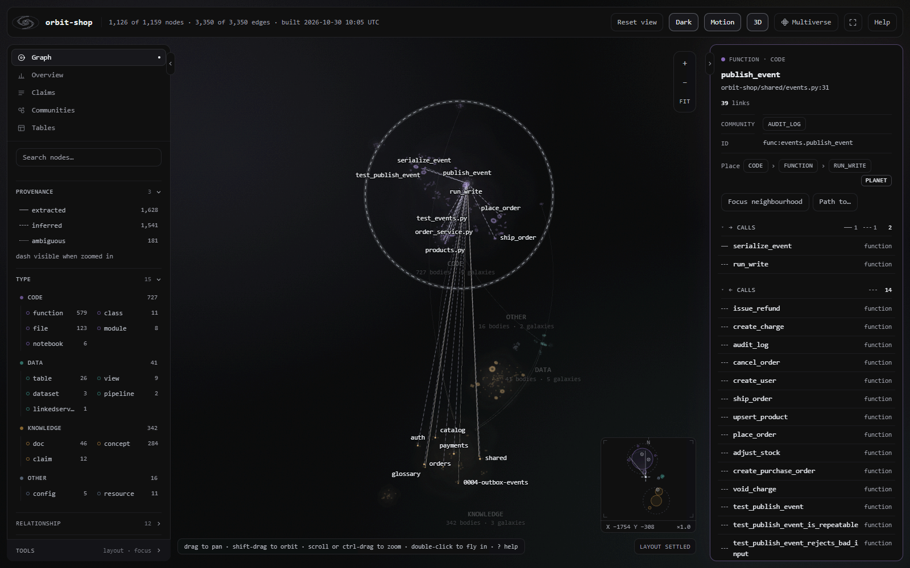 | 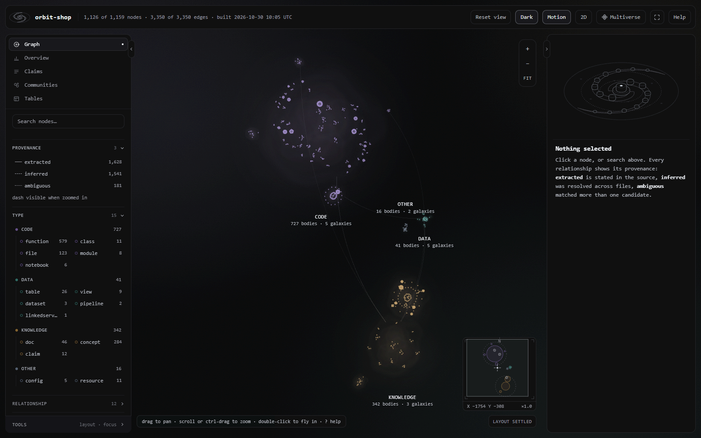 |
| **Select** any body. The inspector lists every relationship with its provenance as line grammar (solid, dashed, dotted). | **2D / 3D** toggle (`v`): a tilted perspective with depth, or a flat face-on map. |
| 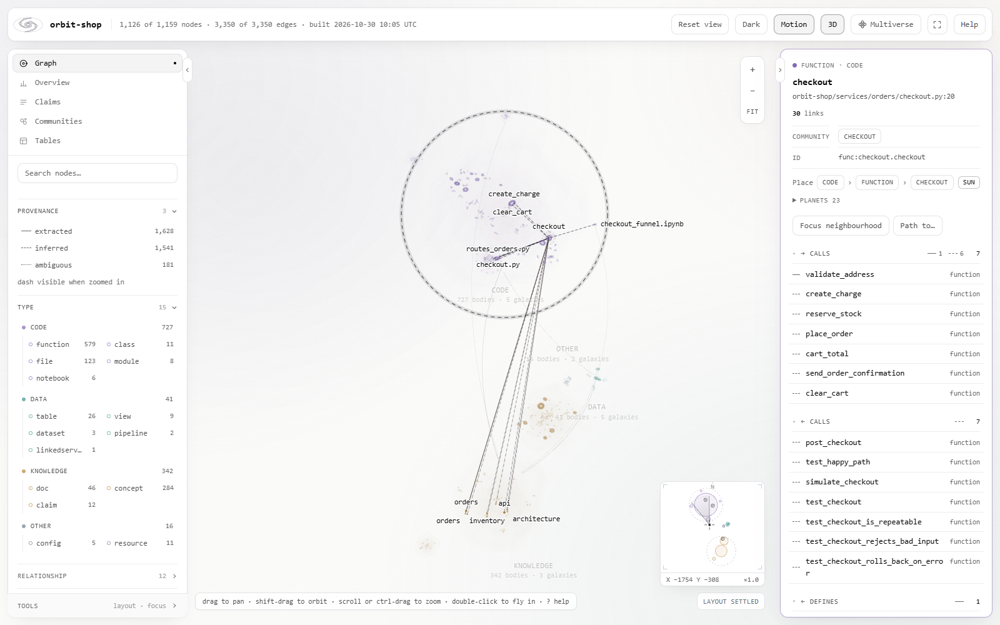 | 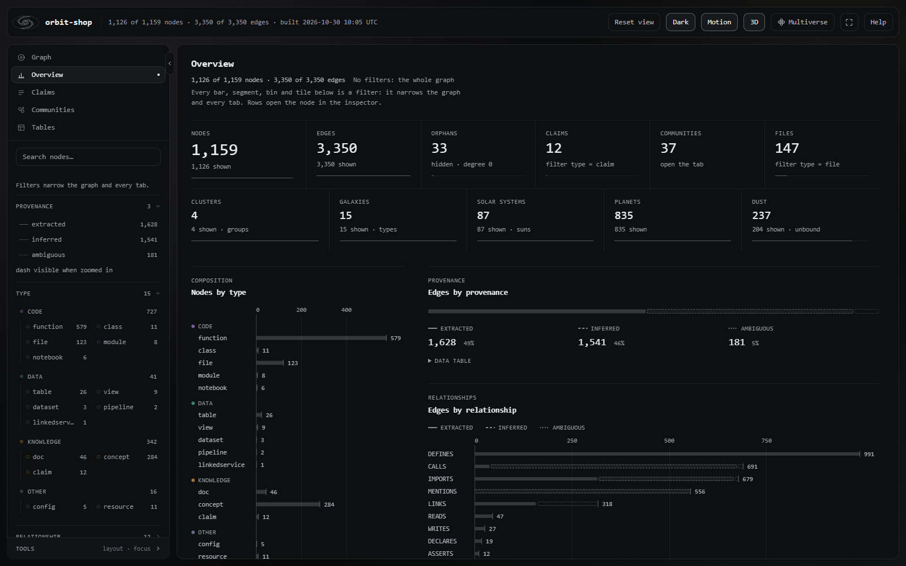 |
| **Light and dark** themes, both in the monochrome hairline style with only faint colour. | **Dashboard tabs:** Overview, Claims, Communities and Tables. They follow the same filters as the graph. |
| 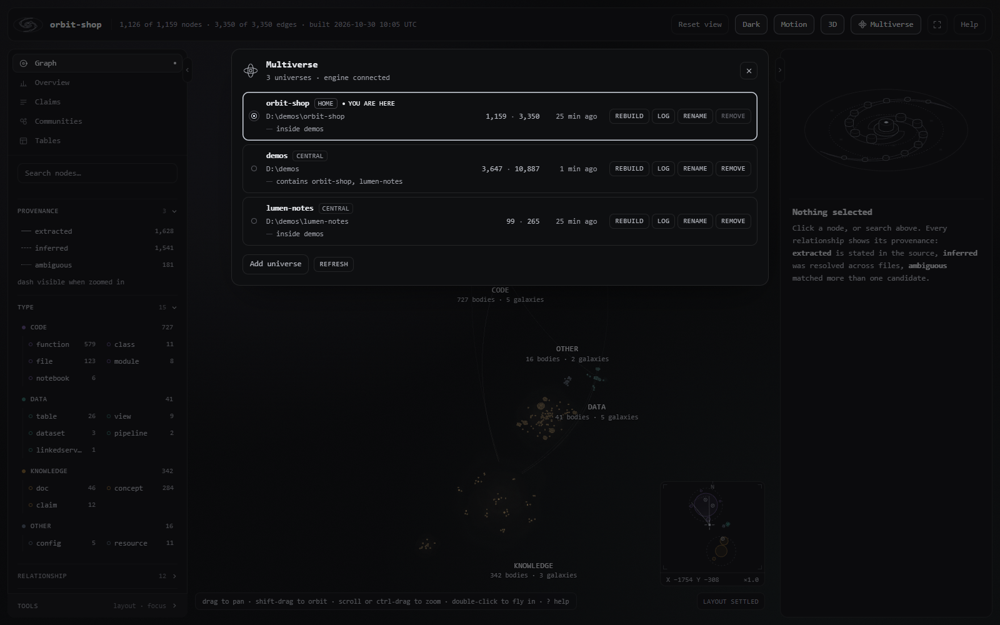 | 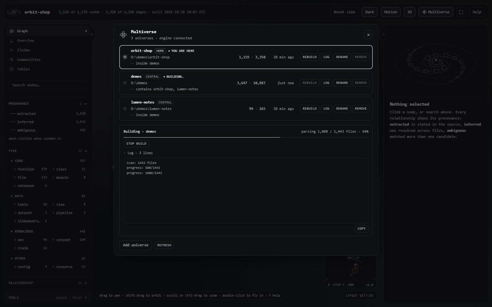 |
| **Multiverse** (`u`) lists every folder you have indexed and switches between them. | **Builds** run as jobs on the local engine, with a progress bar, a live log and a Stop button. |
|  | 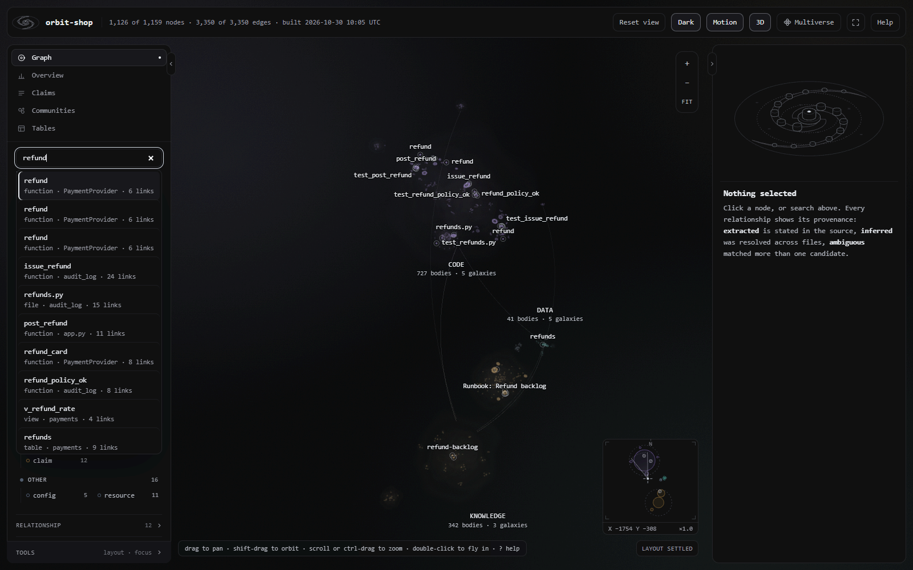 |
| **Landing page:** browse to a folder, preflight-count it, then index it. | **Search** (`/`) runs a ranked, camel-case-aware search over labels, paths and doc text. |

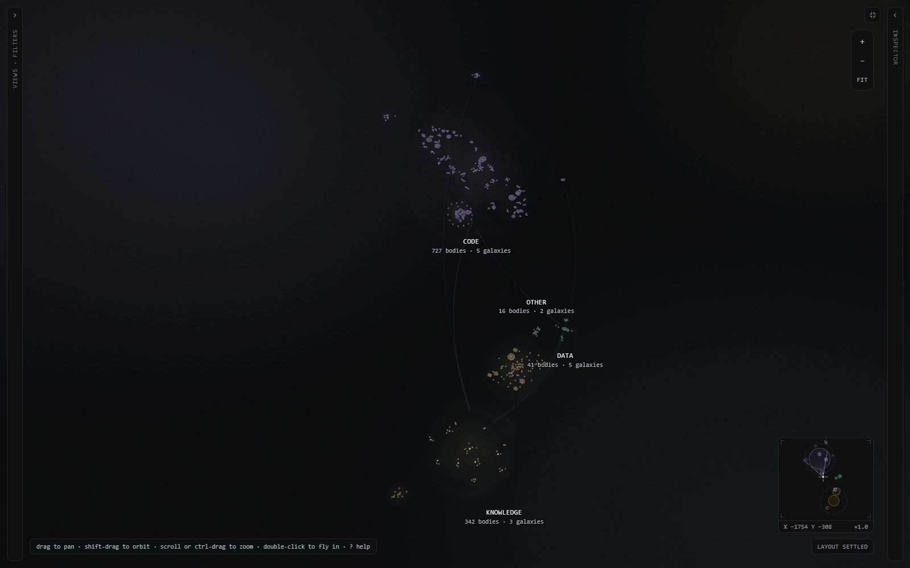

**Collapsible panels** (`Alt+[`, `Alt+]`, `\`), **full screen** (`f`), a **minimap** (`m`), level-of-detail
labels, fly-to camera paths and dolly-to-cursor zoom. All of it is keyboard accessible.

---

## 60-second quickstart

You need Python 3.10 or later. No `pip install` is required.

```bash
git clone https://github.com/Archit3115/matrix.git
cd matrix

# Install into any folder. This copies Matrix to <folder>/.claude/matrix, wires the
# Claude Code hooks, adds a CLAUDE.md block and the /matrix skill, registers the folder
# as a universe, installs the `matrix` launcher and builds the graph.
python matrix/setup.py ~/projects/demos/orbit-shop        # Windows: python matrix\setup.py C:\projects\demos\orbit-shop

# Preview every change without writing anything:
python matrix/setup.py ~/projects/demos/orbit-shop --dry-run
```

Then use any of these:

```bash
# Query from the terminal
python ~/projects/demos/orbit-shop/.claude/matrix/query.py find "checkout"
python ~/projects/demos/orbit-shop/.claude/matrix/query.py explain CartService

# Open the universe: double-click .claude/matrix/out/graph.html, or start the Multiverse engine
matrix                                    # starts the local engine if needed and opens the browser

# Add another folder as its own universe and build it
matrix add ~/projects/demos/lumen-notes --build
```

If the launcher folder is not on your `PATH`, setup prints the one-line command that adds it. Setup never edits
`PATH` itself.

---

## How it plugs into Claude Code

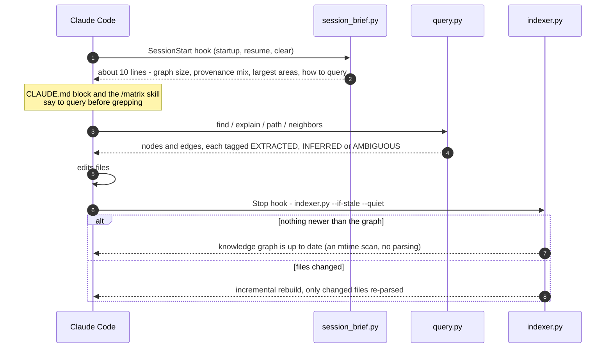

`setup.py` owns four things in the target folder:

- **`.claude/settings.json`:** a `SessionStart` hook that prints the brief, and a `Stop` hook that rebuilds the graph
  when it is stale. Hooks you already have are kept. Only Matrix's own hooks are replaced, in place.
- **`CLAUDE.md`:** a block between `<!-- matrix:begin -->` and `<!-- matrix:end -->` that tells the assistant to
  query first and to cite provenance.
- **`.claude/skills/matrix/SKILL.md`:** the `/matrix` skill, the full command reference for the assistant.
- **`.claude/matrix/`:** the code, `config.json` and the `out/` folder.

Setup computes every change before it writes anything. It backs up each file it changes to `*.matrix-bak`, and it
rolls back if a write fails. See [docs/GUIDE.md](docs/GUIDE.md#claude-code-integration).

---

## CLI cheat sheet

In these tables, `MX` stands for the install folder, `<folder>/.claude/matrix`.

**What you get out of the box**

| Piece | What it is |
|---|---|
| `/matrix` | A Claude Code skill: the full command reference for the assistant. It also triggers on phrases like "where is", "what connects" and "rebuild the graph". |
| `SessionStart` hook | Runs `session_brief.py` on startup, resume and clear (30 s timeout): a short brief of the graph and how to query it. |
| `Stop` hook | Runs `indexer.py --if-stale --quiet` at the end of each turn (180 s timeout): an incremental rebuild when files changed. |
| `CLAUDE.md` block | Between `<!-- matrix:begin -->` and `<!-- matrix:end -->`: query first, cite provenance. |
| `query.py` | `find`, `explain`, `path`, `neighbors`, `stats`. |
| `matrix` | The Multiverse launcher: `open`, `status`, `list`, `add`, `build`, `stop-build`, `stop`, `help`. |

Every flag of every script is listed in [docs/FOR-AGENTS.md](docs/FOR-AGENTS.md#what-matrix-gives-an-agent-out-of-the-box).

| Command | What it does |
|---|---|
| `python matrix/setup.py <folder> [--dry-run]` | Install or update Matrix in a folder. Safe to rerun. |
| `python MX/indexer.py` | Incremental build (only changed files are re-parsed). |
| `python MX/indexer.py --full` | Rebuild from scratch, ignoring the cache. |
| `python MX/indexer.py --if-stale --quiet` | Exit at once unless something is newer than the graph. This is what the Stop hook runs. |
| `python MX/indexer.py --force` | Build even when the roots hold more than `max_files` files. |
| `python MX/query.py find "text" [--json]` | Ranked full-text search. |
| `python MX/query.py explain <node>` | A node and every edge touching it, grouped by relation. |
| `python MX/query.py path <a> <b>` | The shortest connection between two nodes, hop by hop. |
| `python MX/query.py neighbors <node> -d 2` | The local subgraph, by depth. |
| `python MX/query.py stats` | Counts of node types, relations and provenance. |
| `python MX/viz.py` | Re-render `graph.html` from `graph.json`. |

| `matrix` launcher | What it does |
|---|---|
| `matrix` / `matrix open [--no-browser]` | Open the Multiverse, starting the engine if needed. |
| `matrix status` | Whether the engine is running, and what it is building. |
| `matrix list` | Your registered universes. |
| `matrix add <folder> [--name N] [--build] [--force]` | Register a folder as a universe, and optionally build it. |
| `matrix build <id\|name> [--full] [--force]` | Build or rebuild one universe. |
| `matrix stop-build <id\|name>` | Stop a running build. |
| `matrix stop` | Stop the engine. |

`query.py` accepts `-l N` (list cap, default 20) and `--config F` on either side of the subcommand.

---

## Architecture at a glance

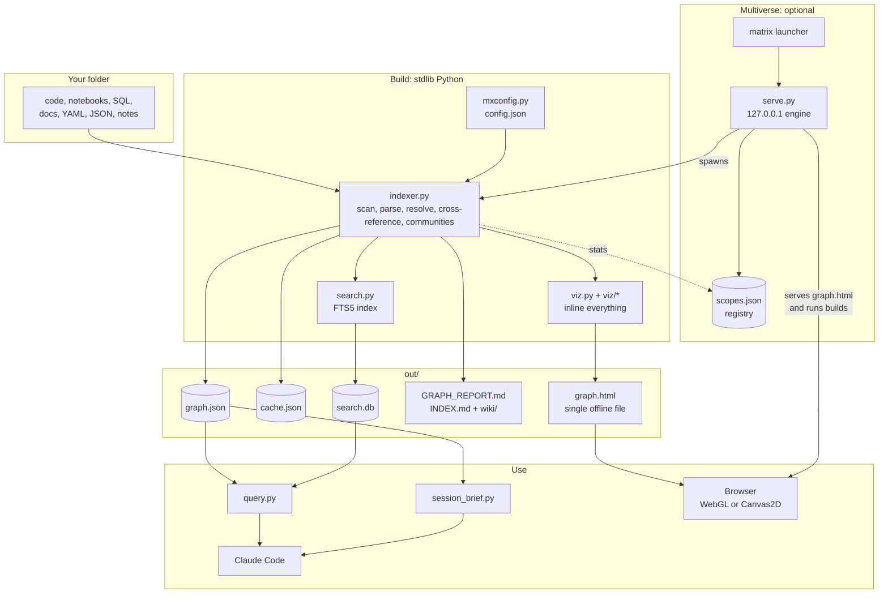

Read more in [docs/ARCHITECTURE.md](docs/ARCHITECTURE.md).

---

## Documentation

| Document | Contents |
|---|---|
| [docs/FOR-AGENTS.md](docs/FOR-AGENTS.md) | How Matrix is built for LLMs and coding agents: the agent loop, provenance, context budget, freshness, safety, use with any agent, prompt patterns, and the full out-of-the-box catalog of commands, flags, hooks and outputs. |
| [docs/GUIDE.md](docs/GUIDE.md) | Install, first build, Claude Code integration, querying, the full UI controls, Multiverse workflows, updating and uninstalling, troubleshooting. |
| [docs/ARCHITECTURE.md](docs/ARCHITECTURE.md) | Components, the graph data model, the indexing pipeline, cache, search, report and wiki, the rendering pipeline, and the `viz/*.js` module graph. |
| [docs/SERVICES.md](docs/SERVICES.md) | The Multiverse engine: HTTP API reference, job lifecycle, security model, launcher, registry and hooks lifecycle. |
| [docs/INFRASTRUCTURE.md](docs/INFRASTRUCTURE.md) | Processes, ports and files on disk; caps and timeouts; backups and rollback; upgrades; cross-platform notes; performance. |
| [docs/UI-PRINCIPLES.md](docs/UI-PRINCIPLES.md) | The hairline rules and how Matrix bends them: tokens, typography, the universe metaphor, the camera, LOD, motion, accessibility. |
| [docs/CONFIGURATION.md](docs/CONFIGURATION.md) | Every config key, with type, default and examples. |
| [docs/DEVELOPMENT.md](docs/DEVELOPMENT.md) | Repo layout, tests and CI, the in-page self-tests, adding an extractor, coding rules. |
| [docs/GITHUB-SETUP.md](docs/GITHUB-SETUP.md) | How the GitHub repository, branch protection and CI are configured. |

---

## Requirements and platform notes

- **Python 3.10 or later**, standard library only. The bundled `sqlite3` must have FTS5, including the `trigram`
  tokenizer (SQLite 3.34 or later). The official python.org builds include it.
- **A modern browser** for `graph.html`. It uses WebGL2, falls back to WebGL1, and falls back again to Canvas2D. Any
  Chromium, Firefox or Safari from the last few years works. The page needs no network.
- **Windows first, cross-platform Python.** Matrix is developed and tested mainly on Windows 10 and 11. It handles NTFS
  junctions, 8.3 short paths, `pythonw.exe` for a windowless engine, `taskkill /T` for build trees,
  `SO_EXCLUSIVEADDRUSE`, and drive-letter roots. The code paths for Linux and macOS are written in too: POSIX process
  groups, `0600` engine records, `~/.local/bin` for the launcher, and system folders skipped at `/`.
- **Claude Code is optional.** Without it you still get the CLI, the wiki and report, `graph.html` and the
  Multiverse. Pass `--no-launcher` or `--no-build` to setup to leave those steps out.

---

## Known limitations

- **Static analysis only.** Dynamic dispatch, reflection, dependency injection and wiring that lives in config are
  invisible. A bare call name that matches several definitions becomes `AMBIGUOUS` rather than a guess.
- **Languages beyond the table above are not parsed yet.** JavaScript, TypeScript, Java and Go files are skipped
  for now; data and binary files appear only as `dataset` nodes, with no text extraction.
- **Whole-drive roots are slow.** The cross-reference step scans every document's text for every nameable symbol,
  so its cost grows with the number of documents multiplied by the number of symbols. A drive full of docs makes this
  the dominant step. Index one project or one source tree where you can.
- **`max_files` (default 60,000).** A build from scratch refuses roots that hold more files than this. Raise the cap
  in the config, set it to `0` to remove it, or pass `--force` ("Index anyway" in the UI). An existing graph is
  updated incrementally regardless.
- **Large graphs make a large page.** `viz.py` warns when `graph.html` passes 3.8 MB. The embedded universe hierarchy
  has a hard 120 kB budget.
- **One machine, one user.** The engine serves only `127.0.0.1`. There is no multi-user or remote mode, by design.
- **`graph.html` lists your universes.** For the Multiverse switcher, each page embeds every registered universe's
  name, root folder and install and interpreter paths. Set `"embed_scopes": false` before you share a page.

---

## Contributing

Anyone can contribute: fork the repo, make a branch, open a pull request. CI has to pass, and every change is
reviewed and merged by the maintainer, [@Archit3115](https://github.com/Archit3115), who is the code owner of the
whole repository.

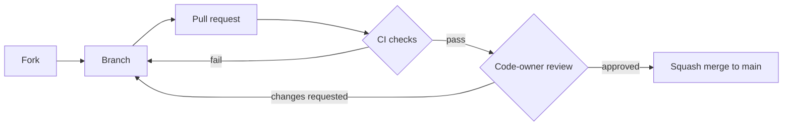

- [CONTRIBUTING.md](CONTRIBUTING.md): how to set up, test and submit a change.
- [CODE_OF_CONDUCT.md](CODE_OF_CONDUCT.md): how we work together.
- [SECURITY.md](SECURITY.md): how to report a vulnerability privately.
- [docs/DEVELOPMENT.md](docs/DEVELOPMENT.md): repo layout, tests, the CI pipeline and coding rules.

## Credits

Matrix's visual language follows **[hairline](https://github.com/lucasmarkes/hairline)** by Lucas Marques (MIT): rounded
solids drawn in a single stroke, bright outside and dim inside, with one bright stroke as the only highlight. The
hairline figure kernel is inlined verbatim in `matrix/viz/hairline.js`, with its MIT notice. Matrix's own `galaxy` and
`nexus` figures are drawn with it. See [THIRD_PARTY_NOTICES.md](THIRD_PARTY_NOTICES.md).

The fly-to camera path follows J. J. van Wijk and W. A. A. Nuij, *Smooth and efficient zooming and panning*
(IEEE InfoVis 2003). Search fuses rankings by reciprocal rank (Cormack, Clarke and Büttcher, SIGIR 2009).

## License

See [LICENSE](LICENSE).
