# Architecture

Matrix has two halves. A **build side** in standard-library Python turns a folder into files on disk. A **view side**
in vanilla JavaScript, inlined into one HTML file, renders those files as a universe. The two halves share no code
and no runtime. The only contract between them is the JSON payload that `viz.py` embeds in the page. An optional
**engine** (`serve.py`) serves those pages over `127.0.0.1` and runs builds as jobs.

**Contents**

- [Component map](#component-map)
- [Data flow](#data-flow)
- [Graph data model](#graph-data-model)
- [Indexing pipeline](#indexing-pipeline)
- [Incremental cache](#incremental-cache)
- [Search index](#search-index)
- [Report and wiki](#report-and-wiki)
- [The page payload](#the-page-payload)
- [Rendering pipeline](#rendering-pipeline)
- [Module dependency graph of viz/*.js](#module-dependency-graph-of-vizjs)

---

## Component map

| File | Role | Called by |
|---|---|---|
| `mxconfig.py` | Loads config: defaults, path resolution, and the forced ignores. | Every script |
| `indexer.py` | Scan, parse, resolve, cross-reference, communities. Writes `out/`. | Stop hook, setup, engine, `matrix`, you |
| `search.py` | Builds and reads `search.db` (SQLite FTS5). | `indexer.py`, `query.py` |
| `viz.py` | Packs `graph.json` into a page payload and inlines `viz/*` into `template.html`. | `indexer.py`, you |
| `viz/*.js`, `viz/*.css`, `viz/template.html` | The universe UI. | The browser |
| `query.py` | The query CLI: `find`, `explain`, `path`, `neighbors`, `stats`. | You, assistants |
| `session_brief.py` | The SessionStart brief. | The SessionStart hook |
| `scopes.py` | The per-user universe registry, preflight, central configs, build commands. | `setup.py`, `indexer.py`, `viz.py`, `serve.py`, `matrix.py` |
| `serve.py` | The Multiverse engine: pages, API, build jobs. | `matrix`, you |
| `matrix.py` | The one-word launcher. | `matrix` / `matrix.cmd` |
| `setup.py` | Installer: code, config, hooks, `CLAUDE.md`, skill, registry, launcher. | You |
| `templates/claude_md_section.md`, `templates/SKILL.md` | Text that setup renders, with `{PY}`, `{MX}`, `{CONFIG}`, `{OUT}` and `{OPEN}` filled in. | `setup.py` |

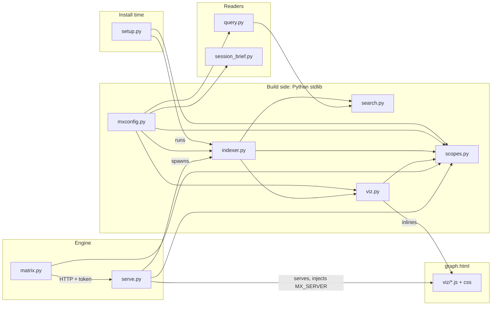

---

## Data flow

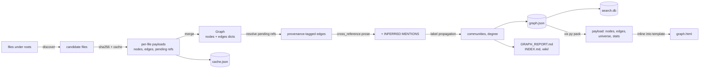

---

## Graph data model

### Node and edge records

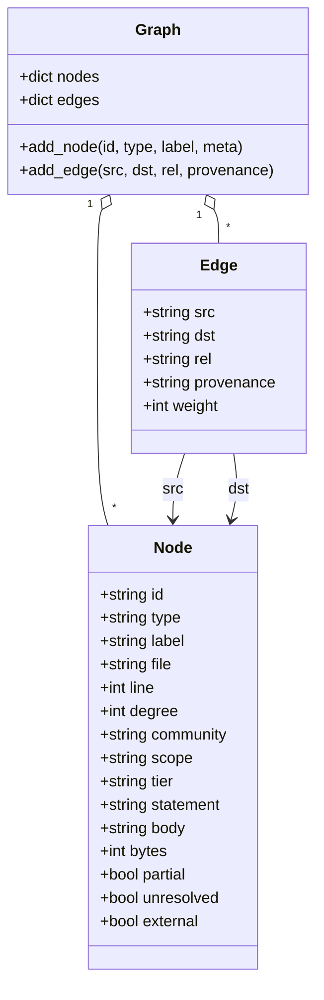

| Field | Present on | Meaning |
|---|---|---|
| `file` | Most nodes | `<root label>/<path inside the root>`, with forward slashes. |
| `line` | Definitions, headings, claims | A 1-based line number. |
| `scope` | Functions | The enclosing class path, for methods. |
| `tier`, `statement` | Claims | The claim tier, and its heading text (up to 300 characters). |
| `body` | Docs, memory notes, concepts, claims | Cleaned, searchable text: up to 2,000, 400 and 600 characters respectively. |
| `bytes` | Datasets | The file size. |
| `partial` | Definitions from the fallback parser | The file is not valid Python. |
| `unresolved` | Concepts | A link target that nothing defines. |
| `external` | Tables | Schema-qualified, referenced but never defined in this corpus. |
| `degree`, `community` | Every node | Distinct neighbours, and the community name. Both are added at the end of the build. |
| `weight` | Edges | How many times the same `(src, dst, rel)` was asserted. |

`graph.json` is `{"version": 1, "generated": "YYYY-MM-DD HH:MM UTC", "stats": {...}, "nodes": [...], "edges": [...]}`.
Nodes are sorted by id, and edges by `(src, dst, rel)`, so the same input gives the same file.

### Node types and relations

```mermaid
erDiagram
  FILE ||--o{ CLASS : DEFINES
  FILE ||--o{ FUNCTION : DEFINES
  CLASS ||--o{ FUNCTION : DEFINES
  CLASS }o--o{ CLASS : INHERITS
  FILE }o--o{ MODULE : IMPORTS
  FILE }o--o{ FUNCTION : IMPORTS
  FILE }o--o{ FUNCTION : CALLS
  FUNCTION }o--o{ FUNCTION : CALLS
  FILE ||--o{ TABLE : DEFINES
  FILE ||--o{ VIEW : DEFINES
  FILE ||--o{ PROCEDURE : DEFINES
  FILE }o--o{ TABLE : READS
  FILE }o--o{ TABLE : WRITES
  DOC ||--o{ CONCEPT : DEFINES
  DOC ||--o{ CLAIM : ASSERTS
  CLAIM }o--o{ CLAIM : SUPERSEDES
  DOC }o--o{ URL : CITES
  DOC }o--o{ DOC : LINKS
  MEMORY }o--o{ CONCEPT : LINKS
  MEMORY }o--o{ FUNCTION : MENTIONS
  DOC }o--o{ TABLE : MENTIONS
  CONFIG ||--o{ RESOURCE : DECLARES
  CONFIG }o--o{ NOTEBOOK : LINKS
  PIPELINE }o--o{ DATASET : USES
  PIPELINE }o--o{ LINKEDSERVICE : USES
  DATASET }o--o{ LINKEDSERVICE : USES
  TRIGGER }o--o{ PIPELINE : USES
```

The diagram shows representative pairs. The rules that produce each relation:

| Relation | From → to | Produced by | Provenance |
|---|---|---|---|
| `DEFINES` | file → class / function; class → method; file → table / view / procedure; doc → concept | AST definitions, SQL `CREATE`, Markdown headings | EXTRACTED |
| `IMPORTS` | file → module | `import x`, `from x import ...` (the top-level package) | EXTRACTED |
| `IMPORTS` | file → definition | the names in `from x import a, b`, resolved by name | by resolution |
| `CALLS` | function or file → function or class | call sites whose last name part is not in the common-call stoplist | by resolution |
| `INHERITS` | class → class | base classes, resolved by name | by resolution |
| `READS` / `WRITES` | file → table | `FROM` / `JOIN` and `INTO` / `UPDATE` / `MERGE INTO` in `.sql` files and in SQL-looking Python strings | EXTRACTED if the table is defined here; INFERRED if it is schema-qualified and external |
| `LINKS` | doc / memory / claim / config → anything | `[[wikilinks]]`, relative Markdown links, YAML `notebook_path:`, `path:` and `file_path:` | by resolution |
| `CITES` | doc → url | `http(s)` Markdown links | EXTRACTED |
| `ASSERTS` | doc → claim | claim headings | EXTRACTED |
| `SUPERSEDES` | claim → claim | `**Supersedes:**` or `**Replaced by:**` lines inside a claim section | EXTRACTED |
| `DECLARES` | config → resource | bare `name:` keys in YAML, except `resources`, `targets`, `jobs`, `tasks`, `pipelines` and `clusters` | EXTRACTED |
| `USES` | ADF artifact → artifact | every `referenceName`, at any depth | by resolution |
| `MENTIONS` | doc / memory / notebook → definition | prose that names a symbol defined in another file | INFERRED |

### Node ids

| Prefix | Example | Type(s) |
|---|---|---|
| `file:` | `file:orbit-shop/api/checkout.py` | `file`, and `notebook` for `.ipynb` |
| `class:` / `func:` | `func:checkout.CheckoutController.post` | `class`, `function`: the module stem plus the dotted scope |
| `module:` | `module:requests` | `module` |
| `table:` | `table:sales.orders` | `table`, `view`, `procedure`: the last two dotted parts, lower-cased |
| `doc:` / `memory:` | `doc:orbit-shop/docs/checkout.md` | `doc`, or `memory` for files under the `memory` root |
| `concept:` | `concept:payment-retries` | `concept`: a slug of the heading or link text |
| `claim:` | `claim:ORB-API-007` | `claim` |
| `url:` | `url:https://example.com/spec` | `url` |
| `config:` / `resource:` | `config:orbit-shop/deploy/app.yml` | `config`, `resource` |
| `dataset:` | `dataset:orbit-shop/data/orders.csv` | `dataset` |
| `pipeline:` `dataset:` `linkedservice:` `trigger:` `dataflow:` | `pipeline:nightly_orders` | ADF artifacts, by parent folder name |

### Provenance semantics

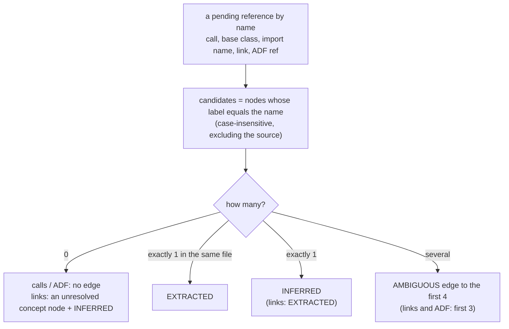

- **Strongest claim wins.** If the same `(src, dst, rel)` is asserted twice, the edge keeps the stronger tier
  (EXTRACTED > AMBIGUOUS > INFERRED) and its `weight` goes up by one.
- **Calls are filtered** against Python's builtins and a list of about 100 generic method names (`get`, `append`,
  `join`, `select`, `filter`, `col`, ...). Without that filter, every `.get()` would collapse onto whichever local
  helper happens to be called `get`.
- **A bare table name that nothing defines is dropped**, because it is far more likely prose than a table. A
  schema-qualified one becomes an `external` table node with an INFERRED edge.
- **Self-loops are never stored.** Dangling edges are dropped before the graph is written.

How an agent should act on each tier is covered in [FOR-AGENTS.md](FOR-AGENTS.md#provenance-as-epistemic-hygiene).

---

## Indexing pipeline

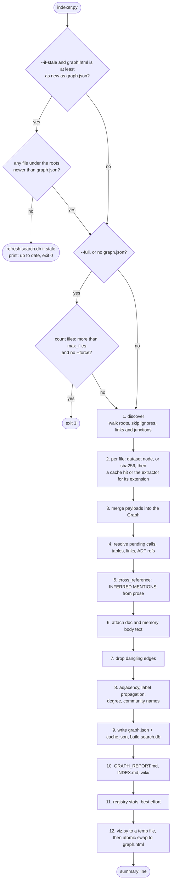

### 1. Discovery

`discover()` walks every root with `os.walk`, in sorted order:

- Directory names in `ignore_dirs`, names ending in `.egg-info`, symlinks and **NTFS junctions** are pruned. Links
  can pull in content from outside the root, and they can loop.
- Folders at or under `out_dir`, or under any `ignore_paths` entry, are pruned. Matrix's own install folder is
  always in `ignore_paths`, under both its given and its resolved spelling.
- File names matching `ignore_globs` are skipped.
- A file reachable from two roots is yielded only once (case-insensitive).
- Each file is tagged with its root's label, and with whether it is inside a `data_dirs` folder.

### 2. Parse

| Condition | Result |
|---|---|
| The extension is in `data_exts`, or the file is larger than `max_file_bytes` | A `dataset` node only. Not read. |
| No extractor for the extension | Skipped. |
| `.json` and `adf_json` is false | Skipped. |
| `.json` / `.yml` / `.yaml` inside a `data_dirs` folder | Skipped. |
| Otherwise | Hashed. On a cache hit the cached payload is reused; otherwise the extractor runs. |

An extractor writes into a **payload**: `nodes`, `edges`, `errors`, and four lists of pending references:
`pending_calls`, `pending_tables`, `pending_links` and `pending_adf`. A payload holds no cross-file knowledge, which
is what makes it cacheable. An exception in one extractor is recorded as a parse error and never fails the build.
Python files that do not parse fall back to a regex pass, so the file still contributes, with `partial` definitions.

Text is kept for the corpus-wide pass whether a file was cached or not: the full text of every `.md`, `.txt` and
`.rst` file, and the first 200,000 characters of each notebook.

### 3–4. Merge and resolve

The payloads are merged into one `Graph`, and then `resolve()` turns the pending references into edges using the
rules in [Provenance semantics](#provenance-semantics). The label index is rebuilt after tables are materialised,
so a `[[wikilink]]` to a table resolves to that table.

### 5. Cross-reference

`cross_reference()` produces the edges that no single file states. For each document, it looks for every nameable
definition (function, class, table, view, procedure, dataset, pipeline) whose label:

- is at least 5 characters long;
- is not a stopword or a common call;
- matches `[\w.]+`;
- appears in the text as a whole word.

Each match gives up to three `MENTIONS` edges, never to a node in the same file. This is how a memory note gets
linked to the code it is about.

> **Cost.** This step tests every document against every target label, with a fast substring check before the
> regex. It grows as documents × symbols, which is why whole-drive roots with many documents are slow.

### 8. Communities

Communities come from **deterministic label propagation**. Every node starts with its own id as its label. In
sorted order, each node takes the most common label among its neighbours (ties go to the smallest label). This
repeats for up to 12 rounds, or until nothing changes. Single-node groups are dropped.

`community_name()` names each community after its most nameable member. Labels of 45 characters or fewer are
preferred, then structural types in the order table, view, class, pipeline, memory, notebook, linkedservice, dataset,
doc, concept, then higher degree. Names longer than 60 characters are cut. Markdown headings make poor titles, so
short structural labels win.

### Atomic outputs

Every text output is written to `<file>.<pid>.tmp` and swapped in with `os.replace`. `search.db` is written to
`search.db.tmp` and swapped the same way. `graph.html` is rendered to a temp file and swapped. A build that is killed
part-way therefore never leaves a truncated file in place of the last good one.

---

## Incremental cache

`out/cache.json` maps each file key to `{"v": CACHE_V, "digest": "<sha256>", "payload": {...}}`.

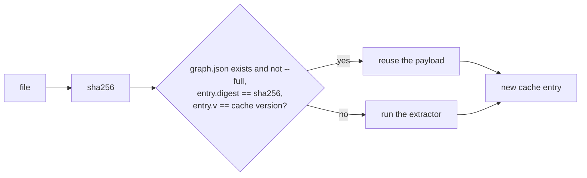

- `CACHE_V` is `2`. With `"claims": false`, the version becomes `"2-noclaims"`, so toggling claim parsing reparses
  every file.
- The cache is used only if last run's `graph.json` survived.
- Only cross-file work (resolve, cross-reference, communities, outputs) is redone on every build. That work is linear
  in the graph, apart from the cross-reference cost noted above.
- Bump `CACHE_V` whenever an extractor's output changes shape.

---

## Search index

`search.db` is a SQLite database with FTS5. One row per node, `rowid` is the node's position in `graph.json`.

| Table | Purpose |
|---|---|
| `w` | FTS5, `porter unicode61 remove_diacritics 2`, with prefix indexes of 2 and 3. Columns are `label`, `alias` (the identifier split into words: `OrderLineNo` → `Order Line No`), `body` (claim statement plus body text), `path` (the file path split into words), and `ctx` (the labels of up to 25 neighbours; nodes with more than 60 neighbours get none). |
| `t` | FTS5 `trigram` over `label` and `body`, so substrings and 3-character codes still match. |
| `w_v` | An `fts5vocab` over `w`, for document frequencies. |
| `docs` | Display fields per node, the concatenated text used for the coverage check, and a prior. |
| `meta` | `schema` (`"2"`), `graph_mtime` and `built`. |

Ranking runs in this order:

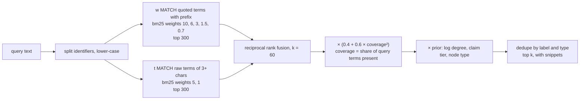

The priors: `1 + 0.05·ln(1 + degree)`, times a tier factor (MEASURED and SOURCE 1.0, INFERRED 0.85, RETRACTED 0.6),
times a type factor (memory 1.3; claim and doc 1.15; pipeline, table, view, procedure and notebook 1.1; module,
function and file 0.9; dataset 0.85; url 0.8), times 0.85 for a bare concept with no text. AMBIGUOUS edges never feed
`ctx`. Community names are never searched, because half the graph can share one. User text is always quoted, so it
is never interpreted as FTS syntax.

**Freshness.** A reader opens the database read-only and rejects it if the schema differs or if `graph_mtime` is
more than 1 s away from `graph.json`'s modification time. `query.py find` then builds an in-memory index for that
call. On Windows, swapping the file fails while a reader holds it open. The build retries 3 times, 0.2 s apart, then
keeps the old file, which readers will detect as stale.

The page has its **own** search (`viz/search.js`). It is a camel-case-aware tokenizer and a BM25F-lite index built in
the browser from the payload when the page goes idle. Fields are weighted label 3, file name 1, statement 2 and
body 1, with `k1 = 1.2` and `b = 0.75`. Query tokens are ANDed, and each token matches a word exactly (1.0), as a
prefix (0.7), or, for 3 or more characters, as an infix (0.4). An exact label match doubles the score, and RETRACTED
claims are multiplied by 0.6.

---

## Report and wiki

| Output | Contents | Caps |
|---|---|---|
| `GRAPH_REPORT.md` | Generation stats; a provenance table; god nodes (highest degree); node types; relations; memory-to-code `MENTIONS`; communities; parse errors | 20 god nodes, 40 memory links, 25 communities, 25 errors |
| `INDEX.md` | One row per community: its article, node count, and its top 5 members | The 40 largest communities |
| `wiki/<slug>.md` | One article per community: members grouped by type, highest degree first, each with `file:line` and up to 6 outgoing edges with their provenance | 60 nodes per type |

The wiki folder is cleared of old `.md` files on every build. These files are meant to be read by people and by
assistants, so neither has to parse JSON. [FOR-AGENTS.md](FOR-AGENTS.md#context-budget-design) explains how they
fit an agent's context budget.

---

## The page payload

`viz.py` reads `graph.json` and writes `graph.html`:

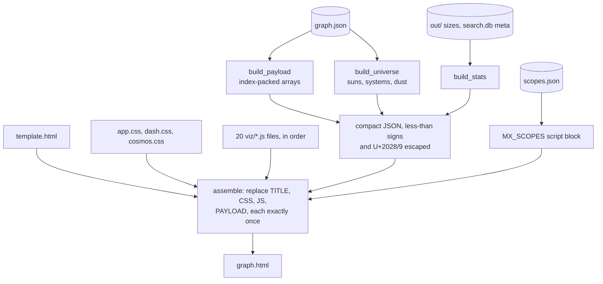

| Payload key | Shape |
|---|---|
| `nodes` | `[label, typeIdx, degree, commIdx, file, line, group, id]` per node |
| `edges` | `[srcIdx, dstIdx, relIdx, provIdx, weight]` per edge |
| `types`, `communities`, `rels`, `provs` | The lookup tables for the indices |
| `groups`, `groupTypes` | `Code`, `Data`, `Knowledge`, `Other`, and the types in each |
| `meta` | `[index, {tier, statement, body (280 characters, docs and memory only), partial, unresolved, external}]`, sparse |
| `roots` | `{label: path}`, used for `file:///` links in the inspector |
| `universe` | `{v, minDeg: 2, clusters, sys: [system index or -1 per node], sun: [node index per system]}` |
| `stats` | `{build: {generated, files_*}, out: {file sizes}, searchDb: {docs, built, graph_mtime, fresh}}` |

**The universe hierarchy** (`build_universe`):

- *Galaxy* is the pair `(cluster, type)`.
- In each galaxy, the members are sorted by `(-degree, id)`. A member of degree 2 or more becomes a **sun** unless it
  is adjacent to a sun already chosen, so the suns form an independent set.
- Every other member binds to the sun that minimises `(-direct edges, -shared neighbours, -degree, id)`, among suns
  whose degree is at least its own. A member that binds to no sun is **dust**.
- A sun left with no planets is demoted, and re-bound once against the surviving suns.
- Systems are ordered by `(cluster, type, -degree, id)`.

**Guards and escaping:**

- A `universe` that serialises to more than 120,000 bytes prints a warning.
- A page over 3.8 MB prints a warning.
- The CSS and JS sources must not contain `</script`, `</style`, `<!--` or a placeholder string.
- The registry block is escaped so that no `/` can recreate a placeholder.

---

## Rendering pipeline

### Boot

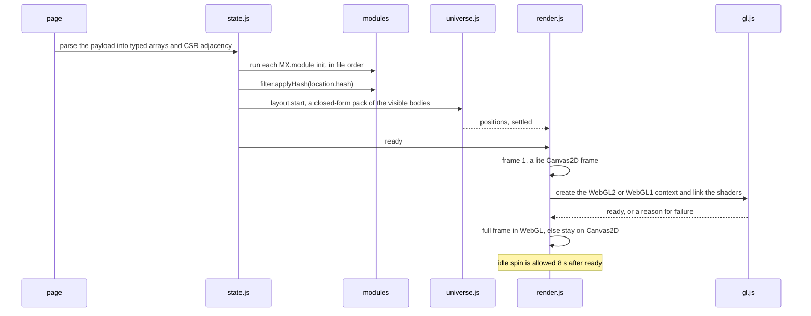

### Per frame

A frame is drawn only when something is dirty or animating, through `requestAnimationFrame`. At the U0 overview the
star twinkle is timer-driven at 30 fps.

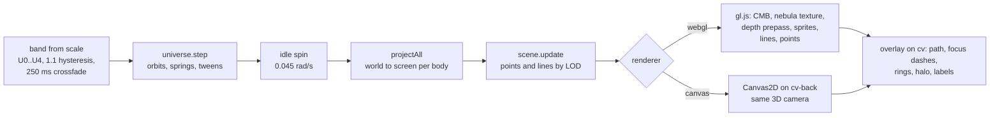

| Layer | Module | Notes |
|---|---|---|
| Layout | `universe.js` | A closed-form gravity and dark-matter model, run on the main thread with no worker. It is the only writer of `S.x/S.y/S.z`. Clusters are loose shells, galaxies are discs (spiral or elliptical) with NFW-style rotation curves, and solar systems have their own orbital planes. Body positions are packed so that they never overlap. Changing visibility repacks, with a 300 ms tween anchored on the selection, or on the sun nearest the view centre. Dragging a body moves its system on springs. |
| Scene | `scene.js` | A pure data module that fills the GL instance buffers. Edge LOD by band: U0 shows a few cross-cluster arcs (at most 6); U1 shows galaxy-pair arcs (at most 16); U2 shows a few galaxy arcs plus short sun-to-sun threads between on-screen systems (at most 90); U3 and up show individual edges, culled to the viewport. Hot (selected or hovered) and path edges are always drawn individually. Provenance changes alpha, never hue. |
| Nebula | `nebula.js` | A low-resolution world texture (1,024 px) of gas and glow on clusters and galaxies, rebuilt on repack, settle or theme change. Near mode (U2 and up) uses a view-local texture around the systems on screen. It is off in forced colours and with reduced transparency. |
| GPU | `gl.js` | WebGL2, falling back to WebGL1. The draw order is clear → density field (CMB) → texture quad → point-core depth prepass → sprites → lines → points. Body cores occlude what is behind them; halos, lines and sprites never write depth. Lines are clipped at the near plane. Context loss and restore are handled. |
| Fallback | `render.js` | Canvas2D, with the same camera and projection. It is used when WebGL fails or is lost, under forced colours, or with `#gl=0` / `?nogl=1`. Orbits, the idle spin and the twinkle run only in WebGL mode. |
| Labels | `labels.js` | Hierarchical LOD on a 100 px screen grid, with padded boxes that never overlap. See [UI-PRINCIPLES.md](UI-PRINCIPLES.md#lod-label-bands). |
| Overlays | `render.js`, `minimap.js`, `cosmos.js` | The selection ring and halo, focus dashes, the path route, the minimap, and short warp streaks on tab switches and flights (at most 300 ms). |

**Camera.** `render.js` owns a perspective orbit camera. Its focal plane reproduces the 2D contract
`screen = v·scale + pan + size/2`, where `v` is a body's position in view-plane coordinates. Every 2D operation (pan,
zoom-to-cursor, fly, fit) therefore holds in 3D too. Yaw spins about the world z axis, pitch tilts away from face-on,
and the principal point is the centre of the **safe rect**: the part of the canvas not covered by the panels, the
header or the hint. See [UI-PRINCIPLES.md](UI-PRINCIPLES.md#camera-model).

### State ownership

The page has one shared state object, `MX.state`, and each field has a single writer:

| Field | Writer |
|---|---|
| `x`, `y`, `z`, `settled` | `universe.js` |
| `nodeVisible`, `edgeVisible`, `facets`, `q`, `results`, `anim` | `filter.js` |
| `selected`, `pinned`, `focus`, `path` | `inspector.js` |
| `camera`, `view3d`, `zScale` | `render.js` |
| `view`, `dash` | `dash.js` |
| `kbdCursor`, `universe` (drill level) | `ui.js` |
| `theme` | `theme.js` |

Modules talk through a small event bus (`MX.on` / `MX.emit`). The events include `ready`, `visibility`, `facets`,
`query`, `select`, `focus`, `path`, `positions`, `settled`, `repack`, `theme`, `view`, `view3d`, `chrome`, `camera`,
`flyto`, `flyreq` and `anim`.

---

## Module dependency graph of viz/*.js

`viz.py` concatenates the files in this order: `state`, `theme`, `search`, `layout`, `gl`, `universe`, `scene`,
`nebula`, `labels`, `render`, `filter`, `inspector`, `ui`, `dash`, `charts`, `tables`, `cosmos`, `minimap`,
`hairline`, `multiverse`. Each file is an IIFE that registers on `window.MX`. An arrow means "reads the API of".

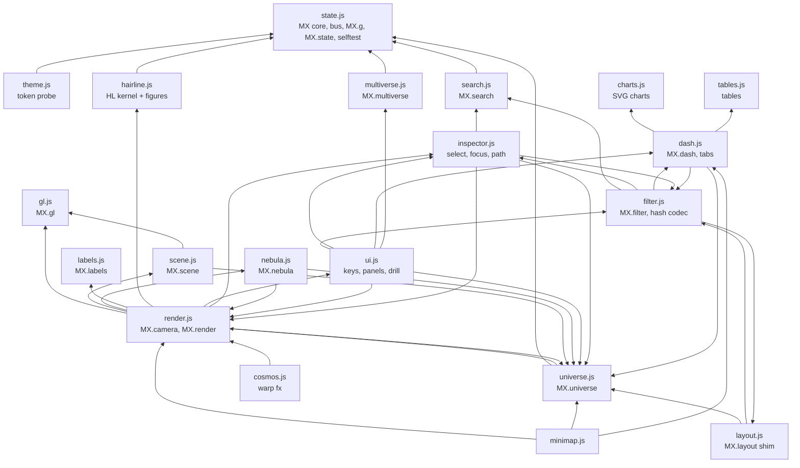

Every module also depends on `state.js`; most of those arrows are left out for legibility. References are resolved
lazily, when a module's `init` or an event handler runs, so a module may use one that is concatenated after it.
`viz.py` creates valid no-op stubs for `universe.js`, `scene.js`, `nebula.js` and `labels.js` if they are missing,
and never overwrites existing files.
