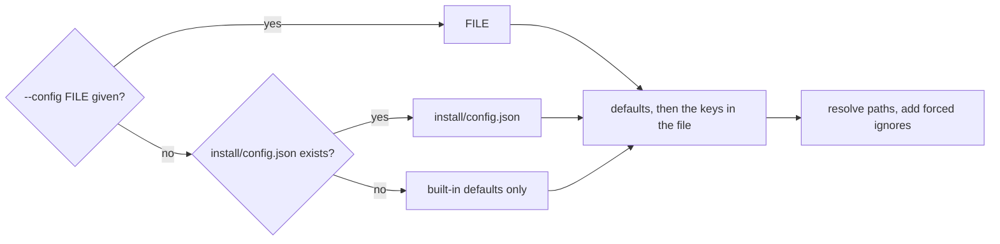
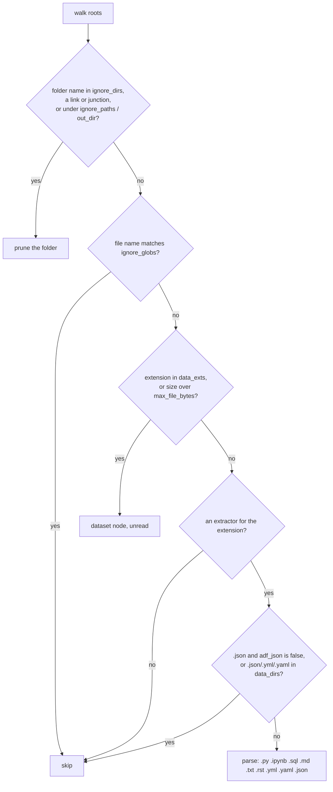

# Configuration

Every Matrix script reads one JSON config, through `mxconfig.py`.

## Where the config comes from



| Rule | Detail |
|---|---|
| Missing keys | Take the defaults below. Every key is optional. |
| Encoding | UTF-8. A BOM is tolerated. |
| Relative paths | Resolved against **the config file's own folder**, or the install folder when there is no file. `~` is expanded. Paths are normalised to forward slashes. |
| Default root | The target folder, two levels above the install: `<target>/.claude/matrix`, so `roots` defaults to `[<target>]`. |
| Forced ignores | The install folder (under both its given and its resolved spelling) and `out_dir` are always ignored, whatever the config says. Matrix never indexes itself or its own output. |
| After editing | Rebuild with `indexer.py --full`. Claim parsing (`claims`) is part of the cache version, so toggling it reparses everything automatically. |

> **`--config` at setup time.** `setup.py --config FILE` copies `FILE` to `<install>/config.json`. Because the file
> moves, setup first rewrites any **relative** `roots`, `memory`, `ignore_paths` and `data_dirs` to absolute paths,
> resolved against `FILE`'s folder, and prints each rewrite. `out_dir` stays relative to the install. A config you
> place in `<install>/config.json` by hand is used as written: its relative paths resolve against the install folder.

## Keys

| Key | Type | Default | Meaning |
|---|---|---|---|
| `roots` | list of `string` or `{"path", "label"}` | `[<target>]` | The folders to index. A bare string uses the folder name, lower-cased, as its label. The label prefixes every file key (`orbit-shop/api/checkout.py`), so give each root a distinct label. |
| `memory` | `string` or `null` | `null` | A notes folder, indexed as a root labelled `memory`. Its Markdown files become `memory` nodes rather than `doc` nodes, are linked to code by prose mentions, and are listed in the brief and the report. A root you label `memory` yourself behaves the same. |
| `ignore_dirs` | list of folder **names** | `.venv`, `venv`, `typings`, `node_modules`, `.git`, `__pycache__`, `.mypy_cache`, `.pytest_cache`, `.ipynb_checkpoints`, `.databricks`, `.vscode`, `dist`, `build`, `.egg-info` | Never walked, at any depth. Names ending in `.egg-info` always match. Replacing the list replaces the defaults, so copy them if you want to keep them. |
| `ignore_globs` | list of file-name globs | `*.min.js`, `*.lock`, `*.log` | File names (not paths) that are skipped. |
| `ignore_paths` | list of folder **paths** | `[]` | Whole folders, with everything below them, never walked. The install folder and `out_dir` are always added. |
| `data_dirs` | list of folder paths | `[]` | Folders walked for source and docs only. `.json`, `.yml` and `.yaml` inside them are skipped, and data files become `dataset` nodes. Use this for folders of fixtures, exports or samples. |
| `data_exts` | list of extensions | `.csv`, `.parquet`, `.xlsx`, `.xls`, `.zip`, `.7z`, `.gz`, `.pptx`, `.docx`, `.bak`, `.png`, `.jpg`, `.jpeg`, `.gif`, `.webp`, `.svg`, `.pdf` | Files with these extensions become one `dataset` node each (name and size), and are never read. |
| `max_file_bytes` | `int` | `2000000` | Any file larger than this also becomes a `dataset` node, unread. |
| `adf_json` | `bool` | `false` | Parse `*.json` as Azure Data Factory / Synapse artifacts. The parent folder name gives the kind (`pipeline`, `dataset`, `linkedservice`, `trigger`, `dataflow`), and `referenceName` values become `USES` edges. With `false`, `.json` files are skipped. |
| `claims` | `bool` | `true` | Parse claim headings in Markdown. See [Claims](#claims). |
| `out_dir` | `string` | `"out"` | Where `graph.json`, `cache.json`, `search.db`, `GRAPH_REPORT.md`, `INDEX.md`, `wiki/` and `graph.html` are written. Relative to the config file's folder. |
| `title` | `string` | `"Matrix"` | The browser title and header of `graph.html`. HTML-escaped. |
| `max_files` | `int` | `60000` | A build **from scratch** (`--full`, or no `graph.json` yet) refuses to start when the roots hold more files than this; the count stops just past the cap. `0` removes the cap. `indexer.py --force` overrides it once. An existing graph is always updated incrementally, whatever its size. |
| `embed_scopes` | `bool` | `true` | `graph.html` embeds every registered universe (id, name, root, kind, install, out, interpreter, build stats) for the Multiverse switcher. With `false`, the page keeps only its own universe's id, name, root, kind and stats. Use `false` for any page you share. |

## What gets indexed



## Claims

With `claims: true`, a Markdown heading of level 2 to 4 in this form:

```markdown
### [MEASURED] ORB-API-007 - Checkout retries a declined card at most twice
```

becomes a `claim` node with id `claim:ORB-API-007`:

| Part | Rule |
|---|---|
| Tier | One of `MEASURED`, `SOURCE`, `INFERRED`, `RETRACTED`, `EXTERNAL`, in square brackets. |
| Id | 2 to 4 capital letters, a dash, 2 to 4 capital letters, a dash, then capitals and digits (`ORB-API-007`). |
| Separator | `-`, `–` or `—`. |
| Statement | The rest of the heading (up to 300 characters). The section text up to the next claim heading becomes its body. |
| Links | `[[wikilinks]]` inside a claim's section attach to the **claim**, not the page. `explain ORB-API-007` therefore shows what that one claim touches. |
| Supersession | A line `**Supersedes:** ORB-API-003` or `**Replaced by:** ORB-API-011` inside the section adds `SUPERSEDES` edges. |
| Examples | Claims inside code fences are ignored, so documentation can show the syntax safely. |

Claims feed the page's Claims tab and the tier factor in search ranking (RETRACTED ranks lower).

## Examples

Each example is written to sit at `<target>/.claude/matrix/config.json`, so `../..` is the target folder. To
pass one to `setup.py --config FILE` instead, write its relative paths against `FILE`'s own folder, or make them
absolute.

### A repo with fixtures and vendored code

`orbit-shop/.claude/matrix/config.json`:

```json
{
  "title": "orbit-shop",
  "roots": ["../.."],
  "ignore_paths": ["../../vendor", "../../web/static"],
  "data_dirs": ["../../fixtures"],
  "max_file_bytes": 1000000
}
```

`../..` is relative to the config file's folder (`.claude/matrix`), so it is the repo root.

### A repo plus a separate notes folder

```json
{
  "title": "orbit-shop + notes",
  "roots": [
    "C:/projects/demos/orbit-shop",
    {"path": "C:/projects/demos/lumen-notes", "label": "notes"}
  ],
  "memory": "~/.claude/projects/C--projects-demos-orbit-shop/memory",
  "claims": true
}
```

The notes folder becomes a second root with its own label. The memory folder becomes the `memory` root, and its
notes are linked to the code they mention.

### A data-engineering repo with Data Factory JSON

```json
{
  "roots": ["../.."],
  "adf_json": true,
  "data_dirs": ["../../samples"],
  "ignore_globs": ["*.min.js", "*.lock", "*.log", "*.snap"]
}
```

### A big tree, built deliberately

```json
{
  "roots": ["D:/archive"],
  "max_files": 0,
  "ignore_dirs": [".venv", "venv", "node_modules", ".git", "__pycache__", "dist", "build", "AppData"],
  "data_exts": [".csv", ".parquet", ".zip", ".gz", ".pdf", ".png", ".jpg", ".docx", ".xlsx", ".pptx"]
}
```

`max_files: 0` removes the cap. Expect the cross-reference step to dominate if the tree holds many documents. See
[INFRASTRUCTURE.md](INFRASTRUCTURE.md#resources-and-performance).

### A page you intend to share

```json
{
  "title": "orbit-shop",
  "embed_scopes": false
}
```

### Central universes

Universes added from the Multiverse window or `matrix add` get a generated config in
`$MATRIX_HOME/scopes/<id>/config.json`. It is rewritten before every build, so edits to it do not last. It sets
`title`, `roots`, the default `ignore_dirs` (plus `$RECYCLE.BIN` and `System Volume Information`, and `AppData` for
whole drives), `ignore_paths` (`$MATRIX_HOME`, every install, and the OS folders for whole drives) and
`out_dir: "out"`. Every other key takes its default. To customise a universe beyond that, install Matrix into the
folder with `setup.py` instead, which makes it a `home` universe with a config you own.

The repository's [`config.example.json`](../config.example.json) lists every key. All of them hold their default
value except `roots`, which is a placeholder: the real default, the target folder, depends on where Matrix is
installed. To use it, copy it, set `roots` to your folders and change any other key, then install it with
`python matrix/setup.py <target> --config my-config.json`. Relative paths in the copy resolve against the copy's own
folder (see [`--config` at setup time](#where-the-config-comes-from)), so absolute `roots` are the simplest.
