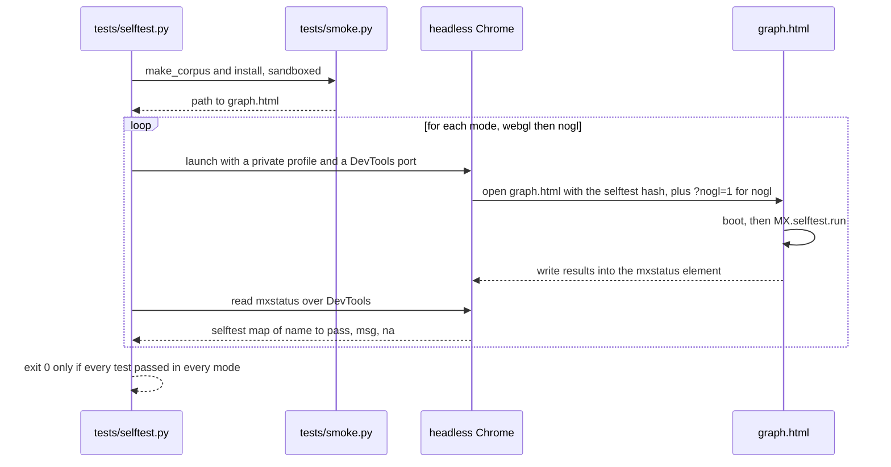
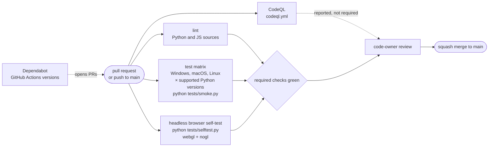
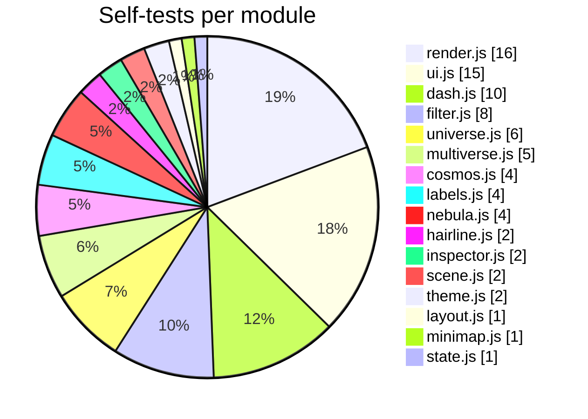
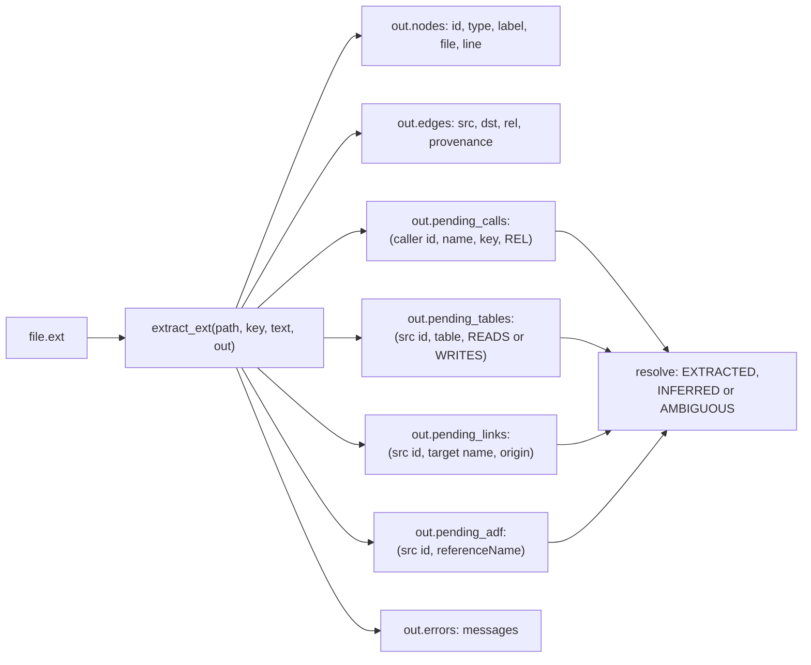

# Development

This document covers how the repository is laid out, how Matrix is tested locally and in CI, how to teach it a new
file type, and the rules that keep it small, offline and dependency-free. For the contribution workflow, see
[CONTRIBUTING.md](../CONTRIBUTING.md). For how the GitHub side is configured, see [GITHUB-SETUP.md](GITHUB-SETUP.md).

**Contents**

- [Repository layout](#repository-layout)
- [Running from a checkout](#running-from-a-checkout)
- [Tests](#tests)
- [The CI pipeline](#the-ci-pipeline)
- [The in-page self-tests](#the-in-page-self-tests)
- [Adding a file extractor](#adding-a-file-extractor)
- [Coding rules](#coding-rules)
- [Contributing](#contributing)

---

## Repository layout

```text
matrix/                       repository root
├── README.md
├── LICENSE
├── THIRD_PARTY_NOTICES.md    hairline kernel MIT notice
├── CONTRIBUTING.md, CODE_OF_CONDUCT.md, SECURITY.md
├── config.example.json       every config key with its default
├── docs/                     this documentation, plus screenshots/
├── tests/
│   ├── smoke.py              end-to-end: install into a temp folder, build, query
│   └── selftest.py           headless Chrome: graph.html self-tests in webgl and nogl modes
├── .github/                  CI, CodeQL, Dependabot, code owners, templates
└── matrix/                   the product: setup.py copies exactly this folder
    ├── setup.py              installer
    ├── mxconfig.py           config loading
    ├── indexer.py            the build
    ├── search.py             FTS5 index
    ├── query.py              query CLI
    ├── session_brief.py      SessionStart brief
    ├── viz.py                page assembly
    ├── scopes.py             registry
    ├── serve.py              Multiverse engine
    ├── matrix.py             launcher
    ├── templates/
    │   ├── claude_md_section.md
    │   └── SKILL.md
    └── viz/
        ├── template.html     the page shell, with placeholders
        ├── app.css, dash.css, cosmos.css
        └── state.js … multiverse.js   20 modules, concatenated in the order listed in viz.py
```

`setup.py` copies the top-level `*.py`, `viz/` and `templates/` (skipping `__pycache__` and `.pyc`). Anything else
you add under `matrix/` is not installed.

---

## Running from a checkout

You do not need to install anything to work on Matrix. Running the scripts in place against a scratch folder is
enough:

```bash
# Install into a scratch copy of a project. Preview first.
python matrix/setup.py /tmp/orbit-shop --dry-run
python matrix/setup.py /tmp/orbit-shop --no-launcher

# Iterate on the indexer or the page.
python /tmp/orbit-shop/.claude/matrix/indexer.py --full
python /tmp/orbit-shop/.claude/matrix/viz.py           # re-render graph.html only
```

To keep your real registry and launcher out of it, set `MATRIX_HOME` to a scratch folder for the session. The
smoke test does the same, and it also sandboxes `HOME` / `USERPROFILE`.

> Editing files under `matrix/viz/` does nothing to an installed page until you rerun setup (which copies the code)
> and `viz.py` (which inlines it). The page is one self-contained file by design.

---

## Tests

Both test scripts use the standard library only, and work on any OS with Python 3.10 or later.

```bash
python tests/smoke.py              # add --keep to inspect the temp folder
python tests/selftest.py           # needs Chrome, Chromium or Edge
```

### `tests/smoke.py`

This is the end-to-end check. Everything runs under one temp folder: a small sample corpus (Python, SQL and Markdown
with cross-references), a sandboxed `MATRIX_HOME`, and a sandboxed `HOME` / `USERPROFILE`, so your real registry,
launcher folder and Claude Code settings are never touched. It checks that:

- `setup.py` installs and builds;
- `graph.json` has nodes and edges;
- `graph.html` exists and loads nothing from the network;
- `query.py find` and `stats` work;
- `scopes.py list` shows the new universe;
- the Python sources import only the standard library.

It exits non-zero on the first failure.

### `tests/selftest.py`

This runs the page's [built-in self-tests](#the-in-page-self-tests) in headless Chrome, once per renderer:

```text
python tests/selftest.py [--html PATH] [--modes webgl,nogl] [--chrome EXE] [--keep]
```

| Option | Default | Meaning |
|---|---|---|
| `--html` | build the smoke corpus | Test an existing `graph.html` instead. |
| `--modes` | `webgl,nogl` | `webgl` renders through SwiftShader (software GL), and must really render with WebGL. `nogl` loads the page with `?nogl=1`, the Canvas2D renderer. |
| `--chrome` | `$CHROME`, `PATH`, then the usual install locations | Any Chromium-based browser works. |
| `--keep` | off | Keep the temp folder. |

Each mode gets a fresh browser with a throwaway profile, driven over the DevTools protocol by a minimal stdlib
websocket client. The page is loaded with a `#selftest=` hash, the suite runs once, and the results are read from
the page's `#mxstatus` element. Once the page is ready, the suite runs under DevTools virtual time
(`Emulation.setVirtualTimePolicy`, the mechanism behind `--virtual-time-budget`): page timers and frames run on a
simulated clock that jumps ahead whenever the page is idle, so timing-sensitive tests depend far less on machine load.
If the only failures in a mode are the timing-sensitive tests (`facets.degSlider`, `minimap.track`, `camera.fly`,
`universe.flyTo`) or test timeouts, that mode is retried once in a fresh browser. The script exits `0` only if every
test passes in every mode; tests reported "n/a" count as passed.



---

## The CI pipeline

Every pull request and every push to `main` runs the CI workflow (`.github/workflows/ci.yml`). Separate workflows run
CodeQL analysis and Dependabot updates. A pull request can merge only when the required checks pass and the code
owner approves.



The exact job names, the OS and Python matrix, and the branch protection rules are defined in `.github/` and
documented in [GITHUB-SETUP.md](GITHUB-SETUP.md).

---

## The in-page self-tests

`graph.html` carries its own test suite: 83 tests across 16 modules. They exercise the real page, with real data,
in a real browser.



### Running them

| How | URL |
|---|---|
| All tests, WebGL | `file:///…/out/graph.html#selftest=1` |
| All tests, Canvas2D | `file:///…/out/graph.html?nogl=1#selftest=1` |
| Only one group | `#selftest=camera.` runs every test whose name starts with `camera.` |

Results go into the hidden `<output id="mxstatus">` element, as JSON:

```json
{
  "v": 1,
  "ready": true,
  "errors": [],
  "warnings": [],
  "selftest": {
    "core.smoke": {"pass": true, "msg": ""},
    "camera.fly": {"pass": true, "msg": ""},
    "search.keys": {"pass": true, "na": true, "msg": "n/a: fewer than 2 results for Sales in this graph"}
  }
}
```

The same status object also reports the renderer, the camera, filters, layout statistics, panels and theme. When
the page becomes ready it is logged once to the console as `MXSTATUS {...}`. That first log is written before the
suite finishes, so read the element for the results.

Without the test script, any Chromium-based browser can run the suite headlessly and dump the DOM:

```bash
chrome --headless=new --use-angle=swiftshader --enable-unsafe-swiftshader \
  --window-size=1600,1000 --virtual-time-budget=45000 \
  --dump-dom "file:///path/to/out/graph.html#selftest=1" > dom.html
# then parse the JSON inside <output id="mxstatus"> from dom.html
```

### Writing one

```js
MX.selftest.add("labels.myRule", async () => {
  if (!MX.state.nodesShown) MX.selftest.skip("nothing shown");    // reported as n/a, not a failure
  // ... drive the page through public APIs: MX.camera, MX.filter, MX.select, synthetic events ...
  if (somethingWrong) throw new Error("what went wrong, with the numbers");
}, {timeout: 10000});                                               // the default is 5 s
```

Rules the existing tests follow:

- **Restore everything.** Selection, camera, filters, hash, `localStorage` keys and motion. The runner restores
  only the URL hash.
- **Skip on absent data.** If the graph lacks what the test needs (no claims, fewer than 2 search hits, no system
  with 3 or more planets), skip it rather than fail. The suite must pass on any graph.
- **Freeze time when exactness matters.** Turn motion off, or set `S.reducedMotion`, so flights and tweens land
  instantly. Animated paths are driven by `requestAnimationFrame` plus a timer, so they also complete under
  headless virtual time.
- **No new globals.** Use `MX.statusExt.<key> = () => ({...})` to expose extra status for a test.

---

## Adding a file extractor

An extractor turns one file into a **payload**: nodes, edges, and *pending references by name* that the indexer
resolves across the whole corpus later. Because payloads hold no cross-file knowledge, they can be cached per file.



### Steps

1. **Write the function** in `matrix/indexer.py`, next to the existing extractors:

   ```python
   GO_FUNC = re.compile(r"(?m)^func\s+(?:\([^)]*\)\s*)?([A-Za-z_]\w*)\s*\(")
   GO_IMPORT = re.compile(r'(?m)^\s*(?:import\s+)?"([\w./-]+)"')

   def extract_go(path, key, text, out):
       """Go source: top-level funcs and imports (structural, no type checking)."""
       pkg = os.path.splitext(os.path.basename(path))[0]
       for m in GO_FUNC.finditer(text):
           nid = f"func:{pkg}.{m.group(1)}"
           out["nodes"].append(dict(id=nid, type="function", label=m.group(1), file=key,
                                    line=text[:m.start()].count("\n") + 1))
           out["edges"].append(dict(src=f"file:{key}", dst=nid, rel="DEFINES",
                                    provenance="EXTRACTED"))
       for m in GO_IMPORT.finditer(text):
           mod = m.group(1).split("/")[-1]
           out["nodes"].append(dict(id=f"module:{mod}", type="module", label=mod))
           out["edges"].append(dict(src=f"file:{key}", dst=f"module:{mod}",
                                    rel="IMPORTS", provenance="EXTRACTED"))
       harvest_sql(text, key, out)            # reuse: SQL in string literals
   ```

   This is an illustrative sketch, not shipped code.

2. **Register it** in the `EXTRACTORS` map: `".go": extract_go`.

3. **Follow the contracts:**
   - The file's own node (`file:<key>`) is created by the indexer. Do not add it yourself. Use `doc:<key>` as the
     source for prose files.
   - Only state **EXTRACTED** for what the file itself says. Anything resolved by name goes into a `pending_*`
     list, and `resolve()` decides EXTRACTED, INFERRED or AMBIGUOUS.
   - Reuse the existing id schemes (`func:`, `class:`, `table:`, `module:`, `concept:`, ...), so cross-language
     references meet. Anything new must have an id that is stable across runs.
   - Never raise for one odd file. The indexer catches exceptions and records them, but a fallback that still
     yields something is better; see `extract_python_fallback`.
   - Keep node metadata JSON-serialisable, because it is cached.

4. **Bump `CACHE_V`** if the change alters what any *existing* extractor emits.

5. **Place a new node type in the page.** Add it to a group in `viz.py` `GROUPS` (Code, Data or Knowledge). Without
   that it lands in "Other". Then add it to `resolve()`'s label index if references should resolve to it, and to
   `cross_reference()`'s target types if prose mentions should link to it. Optionally give it a ranking weight in
   `search.py` `TYPE`.

6. **Test it.** Add a sample file to the smoke corpus in `tests/smoke.py`, run `python tests/smoke.py`, and check
   the result with `query.py explain`.

---

## Coding rules

| Rule | Why |
|---|---|
| **Python standard library only.** No `pip install`, ever. | Matrix is installed by copying a folder. It must run on any stock Python 3.10+, offline. The smoke test enforces this. |
| **One offline HTML file.** No CDN, no fetch, no web fonts, no external images. Every script and style is inlined by `viz.py`. | The page must open from disk, on a plane, from an email attachment. |
| **No build step.** Vanilla JS (ES2020 or so) in IIFEs registered on `window.MX`. Plain CSS. | What you edit is what runs. |
| **No colour literals in JS.** Colours are CSS tokens, probed by `theme.js`. | Themes, forced colours and reduced transparency then work everywhere. |
| **One writer per state field.** See [ARCHITECTURE.md](ARCHITECTURE.md#state-ownership). | Prevents fights between modules. |
| **Escape at one place.** `MX.esc` in the page, `htmlesc` and `script_json` in Python. | Labels and paths are untrusted text. |
| **Atomic writes** for every output and registry change. | A killed build or setup must never leave a half-written file. |
| **Never fail the caller.** The brief never fails a session; registry, visualiser and search problems never fail a build; one bad file never fails the index. | Matrix runs inside other tools' hooks. |
| **Loopback only, token on every API call, no cookies, no CORS.** | See [SERVICES.md](SERVICES.md#security-model). |
| **Respect the hairline rules** and the [UI principles](UI-PRINCIPLES.md): one bright stroke, opaque plates, faint colour as information only, motion gated by reduced motion. | Visual consistency. |
| **Everything keyboard-accessible**, with an announcement for every state change. | [Accessibility](UI-PRINCIPLES.md#accessibility). |
| **Deterministic output.** Sorted walks, sorted JSON, seeded layout. | The same input gives the same graph, so diffs mean something. |
| **The smallest change that works.** Reuse an existing helper before writing a new one. | The code stays readable as one person's tool. |

---

## Contributing

1. Fork the repository and create a branch.
2. Make the change, and keep it focused.
3. Run `python tests/smoke.py`. If you touched `matrix/viz/` or `viz.py`, also run `python tests/selftest.py`.
4. Add or adjust tests: a self-test for UI behaviour, or a smoke-corpus file for a new extractor.
5. Update the docs in `docs/` if you changed a flag, key, route, control or limit. These docs are written from the
   code, so keep them in step with it.
6. Open a pull request. CI must pass, and the maintainer reviews and squash-merges every change.

See [CONTRIBUTING.md](../CONTRIBUTING.md), [CODE_OF_CONDUCT.md](../CODE_OF_CONDUCT.md), and
[SECURITY.md](../SECURITY.md) for reporting vulnerabilities privately.
