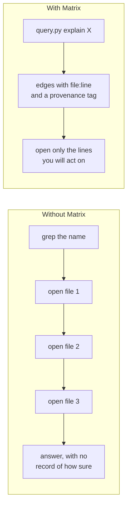
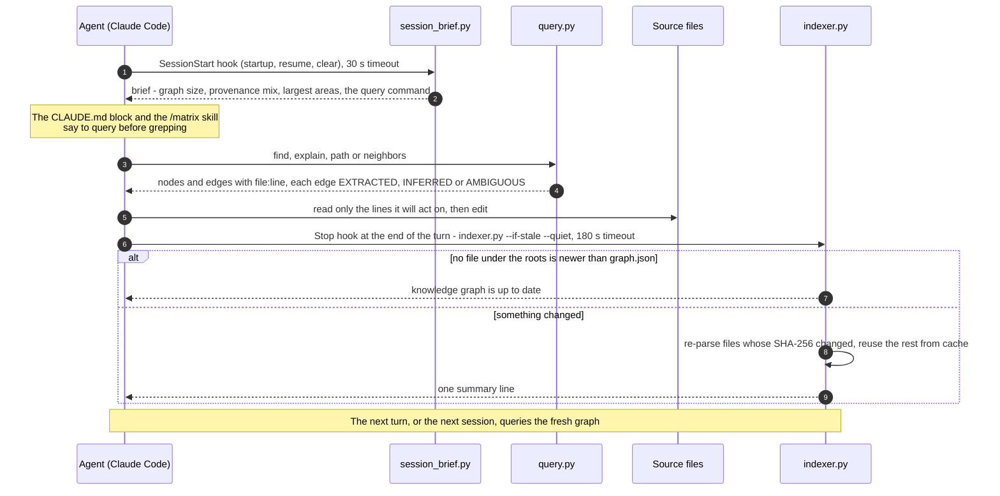
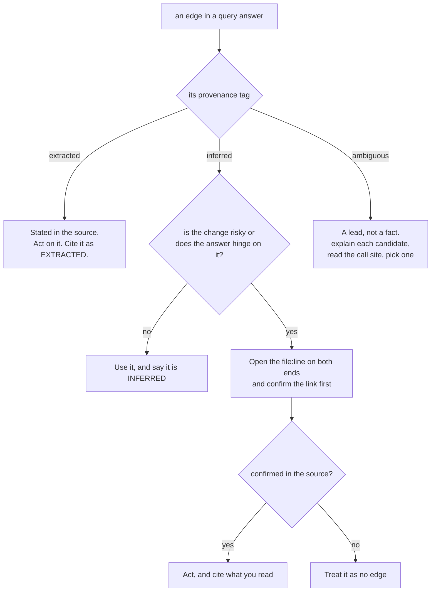
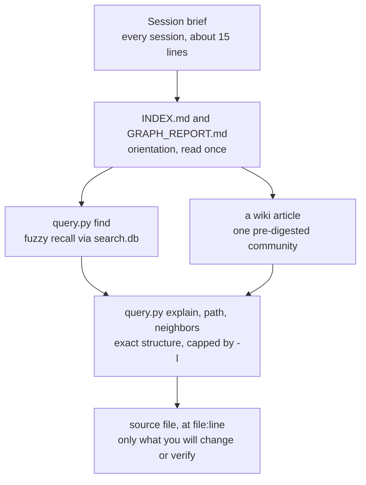
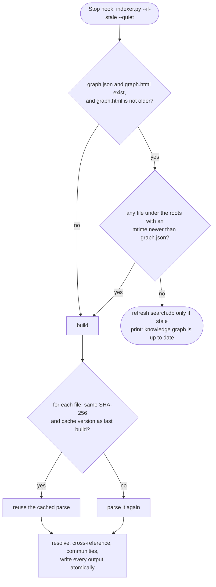
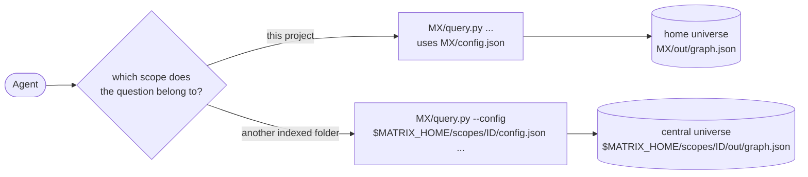

# Matrix for LLMs and coding agents

Matrix is built to be read by a model as much as by a person. The graph, the CLI output, the wiki and the
instructions it installs are all shaped around one goal: an agent should answer *where does X live*, *what does Y
touch* and *how does A reach B* with one short command, know how far it can trust the answer, and start the next
session with the structure already up to date.

This page explains that design and how to get the most from it, in Claude Code or in any other agent. Every
behaviour described here is in the code under `matrix/`; where a number is measured, the page says how.

The examples use the fictional `orbit-shop` project from the screenshots, at `~/projects/orbit-shop`
(`C:\projects\orbit-shop` on Windows). `MX` means the install folder, `<folder>/.claude/matrix`.

**Contents**

- [The problem](#the-problem)
- [The Matrix answer: query first](#the-matrix-answer-query-first)
- [The agent loop](#the-agent-loop)
- [Provenance as epistemic hygiene](#provenance-as-epistemic-hygiene)
- [Context-budget design](#context-budget-design)
- [Instructions as code](#instructions-as-code)
- [Freshness and determinism](#freshness-and-determinism)
- [Multiple universes for agents](#multiple-universes-for-agents)
- [Safety: what stays on the machine](#safety-what-stays-on-the-machine)
- [Using Matrix with any LLM or agent](#using-matrix-with-any-llm-or-agent)
- [Recommended prompts and patterns](#recommended-prompts-and-patterns)
- [Limitations that matter to agents](#limitations-that-matter-to-agents)
- [What Matrix gives an agent out of the box](#what-matrix-gives-an-agent-out-of-the-box)

---

## The problem

A coding agent that meets an unfamiliar folder spends its first turns on navigation, not on the task:

- **Grep is noisy.** A search for a name returns every line that contains it: definitions, calls, comments, docs,
  vendored copies. The agent then opens whole files to find out which line is the definition and which function
  encloses each call.
- **Files are expensive.** Every file opened to answer a structural question is paid for in context, and the
  answer is usually a handful of lines inside it.
- **Structure is rediscovered every session.** A new session, a `/clear` or a resumed conversation starts from zero.
  The map the agent built last time is gone, so it greps and opens the same files again.
- **Guesses look like facts.** When an agent links a call to a definition by name, nothing in its own reasoning
  records whether that link was stated in the source or guessed from a name that several things share.

## The Matrix answer: query first

Matrix moves navigation out of the agent's context and into a prebuilt graph. The agent asks a question in one
command and gets back a compact answer whose every line carries a `file:line` pointer and, for every relationship,
a provenance tag.

| The agent wants to know | One command | What comes back |
|---|---|---|
| Where does something live? | `query.py find "checkout retries"` | Ranked hits, each with type, `file:line`, degree, community and a snippet. |
| What does it touch, and what touches it? | `query.py explain CartService` | Outgoing and incoming edges, grouped by relation, each with `file:line` and `<provenance>`. |
| How does A reach B? | `query.py path CheckoutController sales.orders` | The shortest chain, hop by hop, with each relation and its provenance. |
| What is near it? | `query.py neighbors place_order -d 2` | Everything within N hops, grouped by depth, highest degree first. |
| What is this folder made of? | `query.py stats` | Counts of node types, relations and provenance tiers. |



The agent still reads source. It reads it last, at the exact lines it is about to change or has to verify.

---

## The agent loop



1. **Session start.** Claude Code runs `session_brief.py`. It prints a small Markdown brief into the session: node,
   edge and community counts, the build age, the provenance mix, the eight largest communities, the number of
   memory notes (if any), the exact `query.py` command line, and where `INDEX.md` and `GRAPH_REPORT.md` are.
2. **Query before reading.** The `CLAUDE.md` block and the `/matrix` skill tell the agent to query the graph
   before it greps or opens files, and to say which provenance tier an answer rests on.
3. **Edit.** The agent opens the lines it needs and changes them.
4. **Re-index.** At the end of the turn the `Stop` hook runs `indexer.py --if-stale --quiet`. When nothing is newer
   than the graph, that is a scan of file modification times and nothing else.
5. **Fresh structure.** The next turn, and the next session's brief, see the graph as the agent left the code.

---

## Provenance as epistemic hygiene

Every edge in the graph says how Matrix knows it. An agent should treat the three tiers differently, and say which
one an answer rests on.

### How each tier is produced

| Tier | Produced when | Examples |
|---|---|---|
| `EXTRACTED` | The source states the relationship, or a name resolves to exactly one candidate **in the same file**. | A Python `import`, a class or function definition, a `CREATE VIEW`, `FROM` / `INTO` against a table defined in the corpus, a `[[wikilink]]` or Markdown link with one target, a claim heading. |
| `INFERRED` | The indexer resolved a name across files: exactly one candidate in the whole corpus, but in a different file. Also: prose that names a symbol defined elsewhere, a schema-qualified table that nothing defines, and a wikilink to something that does not exist yet. | `post` calls `place_order` in another module; a doc that mentions `CartService`; a `MENTIONS` edge from a memory note to the code it describes. |
| `AMBIGUOUS` | Several candidates matched the same name. Matrix keeps edges to the first four (three for links and Data Factory references) and flags them all. | `gateway.charge(...)` when two modules each define `charge`. |

If the same `(source, target, relation)` is asserted twice, the edge keeps the stronger tier, in the order
EXTRACTED, then AMBIGUOUS, then INFERRED. Generic call names (`get`, `append`, `join`, Python's builtins and about
100 more) are never resolved as calls, so they cannot pile up as false edges. A bare table name that nothing defines
is dropped rather than guessed. See [ARCHITECTURE.md](ARCHITECTURE.md#provenance-semantics) for the full rules.

AMBIGUOUS edges are also kept out of the search index's neighbour context (`ctx`), so they never make an unrelated
node rank higher in `find`.

### Can I act on this edge?



Two things are easy to miss:

- **A path is only as strong as its weakest hop.** `path` prints the tier of every hop. A chain of `<extracted>`
  hops is a structural fact; a chain that passes through `mentions <inferred>` hops says that some document talks
  about both ends, not that the code connects them.
- **No edge is not proof of no link.** Matrix is static analysis. Dynamic dispatch, reflection, dependency
  injection and wiring in config do not appear. When `path` says `no path between ...`, fall back to reading.

**Claims have their own tiers.** With claim parsing on (the default), a heading such as
`### [MEASURED] ORB-API-007 - Checkout retries a declined card at most twice` becomes a `claim` node with a tier of
MEASURED, SOURCE, INFERRED, RETRACTED or EXTERNAL. That tier describes the *claim*, written by a person or an agent;
edge provenance describes how Matrix found a *relationship*. `find` shows the claim tier before the snippet, and
search ranks RETRACTED claims lower. See [CONFIGURATION.md](CONFIGURATION.md#claims).

---

## Context-budget design

Matrix spends an agent's context in layers: a little up front, more only when asked.



### Compact CLI output

- **One line per node.** Every node prints as `label (type)  [file:line]`. `explain` adds the relation group and a
  `<provenance>` tag; nothing else.
- **Capped lists.** `-l N` (default 20) caps `find` hits, the edges printed per relation in `explain`, and the nodes
  printed per depth in `neighbors`. Anything cut is summarised as `... N more`, so the agent knows to narrow the
  question rather than assume it saw everything.
- **Ambiguity is short.** A name that matches several nodes prints the candidates (up to 15 for a substring match,
  highest degree first) instead of guessing, so the next call can use the exact label or id.
- **Machine output when wanted.** `find --json` prints the hit list as JSON: `id`, `label`, `type`, `tier`, `file`,
  `line`, `degree`, `score`, `snippet`.
- **Encoding-safe.** `query.py` writes UTF-8 with replacement, so an odd label never crashes the call on a legacy
  console.

**A measured example.** On this repository, `query.py explain build_db` printed about 450 bytes: the function's file and
line, the one function it calls, the two functions that call it in two other files, and the file that defines it.
Establishing the same facts by reading means opening `search.py`, `query.py` and `indexer.py`, which together are
about 71 KB. A plain `grep -rn build_db` is small too (388 bytes in the same check), but it returns matching lines,
not the functions that enclose them, so the agent still has to open the files. These sizes were measured on the
Matrix source at the time of writing and will drift as the code changes; the ratio is the point, not the numbers.

### Community wiki articles

`write_wiki` writes one article per community, for the 40 largest, under `out/wiki/`, and an `INDEX.md` that lists
them with their node counts and top five members. `INDEX.md` opens with the line *"One article per community. Read
the article, not the source files."* Each article lists its members grouped by type, highest degree first (up to
60 per type), each with `file:line` and up to six outgoing edges with their provenance. An agent can read one
article to load an entire area of the codebase, already summarised, and never parse JSON.

### Orientation files

`GRAPH_REPORT.md` gives the provenance mix, the 20 highest-degree "god nodes", the node types and relations, up to
40 memory-to-code connections, the 25 largest communities and the first 25 parse errors. It is the one file to
read when the brief is not enough to decide where to look.

### Fuzzy recall

`find` runs over `out/search.db`, a SQLite FTS5 index. Identifiers are split into words (`OrderLineNo` matches
"order line"), a trigram table catches substrings and short codes, the two rankings are fused, and small priors
favour well-connected nodes, docs, claims and memory notes. User text is always quoted, so a query can never be
read as FTS syntax. If `search.db` is stale or missing, `find` builds an index in memory for that call and says so
on stderr. See [ARCHITECTURE.md](ARCHITECTURE.md#search-index).

### What not to read

The skill says it plainly: *do not read the raw graph file directly, it is large; query it.* `graph.json` is the
data store for the CLI; `graph.html` is for people.

---

## Instructions as code

The instructions an agent follows are generated from templates in `matrix/templates/` and written by `setup.py`,
with every path filled in at install time (`{PY}`, `{MX}`, `{CONFIG}`, `{OUT}`, `{OPEN}`). On Linux and macOS the
templates' backslashes become forward slashes. Nothing is hard-coded to a user or a machine.

| What | Where | What it tells the agent |
|---|---|---|
| The `CLAUDE.md` block | `<folder>/CLAUDE.md`, between `<!-- matrix:begin -->` and `<!-- matrix:end -->` | Query before grepping or opening files; three example queries; the three provenance tiers and "say which tier an answer relies on"; where `INDEX.md`, `GRAPH_REPORT.md` and `graph.html` are; that the graph rebuilds after each turn that changed a file. 25 lines. |
| The `/matrix` skill | `<folder>/.claude/skills/matrix/SKILL.md` | The full reference: what to read first, every query command and flag, provenance rules, rebuild commands, the universe UI, the Multiverse, config keys and troubleshooting. |
| The hooks | `<folder>/.claude/settings.json` | Not instructions but behaviour: the brief at session start, the incremental rebuild at the end of a turn. |

The block is short because it is in every prompt. The skill holds the long reference so that the block does not
have to.

**Why marker-delimited.** Setup finds exactly one `<!-- matrix:begin -->` / `<!-- matrix:end -->` pair outside code
fences and replaces only what is between them. Every byte outside the block, and the file's BOM and line endings,
are kept. Markers inside code fences are treated as examples. Unbalanced or duplicated markers make setup refuse and
change nothing.

**Why idempotent.** Rerunning setup produces the same files. The block is replaced in place, not appended again;
Matrix's own hooks are recognised by resolving the script path in each hook command and are replaced at the
position of the first one found; hooks you added yourself are left alone. A file whose content would not change is
not written. `--dry-run` prints the plan, with a diff of `CLAUDE.md` and `settings.json`, and writes nothing.

**Why reversible.** Setup computes every change before writing anything, backs up each `CLAUDE.md`,
`settings.json` and `config.json` it changes to `*.matrix-bak` (never overwriting an earlier backup), and rolls back
the files it already wrote if a write fails. Because Matrix's content is fenced by markers and its hooks are two
identifiable entries, removing it is mechanical: delete the block, delete the two hook entries, delete the install
and skill folders. There is no uninstall command; [GUIDE.md](GUIDE.md#uninstall) lists the steps.

---

## Freshness and determinism

An agent can only rely on a graph that matches the code, and on answers that do not change from one call to the
next for no reason.

### `--if-stale`: cheap enough for every turn



- **The check is an mtime scan.** No file is read or parsed when nothing is newer than the graph.
- **The cache is keyed by content digest.** `cache.json` stores each file's SHA-256 and its parse. A file whose
  mtime changed but whose bytes did not is reused, not re-parsed. Cross-file work (resolution, cross-reference,
  communities, outputs) is redone on every build, because it depends on the whole corpus.
- **Outputs are swapped in atomically.** Every output is written to a temp file and moved into place, so a build
  killed mid-way never leaves a truncated `graph.json` for the next query.

### Never fails the turn

The hooks are written so that Matrix cannot break a session:

- **The brief never fails a session start.** If the graph is missing or unreadable, it prints one line with the
  rebuild command instead.
- **Best-effort steps stay best-effort.** One file that an extractor cannot handle becomes a parse error, not a
  failed build. The search index, the registry update and the `graph.html` render are each wrapped so that a
  failure prints a note and the graph build still completes.
- **Timeouts are set.** The `SessionStart` hook has a 30 s timeout and the `Stop` hook 180 s; Claude Code enforces
  them.
- **The cap cannot stall a turn.** The `max_files` check (default 60,000) applies only to a build from scratch.
  An existing graph is updated incrementally regardless.

### Stable ids and deterministic output

- **Ids are derived from what the thing is**, not from build order: `file:orbit-shop/api/checkout.py`,
  `func:checkout.CheckoutController.post`, `table:sales.orders`, `claim:ORB-API-007`. An agent can keep an id from a
  previous session and query it again. See [ARCHITECTURE.md](ARCHITECTURE.md#node-ids).
- **The same input gives the same graph.** Discovery walks folders and files in sorted order; `graph.json` writes
  nodes sorted by id and edges sorted by source, target and relation; communities come from label propagation in
  sorted order with ties broken by the smallest label; `path` and `neighbors` visit neighbours in sorted order, so
  the same question returns the same path. No model is called, so there is no sampling anywhere.

---

## Multiple universes for agents

Each indexed folder is its own *universe* with its own graph, and an agent queries one universe at a time by
config.



- **Home universe.** The folder you ran setup on. Its config and graph live in `<folder>/.claude/matrix/`, and its
  hooks keep it fresh.
- **Central universes.** Folders added with `matrix add` or `scopes.py add`. Their config, graph and build log live
  in `$MATRIX_HOME/scopes/<id>/`, and **nothing is written into the folder itself**. That makes them a good fit for a
  folder an agent should be able to look up but not modify, such as a sibling service or a notes vault.
- **Separate scopes stay separate.** A query against one universe never returns nodes from another, so an agent
  working on one project is not distracted by another's symbols. To span projects on purpose, index their common
  parent as one universe, or list several roots in one config.
- **Listing them.** `matrix list` (or `scopes.py list`) prints every universe's id, kind, name, root and build
  state. `matrix build <id|name>` rebuilds one.

Central universes have no `Stop` hook. Rebuild one with `matrix build <id|name>` after it changes.

---

## Safety: what stays on the machine

- **No model, no cloud service.** The indexer parses Python with its own `ast` module and everything else with
  small structural parsers. Nothing in Matrix calls a model or a remote API.
- **No outbound network code.** The only networking in Matrix is the optional Multiverse engine, which listens on
  `127.0.0.1`, and the `matrix` launcher, which talks to that engine on `127.0.0.1`. There is no telemetry and no
  update check.
- **The engine is local and token-gated.** `serve.py` binds `127.0.0.1` only. Each run generates a random API token
  and a separate random page key; every `/api/*` request needs the token, the `Host` header must be
  `127.0.0.1:<port>` or `localhost:<port>`, and a foreign `Origin` is refused. The engine reads folder names and each
  universe's `out/` files, never the contents of an indexed folder. See [SERVICES.md](SERVICES.md#security-model).
- **The page is offline.** `graph.html` loads no scripts, styles or fonts from anywhere. Served by the engine, its
  Content Security Policy allows it to talk only to that engine.
- **UNC shares are refused by default.** Adding or browsing a `\\server\share` path needs `--allow-unc`, because
  Windows would send your credentials to that host.

Two honest caveats for agent setups:

- **Your agent is not Matrix.** Matrix keeps everything local, but whatever an agent reads (query output, the
  brief, wiki articles) goes wherever that agent sends its context. Matrix reduces how much source an agent needs
  to read; it does not change where the agent's model runs.
- **Generated files hold local paths.** The `CLAUDE.md` block, the skill and the hooks contain the absolute paths
  of your interpreter and install, and `graph.html` lists every registered universe's name, root and install paths
  unless `embed_scopes` is `false`. Review them before you commit them to a shared repository.

---

## Using Matrix with any LLM or agent

Nothing in the graph or the CLI is specific to Claude Code. Matrix is a set of Python scripts that print plain text,
plus Markdown and JSON files on disk. Any agent that can run a shell command and read text can use it.

What is specific to Claude Code is the wiring: the two hooks in `.claude/settings.json`, the `CLAUDE.md` block, and
the skill under `.claude/skills/`. With another agent you replace that wiring with two habits: query before reading,
and rebuild after editing.

**Option 1: install into the project** with `python matrix/setup.py <folder>`. You get `MX/query.py` and
`MX/indexer.py` with their config in place. The Claude Code files are written too; other agents simply ignore them.

**Option 2: index without touching the project.** Register it as a central universe from a checkout of this
repository. Its config and graph go to `$MATRIX_HOME/scopes/<id>/`:

```bash
python matrix/scopes.py add ~/projects/orbit-shop --name orbit-shop   # prints the new id
python matrix/scopes.py build <id>                                    # full build
python matrix/query.py --config "$MATRIX_HOME/scopes/<id>/config.json" find "checkout"
```

Then add a section like this to whatever instructions file your agent reads (an `AGENTS.md`-style file, a system
prompt, a rules file). Adjust the paths to your install:

```markdown
## Knowledge graph (Matrix)

This project has a Matrix knowledge graph. Query it before you grep or open files.

    python .claude/matrix/query.py find "words to search"       # ranked search, --json available
    python .claude/matrix/query.py explain <Name>               # a node and every edge touching it
    python .claude/matrix/query.py path <A> <B>                 # how A reaches B, hop by hop
    python .claude/matrix/query.py neighbors <Name> -d 2        # everything within 2 hops

Every edge is tagged:
- EXTRACTED: stated in the source. Reliable.
- INFERRED: resolved across files by the indexer. Verify in the source before acting on it.
- AMBIGUOUS: several candidates matched. A lead, not a fact.
Say which tier an answer relies on.

Orientation: .claude/matrix/out/INDEX.md (one wiki article per area) and
.claude/matrix/out/GRAPH_REPORT.md. Do not read graph.json; query it.

After you edit files, refresh the graph:

    python .claude/matrix/indexer.py --if-stale --quiet
```

`query.py` finds its config next to itself, so the commands work from any working directory as long as the script
path is right. If your agent has its own hook or post-edit mechanism, point it at
`indexer.py --if-stale --quiet`: it exits at once when nothing changed.

---

## Recommended prompts and patterns

### Find, explain, path

The pattern that answers most structural questions is three calls:

1. **`find`** to turn words into a node name.
2. **`explain`** to see what that node touches, with `file:line` for every neighbour.
3. **`path`** to check how it reaches the thing you care about, and how strong each hop is.

The outputs below are real, captured from a small `orbit-shop` sample built for this page (a handful of Python
files, one SQL file and one Markdown doc).

````text
$ python MX/query.py find "retries" -l 4
4 best match(es) for 'retries'

  checkout (doc)  [orbit-shop/docs/checkout.md]   deg=8  ~ sales.orders
      …Payment [retries] A declined card is [retried] by [retry]_charge. See sales…
  ORB-API-007 (claim)  [orbit-shop/docs/checkout.md:10]   deg=1  ~ sales.orders
      MEASURED  Checkout [retries] a declined card at most twice Measured against the gateway…
  Payment retries (concept)  [orbit-shop/docs/checkout.md:6]   deg=1  ~ sales.orders
      A declined card is [retried] by [retry]_charge. See sales.orders for…
  retry_charge (function)  [orbit-shop/payments/retry.py:4]   deg=4  ~ sales.orders
````

Each hit is `label (type)  [file:line]   deg=<degree>  ~ <community>`, then an indented snippet with the matched
words in brackets, prefixed by the claim tier for a claim.

````text
$ python MX/query.py explain post
# post

type: function   degree: 5
file: orbit-shop/api/checkout.py:7
community: sales.orders

## outgoing (4)

  CALLS
    - load_cart (function)  [orbit-shop/api/checkout.py:13]  <extracted>
    - charge (function)  [orbit-shop/payments/gateway.py:4]  <ambiguous>
    - charge (function)  [orbit-shop/payments/retry.py:8]  <ambiguous>
    - place_order (function)  [orbit-shop/orders/service.py:17]  <inferred>

## incoming (1)

  DEFINES
    - CheckoutController (class)  [orbit-shop/api/checkout.py:6]  <extracted>
````

Read this the way the tiers say: `load_cart` is in the same file, so the call is EXTRACTED. `place_order` has one
definition in the corpus, in another file, so the call is INFERRED. `gateway.charge(...)` matched two functions
named `charge`, so both edges are AMBIGUOUS: open `checkout.py:7` to see which one is called.

````text
$ python MX/query.py path validate_sku sales.daily_orders
4 hops

  validate_sku (function)  [orbit-shop/orders/service.py:13]
      |  defines (reverse)  <extracted>
  service.py (file)  [orbit-shop/orders/service.py]
      |  writes  <extracted>
  sales.orders (table)  [orbit-shop/sql/orders.sql:1]
      |  reads (reverse)  <extracted>
  orders.sql (file)  [orbit-shop/sql/orders.sql]
      |  defines  <extracted>
  sales.daily_orders (view)  [orbit-shop/sql/orders.sql:7]
````

Every hop is `<extracted>`, so this chain is stated in the source. A hop walked against the edge's direction is
marked `(reverse)`.

````text
$ python MX/query.py path CheckoutController sales.orders
2 hops

  CheckoutController (class)  [orbit-shop/api/checkout.py:6]
      |  mentions (reverse)  <inferred>
  checkout (doc)  [orbit-shop/docs/checkout.md]
      |  mentions  <inferred>
  sales.orders (table)  [orbit-shop/sql/orders.sql:1]
````

This is the case to watch for. The shortest path runs through a document that mentions both ends, and both hops
are INFERRED. It says the doc talks about both, not that the controller writes the table. Follow the code instead
with `explain post` and `explain place_order`.

### Ambiguous names

````text
$ python MX/query.py explain charge
'charge' is ambiguous - 2 candidates:

  charge (function)  [orbit-shop/payments/gateway.py:4]
  charge (function)  [orbit-shop/payments/retry.py:8]
````

Rerun with a more specific name or the full id, for example `explain func:gateway.charge`. Names match by exact id,
then exact label (ignoring case), then substring.

### Prompts that work

These are phrasings to give an agent, or for an agent to give itself. None of them needs special syntax.

| Goal | Prompt |
|---|---|
| Orientation | "Read the Matrix brief and `INDEX.md`, then tell me which two communities matter for checkout." |
| Locate | "Use Matrix `find` to locate where card retries are implemented. Give `file:line`." |
| Impact | "Before changing `place_order`, run `explain place_order` and list every caller with its provenance tier." |
| Trace | "Use `path` from `CheckoutController` to `sales.orders`. If any hop is INFERRED or AMBIGUOUS, verify it in the source before you rely on it." |
| Review | "For each relationship you used in this answer, say whether it was EXTRACTED, INFERRED or AMBIGUOUS." |
| Fallback | "If Matrix finds no path, say so and read the source; do not invent the link." |

### Habits for agents

- **Query, then read the lines.** Use `file:line` from the answer to open just that region.
- **Narrow, don't widen.** If a list ends in `... N more`, ask a more specific question rather than raising `-l`
  until everything fits.
- **Read text, not exit codes.** `query.py` exits `0` for "nothing matches" and for an ambiguous name; only a
  missing graph exits non-zero. Check the first line of the output.
- **Prefer the wiki for areas, the CLI for facts.** One wiki article loads an area; `explain` answers a precise
  question.
- **Rebuild after outside changes.** The `Stop` hook covers edits made in the session. After a `git pull`, a branch
  switch or a config change, run `indexer.py` (or `--full` after a config change).

---

## Limitations that matter to agents

- **Parsed languages are limited.** Python, notebooks, SQL, Markdown and text, YAML, and (opt-in) Data Factory JSON.
  JavaScript, TypeScript, Java and Go are skipped for now, and data and binary files appear only as `dataset` nodes.
  An agent working in an unparsed language gets docs and file-level structure, not call graphs. See the
  [README](../README.md#what-gets-parsed).
- **Static analysis only.** Dynamic dispatch, reflection, dependency injection and config-driven wiring are
  invisible. A missing edge is not evidence that two things are unrelated.
- **Heuristics produce AMBIGUOUS edges.** Calls are resolved by bare name. Common names shared by several
  definitions become AMBIGUOUS fan-outs that the agent has to resolve by reading.
- **Ids are short, so they can merge.** Function and class ids are the module's file stem plus the dotted scope.
  Two same-named functions in same-named modules in different folders (two `utils.py` files that both define
  `helper`) share one node: its `file:line` is the first one met, and both files' edges point at it.
- **Cross-reference cost grows on huge roots.** The pass that links prose to code tests every document against
  every nameable symbol, so a whole drive full of documents makes builds slow. Index a project, not a drive, where
  you can.
- **`--if-stale` sees changed files, not deleted ones.** It compares modification times of the files that exist. A
  deletion on its own, or a move that keeps the file's mtime, is not noticed until something else changes or you
  run `indexer.py`.
- **Matrix's own files are indexed.** The `CLAUDE.md` block and `.claude/skills/matrix/SKILL.md` sit under the root,
  so they are Markdown like any other and show up as docs (a community named after the skill is normal). Add them to
  the ignore settings if you would rather not see them. See [CONFIGURATION.md](CONFIGURATION.md).

---

## What Matrix gives an agent out of the box

Everything below is installed or generated by `setup.py` and the indexer. Flags are taken from each script's
`argparse` definition.

### The `/matrix` skill

`setup.py` writes `matrix/templates/SKILL.md`, with every path filled in, to `<folder>/.claude/skills/matrix/SKILL.md`.
In Claude Code it is available as `/matrix`, and its description makes it trigger on its own.

**Triggers** (from the skill's frontmatter): "matrix", "knowledge graph", "where is", "what connects", "how does X
reach Y", "what touches", "rebuild the graph", "reindex", "open the universe".

| Section of the skill | What it gives the agent |
|---|---|
| Header | The interpreter, install folder, config file and output folder, as absolute paths. |
| Read these first | `INDEX.md`, `GRAPH_REPORT.md`, `wiki/*.md`, and `graph.html` (for the user). "Do not read the raw graph file directly." A note that `graph.html` lists every registered universe unless `embed_scopes` is `false`. |
| Commands | `find` (with `--json`), `explain`, `path`, `neighbors -d 2`, `stats`; `-l N` and `--config F`; how names match. |
| Provenance | The three tiers and "every answer drawn from the graph must state which tier it rests on". |
| Rebuilding | `indexer.py --if-stale --quiet`, `--full`, `--config`. When the `Stop` hook runs and when to use `--full`. |
| Universe UI | How to open `graph.html`, with a ready-made opener command for any shell. |
| Multiverse | The `matrix` launcher commands, and the `serve.py` / `scopes.py` equivalents without it. Where central universes keep their files, and how to query one with `--config`. |
| Config | The config file and its key options. |
| Troubleshooting | Stale results, ambiguous names, no path found, binary files. |

### Claude Code hooks

Written to `<folder>/.claude/settings.json`. Other hooks in the file are kept.

| Event | Matcher | Command | Timeout |
|---|---|---|---|
| `SessionStart` | `startup\|resume\|clear` | `"<python>" "<MX>/session_brief.py"` | 30 s |
| `Stop` | none | `"<python>" "<MX>/indexer.py" --if-stale --quiet` | 180 s |

`<python>` is the interpreter that ran setup, or `--python`.

### The `CLAUDE.md` block

Written from `matrix/templates/claude_md_section.md` between `<!-- matrix:begin -->` and `<!-- matrix:end -->`:
query first, three example queries, the provenance tiers, the orientation files, `graph.html`, the `matrix`
command, and a pointer to the skill. See [Instructions as code](#instructions-as-code) and
[GUIDE.md](GUIDE.md#the-claudemd-block).

### `query.py`

```text
python MX/query.py [-l N] [--config F] <command> ...
```

| Command or flag | Arguments | What it does |
|---|---|---|
| `-l`, `--limit` | `N`, default 20 | Caps `find` hits, edges per relation in `explain`, and nodes per depth in `neighbors`. Accepted before or after the subcommand. |
| `--config` | `F` | Query another universe's config. Accepted before or after the subcommand. |
| `find` | `text` `[--json]` | Ranked full-text search over `search.db`. `--json` prints the hit list. |
| `explain` | `node` | The node's type, degree, file, community and notes, then its outgoing and incoming edges grouped by relation, each with `<provenance>`. |
| `path` | `source` `target` | The shortest undirected path, hop by hop, with relation and provenance; `(reverse)` marks a hop walked against the edge. |
| `neighbors` | `node` `[-d DEPTH]` | Every node within `DEPTH` hops (default 1), grouped by depth, highest degree first. |
| `stats` | none | Build time, node and edge counts, and counts of node types, relations and provenance. |

Exit codes: `0` for every answer, including "nothing matches" and an ambiguous name; `1` with a message when there
is no `graph.json`; `2` for a usage error.

### `search.py`

A library, not a command: it has no CLI of its own. `indexer.py` calls `build_db` to write `out/search.db` after
every build; `query.py find` calls `open_ro` and `search`. Any other Python reader can do the same by putting the
install folder on `sys.path`.

| Function | What it does |
|---|---|
| `build_db(nodes, edges, path, graph_mtime)` | Builds the FTS5 index. A file path is written to `path + ".tmp"` and swapped in; `":memory:"` returns an open connection. |
| `open_ro(db_path, graph_path)` | A read-only connection, or `None` if the database is missing, has another schema, or is more than 1 s out of step with `graph.json`. |
| `search(conn, text, k=20)` | Ranked hits as dicts: `id`, `label`, `type`, `tier`, `file`, `line`, `degree`, `score`, `snippet`. |
| `vocab_df(conn, term)` | How many nodes contain a (stemmed) term. |
| `split_ident(s)` | Splits an identifier into words: `OrderLineNo` to `Order Line No`. |

### `indexer.py`

| Flag | What it does |
|---|---|
| (none) | Incremental build: files whose SHA-256 is unchanged reuse their cached parse. |
| `--full` | Ignore the cache and rebuild from scratch. |
| `--if-stale` | Exit at once, printing `knowledge graph: up to date`, unless a file under the roots is newer than `graph.json` or `graph.html` is missing or older. |
| `--quiet` | Print only the summary line. |
| `--force` | Build from scratch even when the roots hold more than `max_files` files. |
| `--config F` | Use another config. |

Exit codes: `0` on success or when up to date; `3` when a build from scratch is refused by the `max_files` cap.

### `setup.py`

```text
python matrix/setup.py <target> [flags]
```

| Flag | What it does |
|---|---|
| `target` | The folder to install into. Matrix goes to `<target>/.claude/matrix`. |
| `--config FILE` | Install `FILE` as the config. Relative paths in it are made absolute against its own folder. |
| `--memory DIR` | A notes folder to index as the `memory` root. By default, Claude Code's memory folder for the target, if one exists. |
| `--python EXE` | The interpreter the hooks and builds use. By default, the one running setup. |
| `--migrate-from OLD_DIR` | Also remove hooks that run `OLD_DIR`'s `indexer.py` or `session_brief.py`. |
| `--replace-section HEADING` | Replace that `CLAUDE.md` section with the Matrix block. An error if neither it nor a block is found. |
| `--no-build` | Skip the first graph build. |
| `--no-launcher` | Do not install the `matrix` launcher. |
| `--launcher-dir DIR` | Where to put the launcher. |
| `--dry-run` | Print the plan and the diffs, and write nothing. |

Exit codes: `0` on success; `1` when a write fails (after rolling back) or the first build fails; `2` when setup
refuses before writing anything.

### The `matrix` launcher

| Command | What it does |
|---|---|
| `matrix`, `matrix open` | Open the Multiverse, starting the engine if needed. `--no-browser` prints the link instead. |
| `matrix status` | Whether the engine is running, its pid, port and install, and what it is building. Exits `1` if it is not running. |
| `matrix list` | Every registered universe: id, kind, name, root, node count and build time. |
| `matrix add <folder> [--name N] [--build] [--force]` | Preflight-count and register a folder. `--build` also builds it in full; `--force` builds past `max_files`. |
| `matrix build <id\|name> [--full] [--force]` | Build one universe, through the engine if it is running. Incremental unless `--full`. |
| `matrix stop-build <id\|name>` | Cancel the engine's running build of that universe. |
| `matrix stop` | Stop the engine. |
| `matrix help` | Usage. |

`<id|name>` matches an exact id, then an exact name, then an id prefix. Exit codes are listed in
[GUIDE.md](GUIDE.md#the-matrix-command).

### `scopes.py`

The same registry operations without the launcher. Universes are named by their exact id here.

| Command | What it does |
|---|---|
| `scopes.py list` | Every universe, with its node and edge counts. |
| `scopes.py add <root> [--name N]` | Preflight and register a folder as a central universe, and print the build command. |
| `scopes.py rename <id> <name>` | Rename a universe. |
| `scopes.py remove <id>` | Unregister it. A central universe's `$MATRIX_HOME/scopes/<id>/` is deleted; a home install is never touched. |
| `scopes.py build <id> [--if-stale] [--force]` | A full build, or with `--if-stale` the staleness check described above. `--force` builds past `max_files`. |

### `serve.py`

| Flag | What it does |
|---|---|
| `--port N` | The port to try first, default `8765`. If it is taken, the engine uses the next free one. |
| `--open` | Open the browser at the start link. |
| `--scope ID` | The universe to open first. |
| `--verbose` | Log every request. |
| `--allow-unc` | Allow `\\server\share` folders. |

### `session_brief.py` and `viz.py`

| Command | What it does |
|---|---|
| `session_brief.py [--config F]` | Print the session brief. This is what the `SessionStart` hook runs. |
| `viz.py [--config F] [--graph G] [--out O]` | Re-render `graph.html` from `graph.json`. The indexer runs it after every build. |

### Generated artifacts

In `MX/out/` (or `$MATRIX_HOME/scopes/<id>/out/` for a central universe):

| File | For | What it holds |
|---|---|---|
| `graph.json` | `query.py`, the brief, `viz.py` | Every node and edge, with provenance, degree and community. Query it rather than reading it. |
| `search.db` | `query.py find` | The SQLite FTS5 index. |
| `cache.json` | `indexer.py` | Each file's SHA-256 and cached parse. |
| `INDEX.md` | Agents and people | One row per community (the 40 largest), each linking to its wiki article. |
| `wiki/<community>.md` | Agents and people | One article per community: members by type with `file:line` and their edges with provenance. |
| `GRAPH_REPORT.md` | Agents and people | Provenance mix, god nodes, node types, relations, memory-to-code links, communities, parse errors. |
| `graph.html` | People | The universe UI, a single offline file. |
| `last_build.log` | People | Written when the engine builds a universe. |

In the target folder: the `CLAUDE.md` block, `.claude/settings.json`, `.claude/skills/matrix/SKILL.md` and
`.claude/matrix/config.json`. In `$MATRIX_HOME` (by default `~/.claude/matrix`): the registry `scopes.json`, the
launcher record `launcher.json`, the running engine's `engine.json`, and each central universe's folder under
`scopes/`.

### The universe UI, briefly

The UI is for people, but an agent can point a person at it. A few keys: `/` search, `?` keyboard help, `Enter`
drill in, `Backspace` back, `p` path to another node, `1` / `2` focus a 1-hop or 2-hop neighbourhood, `v` 2D or 3D,
`u` the Multiverse window, `g` graph or dashboard. The full table is in [GUIDE.md](GUIDE.md#keyboard).
