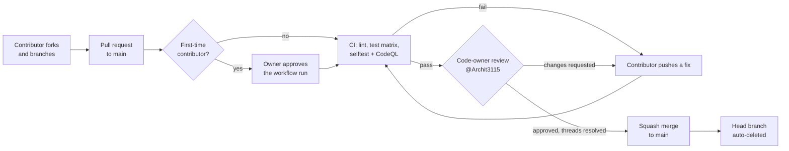

# GitHub setup

A one-time checklist for the repository owner. The files in `.github/` (CI, CodeQL, Dependabot, code owners,
templates, and the branch ruleset) do nothing until these settings are switched on in the GitHub web UI. Work through
the list top to bottom, then open a test pull request to check that everything is enforced.

The goal: anyone can contribute through a fork and a pull request, but nothing reaches `main` until CI has passed and
the code owner has reviewed and approved it.

**Contents**

- [1. Import the branch ruleset](#1-import-the-branch-ruleset)
- [2. Actions: fork pull requests](#2-actions-fork-pull-requests)
- [3. Actions: workflow permissions](#3-actions-workflow-permissions)
- [4. Security features](#4-security-features)
- [5. Pull request and merge settings](#5-pull-request-and-merge-settings)
- [6. Features you do not use](#6-features-you-do-not-use)
- [7. Check that it works](#7-check-that-it-works)
- [Required status checks](#required-status-checks)

---

## 1. Import the branch ruleset

The ruleset is stored in [`.github/rulesets/main-protection.json`](../.github/rulesets/main-protection.json).

1. **Settings → Rules → Rulesets → New ruleset → Import a ruleset.**
2. Choose `.github/rulesets/main-protection.json` from a local checkout.
3. Review the imported rules, check that **Enforcement status** is **Active**, and select **Create**.

What it enforces on the default branch (`~DEFAULT_BRANCH`, that is `main`):

| Rule | Effect |
|---|---|
| Restrict deletions | `main` cannot be deleted. |
| Block force pushes | No history rewrites on `main`. |
| Require linear history | No merge commits on `main`. |
| Require a pull request before merging | Every change arrives through a PR, and squash merge is the only allowed method. |
| ↳ 1 required approval | At least one approving review. |
| ↳ Dismiss stale approvals | A new push invalidates earlier approvals. |
| ↳ Require review from Code Owners | `@Archit3115` (see [`.github/CODEOWNERS`](../.github/CODEOWNERS)) must approve. |
| ↳ Require approval of the most recent push | The last push must be approved by someone other than the person who pushed it. |
| ↳ Require conversation resolution | Every review thread must be resolved. |
| Require status checks to pass | The [checks listed below](#required-status-checks) must pass, and the branch must be up to date with `main` (strict). |

**Bypass list:** the **Repository admin** role, in **pull request only** mode. As the only maintainer, you cannot
approve your own pull requests, so you would otherwise be locked out. With this bypass you can still merge your own
PRs, but only through a pull request: direct pushes to `main` stay blocked for everyone. The bypass also skips the
required checks, so wait for CI to go green on your own PRs before you merge.

If you rename a CI job, update the ruleset as well (Settings → Rules → Rulesets → main-protection → Status checks).
Otherwise every PR waits for a check that never reports.

## 2. Actions: fork pull requests

**Settings → Actions → General → Approval for running fork pull request workflows from contributors:**

- Select **Require approval for all external contributors**.

Every workflow run on a PR from someone outside the repository then waits until you approve it with **Approve and
run**. Read the diff first, especially any change under `.github/` or `tests/`, before you approve.

The workflows use `pull_request` only, never `pull_request_target`. Fork PRs therefore run with a read-only token and
no access to secrets. CI uses no secrets at all.

## 3. Actions: workflow permissions

**Settings → Actions → General → Workflow permissions:**

- Select **Read repository contents and packages permissions**. The workflows ask for anything more themselves:
  CodeQL asks for `security-events: write` on its job only.
- Clear **Allow GitHub Actions to create and approve pull requests**.

Optionally, under **Actions permissions**, select **Allow Archit3115, and select non-Archit3115, actions and
reusable workflows**, then allow **actions created by GitHub**. The workflows only use `actions/*` and
`github/codeql-action/*`.

## 4. Security features

**Settings → Advanced Security** (named **Code security** on some accounts):

| Setting | Why |
|---|---|
| **Private vulnerability reporting: Enable** | [SECURITY.md](../SECURITY.md) and the Code of Conduct point reporters to Security → Report a vulnerability. |
| **Dependency graph: Enable** | Needed by Dependabot. |
| **Dependabot alerts: Enable** | Alerts for vulnerable GitHub Actions versions. |
| **Dependabot security updates: Enable** | Opens PRs that fix those alerts. Version updates come from [`.github/dependabot.yml`](../.github/dependabot.yml). |
| **Secret scanning: Enable** | Flags committed tokens and keys. |
| **Push protection: Enable** | Blocks pushes that contain a recognised secret. |
| **Code scanning** | Results come from [`.github/workflows/codeql.yml`](../.github/workflows/codeql.yml). Leave **default setup** off, because the advanced workflow is already in the repository and the two cannot run together. |

## 5. Pull request and merge settings

**Settings → General → Pull Requests:**

- Clear **Allow merge commits**.
- Keep **Allow squash merging** selected. For the default commit message, choose **Pull request title and
  description**, or **Pull request title**.
- Clear **Allow rebase merging**. The ruleset allows squash only, so this keeps the merge button consistent.
- Select **Automatically delete head branches**.
- Optional: select **Always suggest updating pull request branches**, which helps with the strict status checks.

## 6. Features you do not use

**Settings → General → Features:**

- Clear **Wikis**. The documentation lives in `docs/` and is reviewed like code.
- Clear **Projects** if you do not use them.
- Keep **Issues** selected. The forms in `.github/ISSUE_TEMPLATE/` replace blank issues.
- **Discussions** is optional.

## 7. Check that it works

1. From a second account or a fork, open a small PR, such as a typo fix in a doc.
2. Check that the workflow run waits for your approval, and approve it.
3. Check that all the [required checks](#required-status-checks) report, and that the merge box lists the code-owner
   review as required.
4. Try `git push origin main` from your own clone. The push must be rejected.
5. Approve and squash-merge the PR, and check that its head branch is deleted.

---

## Required status checks

These are the exact check names produced by [`.github/workflows/ci.yml`](../.github/workflows/ci.yml). They are listed
in the ruleset:

| Check | Job |
|---|---|
| `lint` | `compileall` over `matrix/` and `tests/`, and `node --check` on every `.js` file |
| `test (ubuntu-latest, py3.10)` | `python tests/smoke.py` |
| `test (ubuntu-latest, py3.12)` | 〃 |
| `test (ubuntu-latest, py3.13)` | 〃 |
| `test (windows-latest, py3.10)` | 〃 |
| `test (windows-latest, py3.12)` | 〃 |
| `test (windows-latest, py3.13)` | 〃 |
| `test (macos-latest, py3.10)` | 〃 |
| `test (macos-latest, py3.12)` | 〃 |
| `test (macos-latest, py3.13)` | 〃 |
| `selftest` | `python tests/selftest.py` in headless Chrome on Ubuntu, webgl + nogl |

CodeQL's checks (`analyze (python)` and `analyze (javascript-typescript)`) are not in the required list. Review their
results on each PR. To make them blocking as well, add a **Require code scanning results** rule to the ruleset.

A check appears in the ruleset's status-check picker only after it has run at least once. The import adds it by
name, so it works before the first run too.
