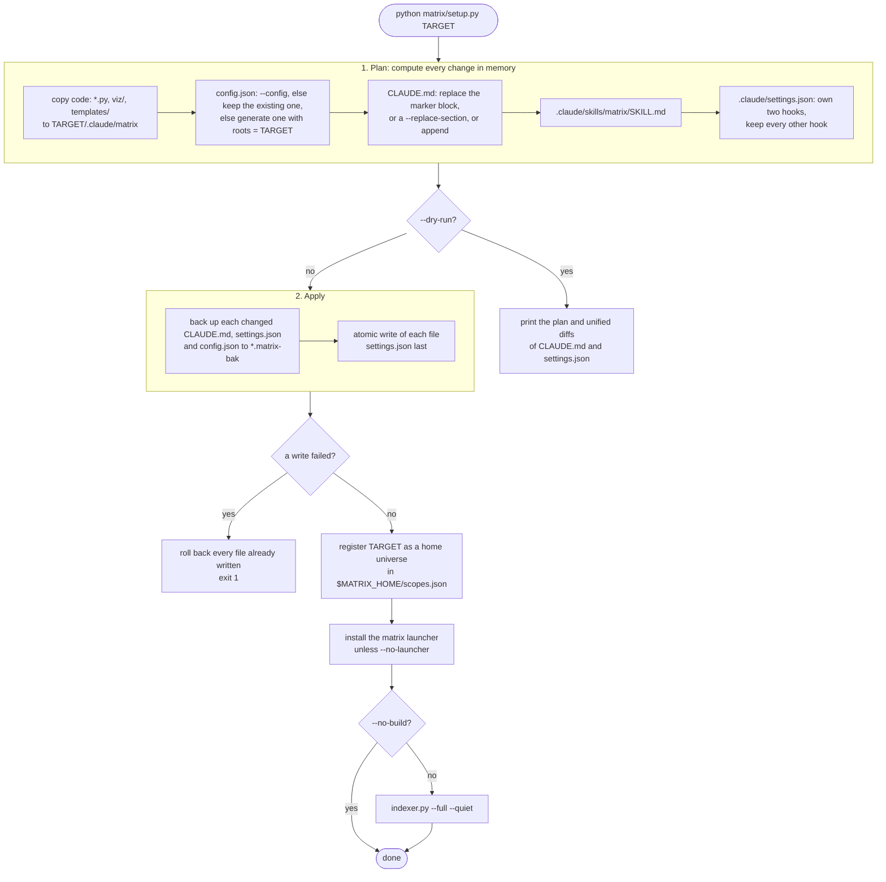
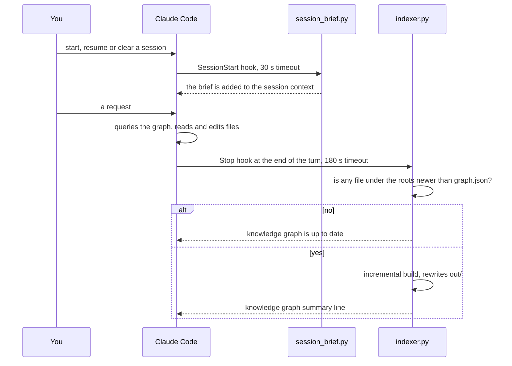
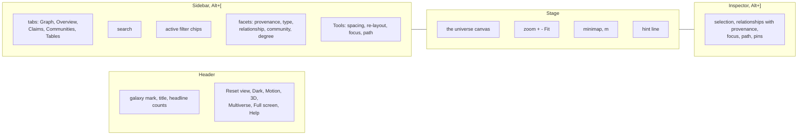
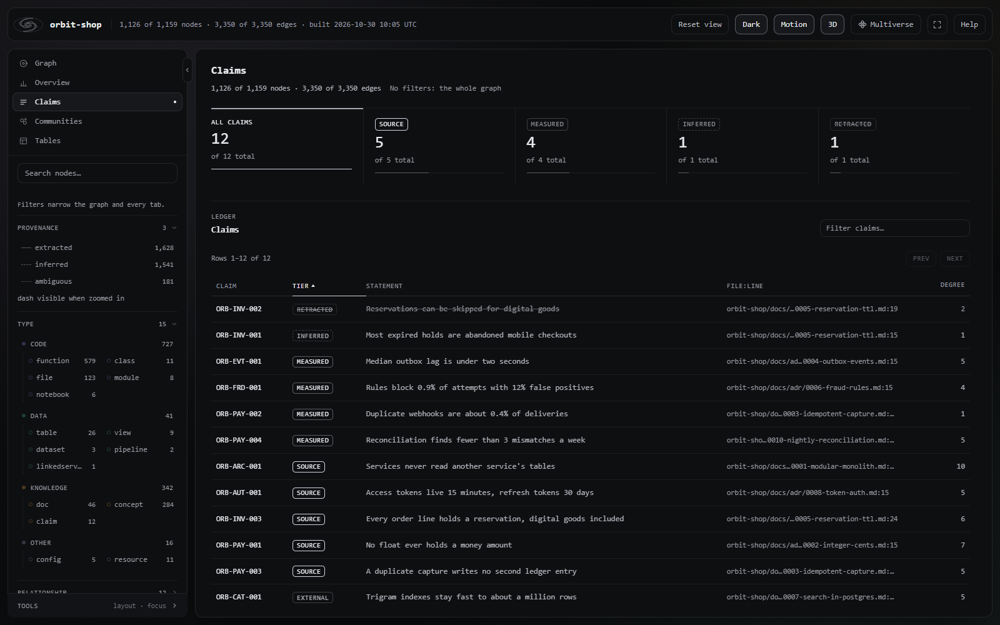
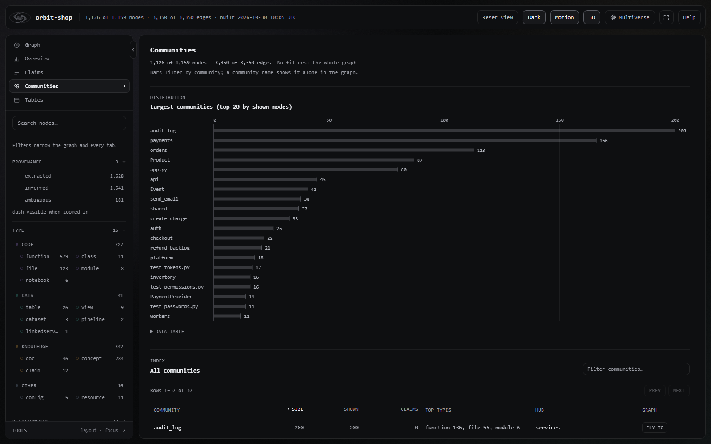
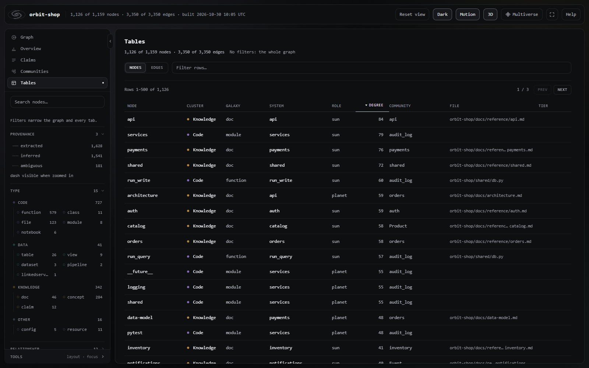
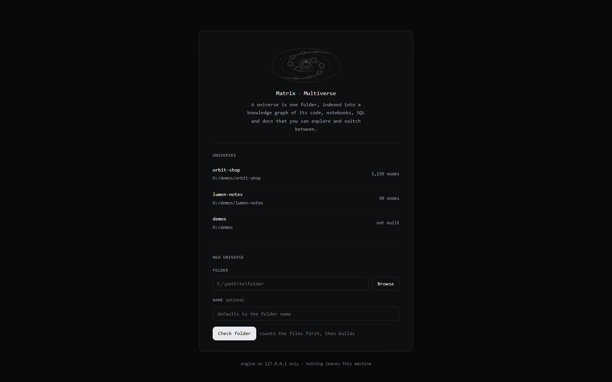
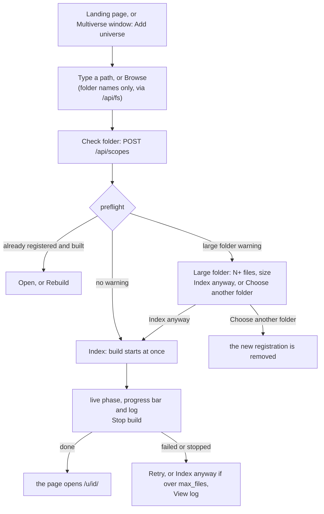
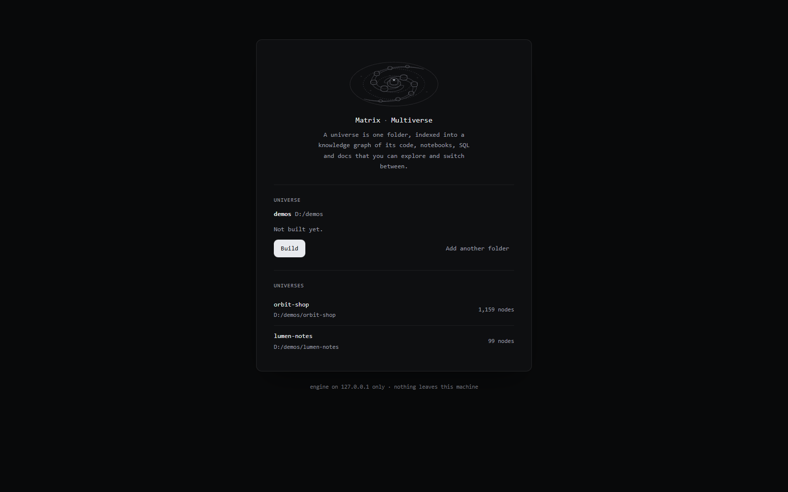

# Matrix user guide

Matrix turns a folder into a provenance-tagged knowledge graph. You can query the graph from the terminal, an
assistant such as Claude Code can query it, and you can explore it in the browser as a 3D universe. Matrix is
generic: it works on any folder on any machine, whether that is a repo, a monorepo, a notes vault or a whole drive.
Nothing is hard-coded to a user or path, and each person keeps their own registry of universes.

The examples use a fictional project called `orbit-shop`, a notes vault called `lumen-notes`, and their parent
folder `demos`:

| | Windows | Linux / macOS |
|---|---|---|
| orbit-shop | `C:\projects\demos\orbit-shop` | `~/projects/demos/orbit-shop` |
| lumen-notes | `C:\projects\demos\lumen-notes` | `~/projects/demos/lumen-notes` |
| demos | `C:\projects\demos` | `~/projects/demos` |

In command tables, **`MX`** means the install folder, `<folder>/.claude/matrix`.

**Contents**

1. [Install](#install)
2. [First build](#first-build)
3. [Claude Code integration](#claude-code-integration)
4. [Querying](#querying)
5. [The universe UI](#the-universe-ui)
6. [Multiverse workflows](#multiverse-workflows)
7. [The `matrix` command](#the-matrix-command)
8. [Updating and uninstalling](#updating-and-uninstalling)
9. [Troubleshooting FAQ](#troubleshooting-faq)

---

## Install

### Prerequisites

- Python 3.10 or later. Matrix uses the standard library only, so there is nothing to `pip install`.
- A browser for `graph.html`.
- Optional: [Claude Code](https://claude.com/claude-code), to get the hooks, the `CLAUDE.md` block and the
  `/matrix` skill.

### Install into a folder

From a clone of this repository:

```bash
python matrix/setup.py ~/projects/demos/orbit-shop
```

```powershell
python matrix\setup.py C:\projects\demos\orbit-shop
```

The interpreter that runs `setup.py` is recorded and used for the hooks and builds. Pass `--python` to choose a
different one, for example a project virtualenv.

### What setup does



Registering the universe and installing the launcher never fail the setup; a problem there is printed and the
setup continues.

### Setup flags

| Flag | Default | Meaning |
|---|---|---|
| `target` (positional) | required | The project folder to install into. It must exist. |
| `--config FILE` | none | Install this file as `MX/config.json`. Relative `roots`, `memory`, `ignore_paths` and `data_dirs` in it are rewritten to absolute paths, resolved against the file's own folder; `out_dir` stays relative to the install. [`config.example.json`](../config.example.json) is a starting point: set its `roots` first. |
| `--memory DIR` | auto | A notes folder to index as the `memory` root. By default this is Claude Code's per-project memory folder for the target (`~/.claude/projects/<mangled-target>/memory`), if one exists. Only used when a new config is generated. |
| `--python EXE` | the running interpreter | The interpreter for the hooks and builds. A name on `PATH` or a file path. |
| `--migrate-from OLD_DIR` | none | Also remove hooks that run `OLD_DIR/indexer.py` or `OLD_DIR/session_brief.py`, from an older install location. |
| `--replace-section "## Heading"` | none | Replace this `CLAUDE.md` section (it also matches `## Heading (...)`) with the Matrix block. It is an error if neither the heading nor a Matrix block exists. |
| `--no-build` | off | Skip the first graph build. |
| `--no-launcher` | off | Do not install the `matrix` launcher. |
| `--launcher-dir DIR` | see below | The folder for the `matrix` / `matrix.cmd` scripts. |
| `--dry-run` | off | Print the plan and the diffs, and write nothing. |

The launcher goes in the first writable folder of: `~/.local/bin` (only if it is already on `PATH`), then
`%LOCALAPPDATA%\Programs\matrix\bin` on Windows or `~/.local/bin` elsewhere. Setup never edits `PATH`. If the folder
is not on `PATH`, setup prints the one-liner that adds it:

```powershell
powershell -NoProfile -Command "[Environment]::SetEnvironmentVariable('Path', [Environment]::GetEnvironmentVariable('Path', 'User') + ';<launcher dir>', 'User')"
```

```bash
echo 'export PATH="<launcher dir>:$PATH"' >> ~/.profile
```

Then open a new terminal.

### The generated config

With no `--config` and no existing `MX/config.json`, setup writes:

```json
{
  "title": "Matrix",
  "roots": ["C:/projects/demos/orbit-shop"],
  "memory": "C:/Users/you/.claude/projects/C--projects-demos-orbit-shop/memory",
  "ignore_paths": ["."],
  "out_dir": "out"
}
```

`memory` appears only when that folder exists. `"ignore_paths": ["."]` is the install folder itself; Matrix also
always ignores its own install folder and `out_dir`. Every other key takes its default; see
[CONFIGURATION.md](CONFIGURATION.md).

---

## First build

Setup runs `indexer.py --full --quiet` for you. To run builds yourself:

| Command | When to use it |
|---|---|
| `python MX/indexer.py` | Incremental build. Files whose SHA-256 has not changed reuse their cached parse. |
| `python MX/indexer.py --full` | Ignore the cache. Run this after you edit the config. |
| `python MX/indexer.py --if-stale` | Exit at once if no file under the roots is newer than `graph.json`. If `graph.html` is older than `graph.json`, or either is missing, it builds. |
| `python MX/indexer.py --quiet` | Print only the summary line. |
| `python MX/indexer.py --force` | Build from scratch even past `max_files`. |
| `python MX/indexer.py --config FILE` | Use another config. |

A build from scratch prints `scan: N files`, then `progress: i/N` every 500 files, then a summary:

```text
knowledge graph: 1873 nodes, 6120 edges, 41 communities (412 files parsed, 0 from cache)
  -> C:/projects/demos/orbit-shop/.claude/matrix/out/graph.json
  -> C:/projects/demos/orbit-shop/.claude/matrix/out/GRAPH_REPORT.md
  -> C:/projects/demos/orbit-shop/.claude/matrix/out/INDEX.md + wiki/
```

The counts above are an example. Exit code `3` means the roots hold more than `max_files` files (default 60,000).
Narrow the roots, add ignores, raise or remove the cap, or pass `--force`.

### What lands in `out/`

| File | What it is | Who reads it |
|---|---|---|
| `graph.json` | Every node and edge, with provenance, degree and community. | `query.py`, `session_brief.py`, `viz.py` |
| `cache.json` | The per-file parse cache, keyed by file and SHA-256. | `indexer.py` |
| `search.db` | The SQLite FTS5 search index. | `query.py find` |
| `GRAPH_REPORT.md` | Provenance mix, the top 20 "god nodes", node types, relations, memory-to-code links, communities and parse errors. | People and assistants |
| `INDEX.md` + `wiki/*.md` | One article for each of the 40 largest communities, listing nodes by type with their edges. | People and assistants |
| `graph.html` | The universe UI: a single self-contained offline file. | Browsers |
| `last_build.log` | Written when the engine builds a home universe. | The Multiverse "View log" |

---

## Claude Code integration

Matrix integrates with Claude Code through four files in the target folder. Every one of them is safe to rerun
setup over.

For why the integration is shaped this way, how an agent should treat each provenance tier, and how to use Matrix
with agents other than Claude Code, see [FOR-AGENTS.md](FOR-AGENTS.md).

### Hooks (`.claude/settings.json`)

Setup adds or updates exactly these two entries. Any other hooks in the file are left untouched.

```json
{
  "hooks": {
    "SessionStart": [
      {
        "matcher": "startup|resume|clear",
        "hooks": [
          {"type": "command", "command": "\"<python>\" \"<MX>/session_brief.py\"", "timeout": 30}
        ]
      }
    ],
    "Stop": [
      {
        "hooks": [
          {"type": "command", "command": "\"<python>\" \"<MX>/indexer.py\" --if-stale --quiet", "timeout": 180}
        ]
      }
    ]
  }
}
```

Setup recognises its own hooks by resolving each path-like token in a hook command: quoted or bare, `/` or `\`,
absolute or relative to `$CLAUDE_PROJECT_DIR`, and 8.3 or long form. A Matrix hook is replaced in place, at the
position of the first one found. The file's BOM, line endings and indent are preserved. Setup refuses, and changes
nothing, if `settings.json` is not valid JSON, has a duplicate key, or has a `hooks` value of the wrong shape.



The brief is deliberately small, because it costs context in every session. It looks like this (the values are an
example):

```text
## Matrix knowledge graph

1873 nodes, 6120 edges, 41 communities. Built 3h ago.
Edges: 4410 extracted, 1502 inferred, 208 ambiguous.

Largest areas: CartService (212), orders (180), checkout (96), ...

**Query this before reading source files.** Use the `matrix` skill, or:
```

The brief then prints the exact `query.py` command line, and where `INDEX.md` and `GRAPH_REPORT.md` are. If the
graph is missing or unreadable, it prints a one-line note with the rebuild command. It never fails a session start.

### The `CLAUDE.md` block

Setup keeps one block between `<!-- matrix:begin -->` and `<!-- matrix:end -->`. The block tells the assistant to
query before it greps, shows three example queries, explains the provenance tiers, and points at `INDEX.md`,
`GRAPH_REPORT.md`, `graph.html` and the `matrix` command.

| What is in `CLAUDE.md` now | What setup does |
|---|---|
| A single marker pair, outside code fences | Replaces the block in place. Every byte outside it is untouched. |
| A marker pair, and `--replace-section` names a section that still exists elsewhere | Replaces the block and removes that legacy section. |
| No markers, but `--replace-section` matches a heading | Replaces that section with the block. |
| No markers, and no `--replace-section` | Appends the block after a blank line. Creates the file if it does not exist. |
| Unbalanced or duplicated markers | Refuses, and changes nothing. |

Markers inside code fences are treated as examples, not live markers.

### The `/matrix` skill

`.claude/skills/matrix/SKILL.md` holds the full command reference for the assistant: the interpreter and install
paths, what to read first, every `query.py` command, the provenance rules, the rebuild commands, the universe UI,
the Multiverse commands, the config keys and troubleshooting. In Claude Code it is available as `/matrix`. It also
triggers on phrases like "where is", "what connects", "rebuild the graph" and "open the universe".

---

## Querying

```text
python MX/query.py [-l N] [--config F] <command> ...
```

| Command | Arguments | Output |
|---|---|---|
| `find` | `"text"` `[--json]` | Up to `-l` ranked hits: label, type, `file:line`, degree, community, and a snippet or claim tier. `--json` prints the raw hit list. |
| `explain` | `node` | Type, degree, file, community and notes (external, partial parse), then the outgoing and incoming edges grouped by relation, each with its `<provenance>`. |
| `path` | `source target` | The shortest undirected path, hop by hop, with each relation and its provenance. A hop walked against the edge's direction is marked `(reverse)`. |
| `neighbors` | `node` `[-d DEPTH]` | Every node within the given number of hops (default 1), grouped by depth, highest degree first. |
| `stats` | none | The build time, and counts of node types, relations and provenance. |

**Node names match loosely:** first an exact id, then an exact label (ignoring case), then a substring of a label.
If a name matches more than one node, Matrix prints up to 15 candidates, highest degree first; rerun with a more
specific name or the full id. Ids look like `func:cart.CartService.add_item`, `table:sales.orders` or
`doc:orbit-shop/docs/checkout.md`. See [ARCHITECTURE.md](ARCHITECTURE.md#node-ids).

```text
$ python MX/query.py path CheckoutController sales.orders
3 hops

  CheckoutController (class)  [orbit-shop/api/checkout.py:14]
      |  calls  <inferred>
  place_order (function)  [orbit-shop/orders/service.py:40]
      |  defines (reverse)  <extracted>
  service.py (file)  [orbit-shop/orders/service.py]
      |  writes  <extracted>
  sales.orders (table)  [orbit-shop/sql/orders.sql]
```

The output above is illustrative. `find` uses `search.db`. If that file is stale or missing, `find` builds the index
in memory for the call and prints `(search.db stale; built in memory)` on stderr.

---

## The universe UI

Open `out/graph.html` by double-clicking it, or with `python -m webbrowser <file URL>`. The page works from
`file://` with no network. Served by the Multiverse engine, the same page also gets the add, build, rename and
remove features.

### Layout



The universe metaphor maps the graph like this:

| Universe term | What it is in the graph |
|---|---|
| Cluster | A node group: **Code** (function, class, file, module, notebook), **Data** (table, view, procedure, dataset, pipeline, linkedservice, trigger, dataflow), **Knowledge** (memory, doc, concept, claim, url), or **Other** (config, resource and anything else). |
| Galaxy | One node type inside a cluster. |
| Solar system | A *sun*, a node of degree 2 or more not adjacent to a bigger sun of its galaxy, with the same-type nodes bound to it as *planets*. |
| Dust | Same-type nodes bound to no sun. |

### Keyboard

Press `?` in the page for the live list. Tab into the canvas first for the canvas keys.

| Key | Action |
|---|---|
| `/` | Focus search. Opens the sidebar if it is collapsed. |
| `?` | Open or close the keyboard help. The help dialog traps focus, and `Esc` closes it. |
| `g` | Switch between the graph and the last dashboard tab. |
| `Esc` | Close help, else leave immersive full screen, else clear the search, else clear focus or path, else clear the selection, else go back to the whole universe. |
| `Tab` | Move into the graph. The canvas is a focusable application region. |
| `←` `→` `↑` `↓` | No selection: the next or previous cluster, galaxy or system, flying there. With a selection: cycle through its visible neighbours (the keyboard cursor). |
| `Enter` | Drill in: universe → cluster → galaxy → system → its sun. With a selection, select the keyboard cursor. |
| `Backspace` | Previous selection (history of 50). Otherwise up one level: system → galaxy → cluster → universe. |
| `Page Up` / `Page Down` | Cycle through the bodies of the selected body's solar system. |
| `Shift` + arrows | Pan by 60 px. |
| `Home` | Select the visible node with the highest degree. |
| `+` `=` / `-` `_` | Zoom in ×1.25 / out ×0.8, toward the centre of the view. |
| `0` | Fit the graph. |
| `[` `]` | Orbit the 3D view: turn left or right by 15°. |
| `{` `}` | Orbit the 3D view: tilt flatter or steeper by 15°. |
| `1` / `2` | Focus the selection's 1-hop or 2-hop neighbourhood. |
| `p` | Path to…: pick a second node and show the shortest path. |
| `v` | Switch between the 2D and 3D views. |
| `m` | Show or hide the minimap. |
| `u` | Open the Multiverse window. |
| `f` | Full screen. Without the Fullscreen API, an "immersive" mode collapses both panels and the header. |
| `Alt` + `[` | Collapse or expand the sidebar. Uses the physical key, so it works on any keyboard layout. |
| `Alt` + `]` | Collapse or expand the inspector. |
| `\` | Collapse or expand both panels. |

Letter keys are case-insensitive. AltGr layouts that type `[ ] { } \` as `Ctrl+Alt+key` still work as the plain
character.

### Mouse, trackpad and touch

| Gesture | Action |
|---|---|
| Click a body | Select it. |
| Click empty space | At the overview levels (U0 / U1), fly into the cluster or galaxy under the pointer. Otherwise clear the selection. |
| Double-click a body | Select it and fly to it. |
| Double-click empty space | Drill one level in at the pointer: cluster → galaxy → system. |
| Drag empty space | Pan, screen-aligned and 1:1 at the focal depth. |
| Right-drag or middle-drag | Pan. |
| `Shift` + drag | Orbit the 3D view (does nothing in 2D). |
| `Ctrl` + drag (`Cmd` on macOS) | Dolly toward the point where the drag started: up zooms in, down zooms out. |
| Scroll wheel | Dolly toward the cursor. |
| Drag a body | Pull its solar system. It springs back when you let go. |
| Two fingers | Pinch to zoom, and move to pan. |
| Hover | Highlights the body and shows its full name and type. |
| Minimap: click / drag / wheel | Fly the view there / pan live / dolly. |

Any pointer input cancels a camera flight and stops the idle spin.

### Header buttons

| Button | Action | Remembered in |
|---|---|---|
| Reset view | Clear focus and selection, return to the default 3D angle and fit. | none |
| Dark / Light | Switch the theme. The default is dark. | `localStorage` `mx.theme` |
| Motion | Turn orbits, twinkle, the idle spin and flights on or off. The OS reduced-motion setting also stops motion. | `mx.anim`, and `#anim=0` |
| 3D | Pressed means the tilted view with depth. Not pressed means the flat, face-on 2D view. | `mx.view`, and `#view=2d` / `#view=3d` |
| Multiverse | The universe switcher (`u`). | none |
| Full screen | `f`. | none |
| Help | The keyboard help (`?`). | none |

### Sidebar: search, filters and tools

- **Search** is a combobox. `↑` / `↓` move through the results, `Enter` selects, and `Esc` clears. It shows up to
  50 results; a match hidden by the filters is badged as such, and choosing it pins it into view.
- **Facets:** provenance chips, type chips grouped by cluster (clicking a group chip toggles all of its types),
  relationship chips, a community checklist with its own filter box, a minimum-degree slider (0 up to 50 or the
  maximum degree, whichever is lower), and "Show orphans". Selecting values narrows the graph to them; selecting
  nothing means all. Each section's open or closed state is remembered (`mx.side.sec`).
- **Active filters** shows one removable chip per narrowing, and a **Clear** button.
- **Tools:** Spacing (0.5× to 3×) and Re-layout; Focus 1 hop, Focus 2 hops, Path to… and Clear focus.

Filters apply to the graph and to every dashboard tab.

### Inspector

The inspector shows the selected node's label, type, degree, community, its solar system and role, and a `file:///`
link to its file. Below that it lists every relationship, grouped by relation and direction, with its provenance
drawn as line grammar: solid for extracted, dashed for inferred, dotted for ambiguous. Each group shows 25 rows,
with **Show all**. Neighbours hidden by the filters can be pinned into view with **Show top N**, ten at a time, and
**Unpin all** removes them again.

| Action | What it does |
|---|---|
| Focus neighbourhood | Breadth-first focus over edges that pass the provenance and relationship filters: 1 to 3 hops, direction out, in or both, capped at 2,000 nodes beyond 1 hop. **EXTRACTED only** restricts it to extracted edges. |
| Path to… | The shortest path to a second node you pick, up to 20 hops. **Reverse** swaps the ends. **Clear path** removes it. |

### Dashboard tabs

| Tab | Contents |
|---|---|
| Graph | The universe. |
| Overview | Tiles for nodes, edges, orphans, claims, communities and files, plus clusters, galaxies, solar systems, planets and dust. Cards for nodes by type, edges by provenance, edges by relationship (split by provenance), the degree distribution, files by folder, the top 20 hubs, and build facts (scan and parse counts, output sizes, search index freshness). Clicking a bar toggles that filter. |
| Claims | Claim-tier tiles (SOURCE, MEASURED, INFERRED, RETRACTED) and the claims ledger, filled from [claim headings](CONFIGURATION.md#claims) in your docs. With no claims, the tab says so. |
| Communities | Community sizes and a table of every community, each with **Fly to**. |
| Tables | Sortable native tables of nodes and edges: 500 rows a page, and a row filter. |

| Claims | Communities | Tables |
|---|---|---|
|  |  |  |

### URL hash: shareable state

The page writes its state to the URL hash, so you can bookmark or share a view of a page:

| Key | Example | Meaning |
|---|---|---|
| `q` | `q=checkout` | The search text. |
| `type` | `type=table,view` | Type filter (comma-separated type names). |
| `comm` | `comm=orders` | Community filter. |
| `rel` | `rel=READS,WRITES` | Relationship filter. |
| `prov` | `prov=EXTRACTED` | Provenance filter (case-insensitive). |
| `orphans` | `orphans=1` | Show degree-0 nodes. |
| `deg` | `deg=3` | Minimum degree (clamped to the maximum). |
| `sp` | `sp=1.5` | Layout spacing, 0.5 to 3. |
| `n` | `n=class%3Acart.CartService` | The selected node id, URL-encoded. |
| `hops` | `n=...&hops=2` | Focus that node's neighbourhood, 1 to 3 hops. |
| `path` | `path=<id>\|<id>` | Show the path between two node ids. |
| `view` | `view=overview` | The tab: `graph`, `overview`, `claims`, `communities` or `tables` (`table` also works). |
| `anim` | `anim=0` | Motion off. |

Diagnostic and test keys, which are read but not written back:

| Key | Meaning |
|---|---|
| `view=2d` / `view=3d` | The starting view. Overrides `mx.view`. |
| `theme=light` / `theme=dark` | Force the theme on load. |
| `cam=U0` … `cam=U4` | Start the camera in that LOD band. |
| `cam=yaw,pitch[,dist]` | A fixed 3D view in degrees, with `dist` as a multiple of the fit distance. No auto-rotate. |
| `gl=0` | Force the Canvas2D renderer. The query string `?nogl=1` does the same. |
| `panels=left\|right\|both\|fs` | Start with panels collapsed, or in immersive mode. Not stored. |
| `hl=loading` | Hold the loading card on screen. |
| `selftest=1` / `selftest=<prefix>` | Run the built-in self-tests. See [DEVELOPMENT.md](DEVELOPMENT.md#the-in-page-self-tests). |
| `bench=1` | The frame-time benchmark. |
| `wheel=n` | Diagnostic: `n` wheel notches into the largest galaxy on screen after the first settle. |

### Remembered preferences

All of these live in the browser's `localStorage`, per page origin: `mx.theme`, `mx.anim`, `mx.view`, `mx.minimap`,
`mx.panels` (sidebar and inspector open or closed) and `mx.side.sec` (which sidebar sections are open). If storage
is blocked, the page uses its defaults: dark theme, motion on, 3D, minimap shown, both panels open (the sidebar
starts collapsed on screens narrower than 1100 px).

---

## Multiverse workflows

A **universe** is one indexed folder. Your registry, `$MATRIX_HOME/scopes.json` (by default `~/.claude/matrix`), lists
all of your universes and is shared by every Matrix install on the machine:

| Kind | Created by | Config and output live in | Rebuilt by |
|---|---|---|---|
| `home` | `setup.py` | The folder's own `.claude/matrix/` | Its Stop hook, the engine, `matrix build` |
| `central` | The Multiverse window, `matrix add` or `scopes.py add` | `$MATRIX_HOME/scopes/<id>/`. Nothing is written into the folder itself. | The engine, `matrix build`, `scopes.py build` |

### Start the engine

```bash
matrix                # or: python MX/serve.py --open
```

The engine binds to `127.0.0.1` (port 8765, or a free port if that one is taken) and prints a start link like
`http://127.0.0.1:8765/s/<key>/`. The key is new on every run, so links from an earlier run stop working: open the
new link, or just run `matrix` again.

### Add, build and switch





The preflight counts files for at most 5 seconds and stops just past the `max_files` cap, so a whole drive answers
quickly. It warns, without blocking, above 50,000 files or 5 GB, and when it stops counting early. A whole-drive
root (`C:\` or `/`) skips OS and program folders by default: on Windows, `Windows`, `Program Files`,
`Program Files (x86)`, `ProgramData`, `$Recycle.Bin`, `System Volume Information`, `Recovery`, `PerfLogs`,
`$WinREAgent`, `MSOCache` and every `AppData`; under `/`, `proc`, `sys`, `dev`, `run`, `tmp`, `var`, `usr`, `bin`,
`sbin`, `lib`, `lib64`, `boot`, `snap`, `opt`, `System`, `Library`, `private`, `Volumes` and `cores`.

### The Multiverse window (`u`)

The window lists every universe: its name, its root (middle-ellipsised), a `home` or `central` badge, nodes and
edges, how long ago it was built, the current universe first, and nesting ("inside demos" / "contains orbit-shop,
lumen-notes").

| Action | Server mode (page served by the engine) | File mode (page opened from disk) |
|---|---|---|
| Switch | Navigates to `/s/<key>/u/<id>/`. A universe that is not built yet is built first, with progress shown in the window. | Opens `file:///<out>/graph.html` if that universe is built. |
| Add universe | Path, browser, preflight, build with progress. | Disabled. The window shows the exact command that starts the engine, with a **Copy** button. |
| Rebuild | A build with `ifStale`, or forced past the cap. | Disabled. |
| Rename | Inline rename (1 to 100 printable characters). | Disabled. |
| Remove | Asks for confirmation. Disabled for the universe you are in and while it builds. | Disabled. |
| View log | The last 500 lines of `last_build.log`. | none |

Removing a `central` universe deletes `$MATRIX_HOME/scopes/<id>/`. Removing a `home` universe only unregisters it;
the install is never touched.

### Unbuilt universes

Opening a universe that has no `graph.html` yet shows a small page with **Build**, the last build's state (running,
failed, stopped, or not built yet), **View log** if a log exists, and the other universes.



---

## The `matrix` command

`matrix` is a small launcher that `setup.py` installs (`matrix` and `matrix.cmd` on Windows; a `sh` script
elsewhere). It runs `$MATRIX_HOME/launcher/matrix_entry.py`, which follows `$MATRIX_HOME/launcher.json` to the most
recently installed copy of Matrix and its interpreter.

| Command | What it does | Exit codes |
|---|---|---|
| `matrix`, `matrix open` | Finds a live engine through `$MATRIX_HOME/engine.json`, or starts one detached (windowless on Windows) and waits up to 25 s for it. Then opens the start link. `--no-browser` prints the link instead. | 0, or 2 on error |
| `matrix status` | Engine pid, port, start time, install, and the universes currently building. | 0 running, 1 not running |
| `matrix list` | Every universe: id, kind, name, root, nodes and build time, or "building". | 0 |
| `matrix add <folder> [--name N]` | Preflight, then register. | 0 |
| `matrix add <folder> --build [--force]` | Also build, in full. Refuses if over `max_files` unless `--force`. | 0, 1 failed, 3 over the cap |
| `matrix build <id\|name> [--full] [--force]` | If an engine is running, the engine builds it and the log streams to the terminal. Otherwise the indexer runs directly. Without `--full` the build is incremental. | 0, or 1 failed |
| `matrix stop-build <id\|name>` | Cancels the engine's running build of that universe. | 0, or 1 if no engine |
| `matrix stop` | `POST /api/shutdown`, then waits up to 15 s for the process to exit. | 0 |
| `matrix help` | Usage. | 0 |

`<id|name>` matches an exact id first, then an exact name (ignoring case), then an id prefix. An ambiguous match
lists the ids it could mean.

The same operations are also available without the launcher, through `scopes.py`:

```text
python MX/scopes.py list
python MX/scopes.py add <root> [--name N]
python MX/scopes.py rename <id> <name>
python MX/scopes.py remove <id>
python MX/scopes.py build <id> [--if-stale] [--force]
```

To query a central universe, pass its config: `python MX/query.py --config "$MATRIX_HOME/scopes/<id>/config.json" find ...`.

---

## Updating and uninstalling

### Update

Pull the new version of this repository and rerun setup over the same folder:

```bash
git pull
python matrix/setup.py ~/projects/demos/orbit-shop --dry-run   # review first
python matrix/setup.py ~/projects/demos/orbit-shop
```

The code files are overwritten. `config.json` is kept unless you pass `--config`. The hooks and the `CLAUDE.md`
block are replaced in place, the launcher is re-pointed at this install, and the home universe keeps its id, name and
stats. If you moved an install, `--migrate-from <old .claude/matrix>` removes the old hooks. See
[INFRASTRUCTURE.md](INFRASTRUCTURE.md#upgrade-path).

### Uninstall

There is no uninstall command. Removing Matrix from a folder is five manual steps:

1. Run `matrix stop` if the engine is running.
2. In `<folder>/.claude/settings.json`, delete the `SessionStart` entry that runs `session_brief.py` and the `Stop`
   entry that runs `indexer.py`.
3. In `<folder>/CLAUDE.md`, delete everything from `<!-- matrix:begin -->` to `<!-- matrix:end -->`.
4. Delete `<folder>/.claude/matrix/` and `<folder>/.claude/skills/matrix/`, and any `*.matrix-bak` files you no
   longer want.
5. Unregister the universe with `python <another install>/scopes.py remove <id>`, or edit `scopes.json`.

To remove Matrix from the machine entirely, also delete `$MATRIX_HOME` (by default `~/.claude/matrix`) and the
`matrix` / `matrix.cmd` scripts in the launcher folder.

---

## Troubleshooting FAQ

**`query.py` says there is no graph.**
Run `python MX/indexer.py --full`. If that fails, the last lines of its output say why.

**The results are stale or a file is missing from the graph.**
Check that the file is under a `roots` entry, is not in `ignore_dirs`, `ignore_globs` or `ignore_paths`, and has an
extension Matrix parses (see the README). Files in `data_exts`, or larger than `max_file_bytes`, become `dataset`
nodes only. After editing the config, rebuild with `--full`.

**The name I asked for is ambiguous.**
Use the full id from the candidate list (`class:...`, `table:...`), or run `find` first.

**`path` finds no path.**
The connection is probably not visible to static analysis: dynamic calls, or wiring done in config. Read the source.

**The build refuses: "the roots hold more than 60,000 files".**
Narrow the roots, add `ignore_paths`, raise `max_files` (or set it to `0`), or pass `--force`. In the UI, choose
**Index anyway**.

**A build of a big folder is slow.**
The cross-reference step dominates when there are many documents. Index a narrower folder, or move bulky documents
into `data_dirs` or `ignore_paths`.

**`matrix` is not found.**
The launcher folder is not on `PATH`. Rerun setup and use the printed one-liner, or call
`python MX/serve.py --open` directly.

**`matrix` says "no install recorded" or "install moved or removed".**
`$MATRIX_HOME/launcher.json` points at a folder that no longer exists. Rerun setup from any install.

**The engine did not start.**
`matrix` prints the last 8 lines of `$MATRIX_HOME/engine.log`. A common cause is a broken registry:
`scopes.json` is not valid JSON. Fix or delete it.

**"registry is locked".**
Another Matrix process is writing the registry. Retry. A lock file older than 30 s belongs to a crashed writer and is
broken automatically. If no Matrix process is running, you can delete `scopes.json.lock`.

**An old engine link shows "This link has no key".**
The page key changes on every engine run. Run `matrix` to get the current link.

**The page says "This page's engine has restarted".**
The API token changed because the engine was restarted. Run `matrix` again.

**A network path is refused.**
UNC paths (`\\server\share`) are refused, because opening one makes Windows send your credentials to that host. Map
the share to a drive letter, or start the engine with `python MX/serve.py --allow-unc`.

**The universe looks flat, or has no glow.**
WebGL may be unavailable or blocked, or forced colours (High Contrast) may be on. The page then uses its Canvas2D
renderer; the `render.mode` field of the hidden `#mxstatus` element says which renderer is active. The soft glow is drawn only in the
dark theme.

**Nothing moves.**
Motion is off: check the Motion button, `#anim=0`, or the OS reduced-motion setting. The idle spin also waits 8 s
after load and 20 s after your last input, and it never runs while something is selected, focused or on a path.

**I want to share `graph.html` without revealing my other folders.**
Set `"embed_scopes": false` and rebuild. The page then lists only its own universe, without install or interpreter
paths.

**Setup refuses to touch `settings.json` or `CLAUDE.md`.**
The message names the problem: invalid JSON, a duplicate key, `hooks` of the wrong shape, unbalanced markers, or a
file that is not UTF-8. Nothing was changed. Fix the file and rerun.
