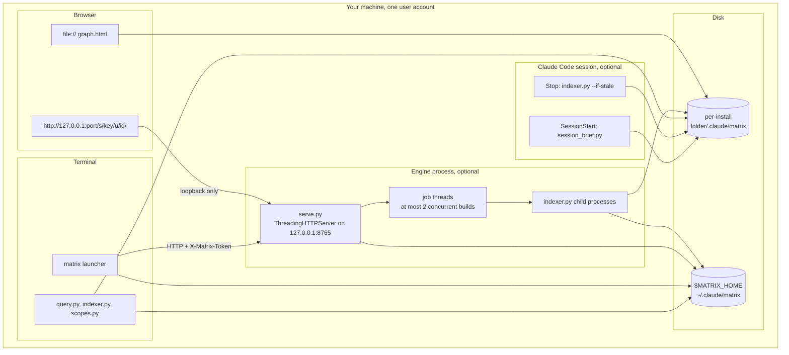
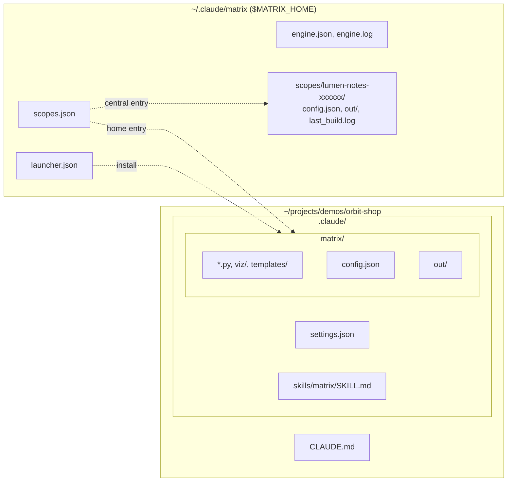
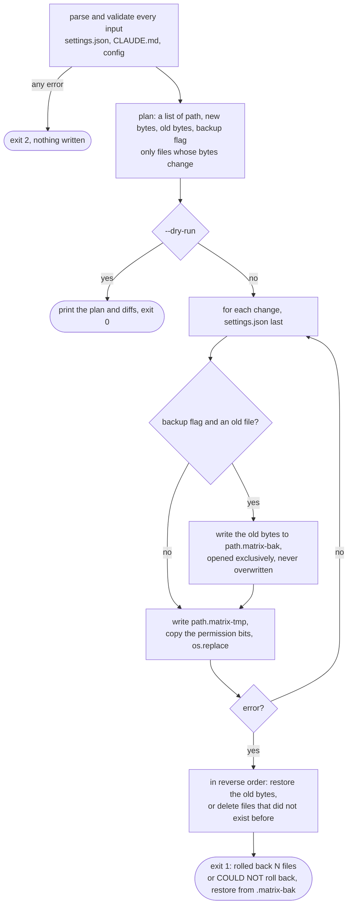
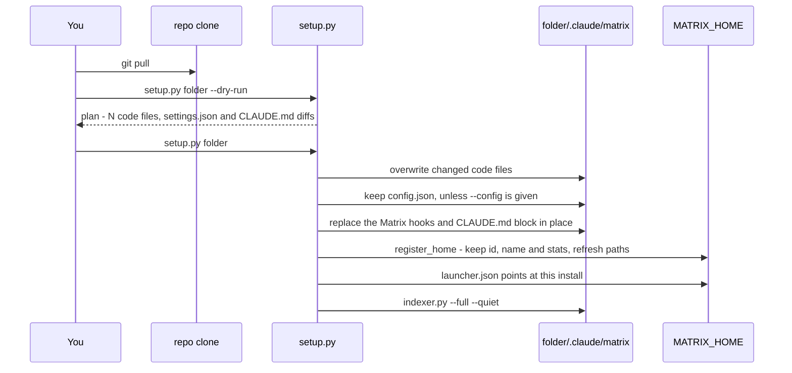

# Infrastructure

Matrix deploys onto a single machine, for a single user. It has no daemon that must stay up, no database server,
no container and no network dependency. This document covers what runs, where its files live, and what the limits
are.

**Contents**

- [Deployment topology](#deployment-topology)
- [Processes and ports](#processes-and-ports)
- [Files on disk](#files-on-disk)
- [Logs](#logs)
- [Caps and timeouts](#caps-and-timeouts)
- [Backups and rollback in setup.py](#backups-and-rollback-in-setuppy)
- [Upgrade path](#upgrade-path)
- [Cross-platform notes](#cross-platform-notes)
- [Resources and performance](#resources-and-performance)

---

## Deployment topology

Nothing listens on a network interface other than loopback, and nothing is fetched from the internet at build time
or view time.

---

## Processes and ports

| Process | Started by | Lifetime | Network |
|---|---|---|---|
| `session_brief.py` | the Claude Code SessionStart hook | under a second, 30 s timeout | none |
| `indexer.py` | the Stop hook (180 s timeout), `setup.py`, the engine, `matrix build`, `scopes.py build`, you | one build | none |
| `viz.py` | `indexer.py`, as an in-process import, or you | part of a build | none |
| `query.py` | you, assistants | one query | none |
| `serve.py` | `matrix` (detached, windowless on Windows) or you | until `matrix stop`, `Ctrl+C` or `POST /api/shutdown` | listens on `127.0.0.1:<port>` |
| `matrix.py` | the `matrix` / `matrix.cmd` scripts | one command | client of `127.0.0.1:<port>` |
| Browser | you | open tab | `file://`, or loopback to the engine |

**Ports.** The engine tries `8765`, or the `--port` you give. If that port is taken, it binds port `0` and lets the
OS choose a free one. The chosen port is recorded in `engine.json`, so `matrix` always finds it. Only one engine is
meant to run per user: `matrix` reuses a live one rather than starting a second.

---

## Files on disk

### Per install: `<folder>/.claude/matrix/` and friends

| Path | Written by | Purpose |
|---|---|---|
| `<folder>/.claude/matrix/*.py`, `viz/`, `templates/` | `setup.py` | The code (a copy of the repo's `matrix/` folder). |
| `<folder>/.claude/matrix/config.json` | `setup.py` | The install's config. |
| `<folder>/.claude/matrix/out/graph.json` | `indexer.py` | The graph. |
| `.../out/cache.json` | `indexer.py` | The incremental parse cache. |
| `.../out/search.db` | `indexer.py` via `search.py` | The FTS5 search index. |
| `.../out/GRAPH_REPORT.md`, `INDEX.md`, `wiki/*.md` | `indexer.py` | The report and wiki. |
| `.../out/graph.html` | `viz.py` | The universe page. |
| `.../out/last_build.log` | `serve.py` | The log of the last engine build of this home universe. |
| `<folder>/.claude/settings.json` | `setup.py` | The two Matrix hooks, merged with yours. |
| `<folder>/.claude/skills/matrix/SKILL.md` | `setup.py` | The `/matrix` skill. |
| `<folder>/CLAUDE.md` | `setup.py` | The marked Matrix block, merged with your text. |
| `*.matrix-bak`, `*.matrix-bak.<timestamp>` | `setup.py` | Backups of each changed `settings.json`, `CLAUDE.md` and `config.json`. |

### Per user: `$MATRIX_HOME`

`MATRIX_HOME` is the environment variable, or `~/.claude/matrix` (on Windows, `%USERPROFILE%\.claude\matrix`).

| Path | Written by | Purpose |
|---|---|---|
| `scopes.json` | `scopes.py` (via setup, the engine, `matrix`, the indexer) | The universe registry. |
| `scopes.json.lock` | `scopes.py` | A transient cross-process write lock. |
| `scopes/<id>/config.json` | `scopes.py` | A central universe's generated config. |
| `scopes/<id>/out/` | `indexer.py` | A central universe's graph, cache, search index, wiki and page. |
| `scopes/<id>/last_build.log` | `serve.py` | That universe's last build log. |
| `launcher.json` | `setup.py` | Which install and interpreter `matrix` runs. |
| `launcher/matrix_entry.py` | `setup.py` | The stable entry point the launcher scripts run. |
| `engine.json` | `serve.py` | The running engine: pid, port, URL, token, install, interpreter, start time. |
| `engine.log` | `matrix.py` | The stdout and stderr of engines started by `matrix`, appended. |

### Launcher scripts

| OS | Files | Folder |
|---|---|---|
| Windows | `matrix.cmd` and `matrix` (a `sh` script, for Git Bash) | `~/.local/bin` if it is on `PATH`, else `%LOCALAPPDATA%\Programs\matrix\bin` |
| Linux, macOS | `matrix` (`sh`, mode `0755`) | `~/.local/bin` |

Pass `--launcher-dir` to setup to choose another folder.

---

## Logs

| Log | Location | Contents | Retention |
|---|---|---|---|
| Hook output | Claude Code's hook output | The brief, and the Stop hook's one summary line or error. | Per session |
| Engine log | `$MATRIX_HOME/engine.log` (when started by `matrix`), else the engine's stderr | Time-stamped state changes: jobs started and ended, shutdown, errors, and failing requests. It never contains the page key; `--verbose` adds every request. | Appended. Delete it whenever you like. |
| Build log | a home universe's `out/last_build.log`, or `$MATRIX_HOME/scopes/<id>/last_build.log` | The full indexer output of the last engine build, with a header and a footer. | Replaced by the next build |
| Job log | engine memory | The last 2,000 lines of each job. | The 50 most recent ended jobs |
| Parse errors | `GRAPH_REPORT.md`, "Parse errors" | Files that did not parse cleanly. | Rewritten every build |
| Page status | The hidden `<output id="mxstatus">` element in the page, and one `MXSTATUS {...}` console line | JSON: errors, warnings, renderer, camera, filters, layout, self-test results. | Live |

---

## Caps and timeouts

| What | Value | Where | Effect |
|---|---|---|---|
| `max_files` | 60,000 (`0` = no cap) | config | A build from scratch with more files is refused (exit 3) unless `--force`. |
| `max_file_bytes` | 2,000,000 | config | Larger files become `dataset` nodes, unread. |
| Notebook text for cross-reference | 200,000 characters | `indexer.py` | Truncated beyond that. |
| Body text | doc 2,000, claim 600, concept 400 characters; 280 in the page | `indexer.py`, `viz.py` | Search and inspector text. |
| Ambiguous fan-out | calls 4, links and ADF refs 3, mentions 3 | `indexer.py` | Candidates kept per reference. |
| Label propagation | 12 rounds | `indexer.py` | Stops early when stable. |
| Preflight | 5 s, or just past `max_files` | `scopes.py` | The counts become lower bounds (`partial`). |
| Preflight warning | 50,000 files or 5 GiB | `scopes.py` | Shows the "Large folder" warning. Does not block. |
| Registry lock | 15 s wait (3 s for stats); stale after 30 s | `scopes.py` | `registry is locked` error. |
| Concurrent builds | 2 | `serve.py` | Further builds wait as `queued`. |
| Build timeout | 4 h | `serve.py` | The process tree is killed and the job fails. |
| Job log in memory | 2,000 lines | `serve.py` | The full log is in `last_build.log`. |
| Ended jobs kept | 50 | `serve.py` | Older ones are forgotten. |
| Request body | 64 KB | `serve.py` | `413`. |
| Socket timeout | 60 s | `serve.py` | Idle connections are closed. |
| `/api/fs` entries | 5,000 | `serve.py` | `truncated: true`. |
| Log tail | 1 to 5,000 lines, default 500 | `serve.py` | `GET /api/scopes/<id>/log`. |
| Engine start wait | 25 s | `matrix.py` | Then `matrix` shows the last 8 lines of `engine.log`. |
| Engine stop wait | 15 s | `matrix.py` | Then it tells you to end the process yourself. |
| Liveness probe | 3 s | `matrix.py` | A record that does not answer is stale. |
| Hook timeouts | SessionStart 30 s, Stop 180 s | `settings.json` | Enforced by Claude Code. |
| Universe payload | 120,000 bytes | `viz.py` | Printed to stderr. |
| Page size warning | 3.8 MB | `viz.py` | Printed to stderr. |
| Search index swap | 3 tries, 0.2 s apart | `search.py` | Keeps the old file, which readers see as stale. |
| Self-test timeout | 5 s per test (some 10 to 12 s) | `state.js` | The test fails with `timeout`. |

---

## Backups and rollback in setup.py

- Backups are taken only for `settings.json`, `CLAUDE.md` and `config.json`, and only when they change. Code files
  are not backed up, because they are Matrix's own.
- If `X.matrix-bak` already exists, the backup goes to `X.matrix-bak.<YYYYmmdd-HHMMSS>`, and then
  `...-1`, `...-2` and so on. A backup is never overwritten.
- Files are written as bytes. Setup keeps each file's BOM, line endings and JSON indent, and leaves the rest of
  `CLAUDE.md` byte for byte.
- Interrupting setup with `Ctrl+C` also rolls back.

---

## Upgrade path

- **Cache invalidation is automatic.** When an extractor's output changes shape, `CACHE_V` is bumped and old cache
  entries are re-parsed. The setup build is `--full` in any case.
- **Pages are regenerated** on every build, so `graph.html` always matches the installed code. A page from an
  older Matrix that has no `MX_SCOPES` still opens. Its Multiverse window explains that the page predates the
  Multiverse and offers the engine command.
- **Moving an install:** run setup at the new location with `--migrate-from <old>/.claude/matrix`. It removes the
  hooks that ran the old copy.
- **Several installs:** each folder you run setup on gets its own copy. `launcher.json` follows the most recent
  setup, and the engine always builds a home universe with that universe's own install and interpreter.

---

## Cross-platform notes

| Concern | Windows | Linux / macOS |
|---|---|---|
| Install folder | `<folder>\.claude\matrix` | `<folder>/.claude/matrix` |
| `MATRIX_HOME` default | `%USERPROFILE%\.claude\matrix` | `~/.claude/matrix` |
| Paths in JSON | Forward slashes, resolved to their long names (`realpath`), so 8.3 names compare equal. | Forward slashes |
| Folder links | NTFS junctions and symlinks are skipped (`os.path.isjunction` where available, `DirEntry.is_junction`). | Symlinks are skipped. |
| Detached engine | `pythonw.exe` next to the interpreter, with `DETACHED_PROCESS` and `CREATE_NEW_PROCESS_GROUP`. | `start_new_session=True` |
| Build children | `CREATE_NO_WINDOW`, killed with `taskkill /T /F`. | A new session, killed with `SIGTERM` then `SIGKILL` to the group. |
| Liveness | `OpenProcess` and `GetExitCodeProcess` (`os.kill(pid, 0)` would terminate the process). | `os.kill(pid, 0)` |
| Socket | `SO_EXCLUSIVEADDRUSE` | default (no `SO_REUSEADDR`) |
| File replace | Retries `PermissionError` while another process holds the file. | Atomic `os.replace` |
| `engine.json` privacy | Profile ACLs | Mode `0600` |
| Drive roots | `C:` alone means `C:\`. Drive letters are listed with `os.listdrives` or a probe. | `/` |
| Whole-drive ignores | `Windows`, `Program Files`, `ProgramData`, `AppData`, ... | `proc`, `sys`, `dev`, `usr`, `Library`, `Volumes`, ... |
| UNC | Refused unless `--allow-unc` | n/a (`//host` paths are also refused) |
| Console encoding | Output is reconfigured with `errors="replace"` (and `utf-8` for `query.py`), so cp1252 consoles never crash. | UTF-8 |
| Templates | `\` paths as written | `\` is rewritten to `/` when the templates are rendered |

---

## Resources and performance

| Stage | Cost | Notes |
|---|---|---|
| Discovery | O(files walked) | Pruned by ignores; the stale check walks it too. |
| Hashing | O(bytes of parseable files) | SHA-256 in 64 KB chunks. Data files are not hashed. |
| Parsing | O(changed files) | Cached by digest. |
| Resolution | O(pending references) | Dictionary lookups by label. |
| Cross-reference | O(documents × target labels) | A substring pre-check, then a word-boundary regex. **This dominates on doc-heavy whole-drive roots.** |
| Communities | O(rounds × edges) | 12 rounds at most. |
| Report and wiki | O(communities × members) | The wiki's per-node edge lookup scans the edge list. |
| Search build | O(nodes + edges) | SQLite does the work, then `optimize` and `VACUUM`. |
| `graph.json` | Pretty-printed (`indent=1`) | Easy to diff. Read it with `query.py`, not by hand. |

**Memory.** The indexer holds the whole graph and every document's text in memory during a build. The page holds
the payload as typed arrays: CSR adjacency, `Float32Array` positions and `Uint8Array` visibility masks.

**Page performance budget:**

- One `requestAnimationFrame` loop, which runs only while something is dirty or animating. The U0 overview twinkles
  on a 30 fps timer.
- Device pixel ratio capped at 2. The Canvas2D fallback mesh draws at DPR 1.
- Labels capped at `min(36, max(4, W·H / 52,000))`, plus up to 44 forced labels. Placement is reused while panning.
- The nebula texture is 1,024 px (768 in near mode), recomposed only on drift, at most every 250 ms.
- The minimap redraws at most 15 times a second, and only while the camera moves. It stops after 1 s still.
- The client search index is built when the page goes idle, unless the URL already carries `#q=`.
- Universe layout is closed form, so there is no force simulation to wait for. Repacks tween over 300 ms.

**Practical sizes.** A project or a source tree of a few thousand files builds in seconds and gives a page well
under the 3.8 MB warning. The `max_files` default of 60,000 is where a build becomes slow, and the graph too dense
to read; that is why it is the cap.
