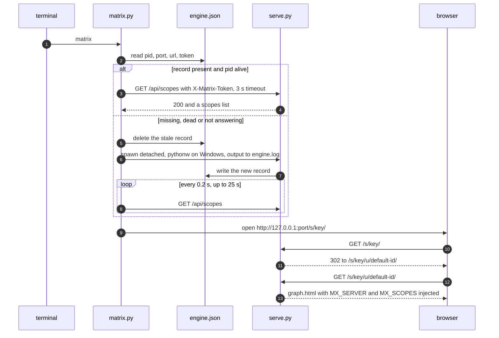
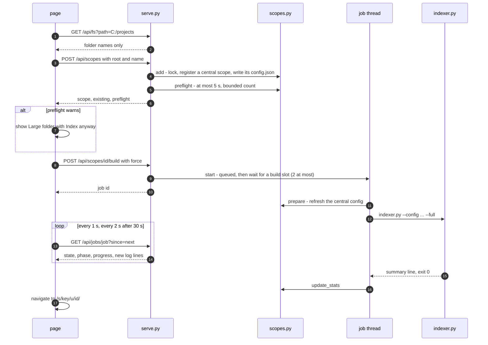
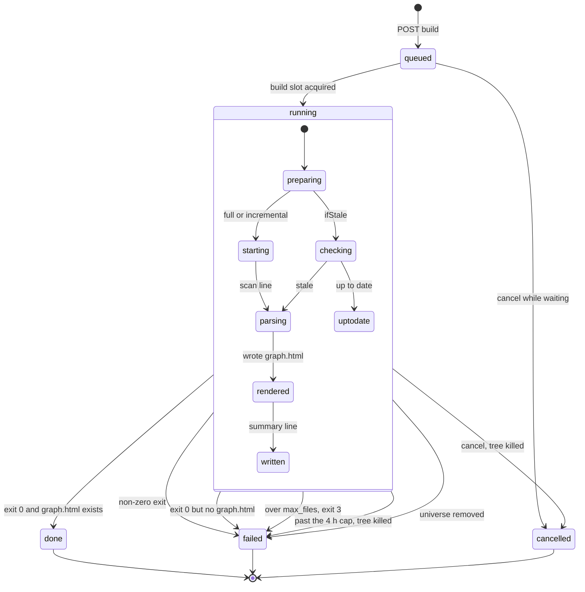
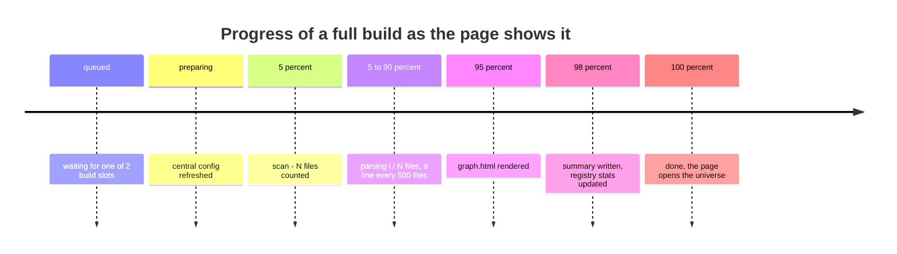
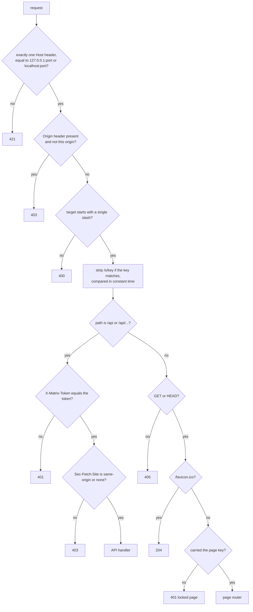
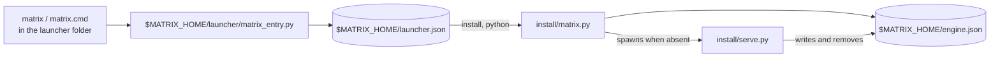
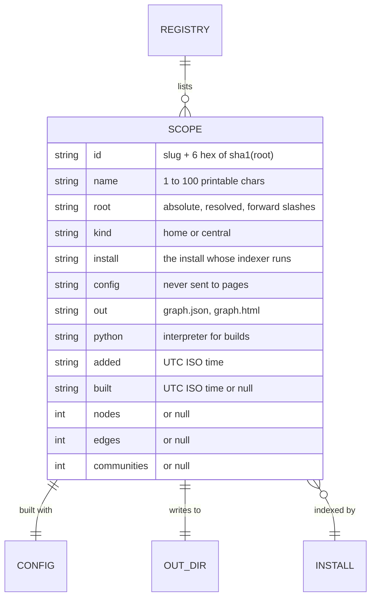
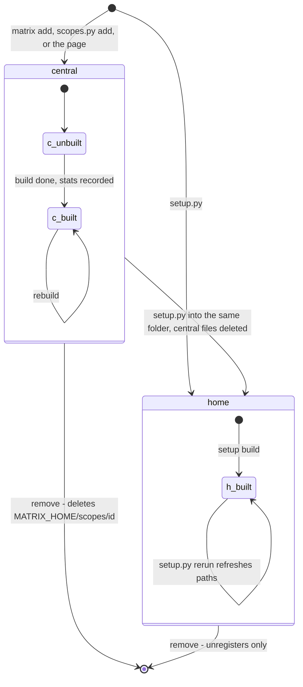
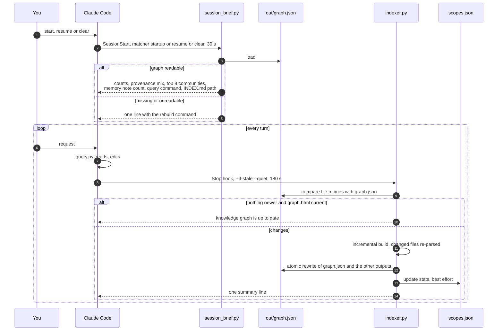

# Services

Matrix has three long-lived pieces besides the build itself:

- **The Multiverse engine** (`serve.py`): a localhost HTTP server that serves universes and runs builds as jobs.
- **The launcher** (`matrix.py`, installed as `matrix`): finds or starts the engine, and drives it from the terminal.
- **The registry** (`scopes.py`, `$MATRIX_HOME/scopes.json`): your list of universes.

This document also covers the **Claude Code hooks lifecycle**, the other place Matrix runs without being asked.

**Contents**

- [The Multiverse engine](#the-multiverse-engine)
- [HTTP API reference](#http-api-reference)
- [Request sequences](#request-sequences)
- [Build jobs](#build-jobs)
- [Security model](#security-model)
- [The launcher](#the-launcher)
- [The registry](#the-registry)
- [Hooks lifecycle](#hooks-lifecycle)

---

## The Multiverse engine

```text
python serve.py [--port 8765] [--open] [--scope <id>] [--verbose] [--allow-unc]
```

| Flag | Default | Meaning |
|---|---|---|
| `--port` | `8765` | The port to try. If it is taken, the OS picks a free one. |
| `--open` | off | Open the start link in the default browser. |
| `--scope <id>` | none | The universe to open first. It must exist (exit 2 otherwise). |
| `--verbose` | off | Log every request. By default only state changes, errors and non-GET requests are logged. |
| `--allow-unc` | off | Allow `\\server\share` roots and browsing. Windows sends your credentials to that host. |

At start-up the engine:

1. Binds a `ThreadingHTTPServer` to `127.0.0.1`. On Windows it sets `SO_EXCLUSIVEADDRUSE`, and it never sets
   `SO_REUSEADDR`, so no other process can steal the port. It also skips the reverse-DNS lookup.
2. Generates a fresh **API token** (`secrets.token_urlsafe(32)`) and a separate **page key**
   (`secrets.token_urlsafe(18)`).
3. Writes `$MATRIX_HOME/engine.json` atomically (mode `0600` on POSIX).
4. Prints `open: http://127.0.0.1:<port>/s/<key>/`.

On `Ctrl+C` or `POST /api/shutdown`, it kills every running build tree, closes the socket, and deletes
`engine.json` if the file still names its own pid.

### Pages

Every page lives under the per-run secret path `/s/<key>/`.

| Path (after `/s/<key>`) | Response |
|---|---|
| `` (no slash) | `302` to `/s/<key>/` |
| `/` | `302` to `/u/<default>/`. The default is `--scope`, else this install's home universe, else any home universe, else the first one. With no universes, the landing page. |
| `/new` | The landing page: a list of universes, the **New universe** form with its folder browser, and build progress. |
| `/u/<id>` | `301` to `/u/<id>/` |
| `/u/<id>/` or `/u/<id>/graph.html` | That universe's `graph.html`, with `window.MX_SERVER = {token, base, current}` and a fresh `MX_SCOPES` (including `building` flags) injected before `</head>`. If it is not built yet, a `404` page offering **Build**. |
| `/c/<id>,<id>[,...]/` | Two or more built universes on one page (`combine.py`): each universe is a top-level cluster, names they share (modules, classes, functions, tables, views, datasets, pipelines, URLs) are joined by `SHARED` edges tagged `INFERRED`, and related universes are seated together, unrelated ones apart. `404` if one is unknown or not built, or the graphs together pass 300 MB. |
| `/u/<id>/<file>` | A file inside that universe's `out/`, such as `GRAPH_REPORT.md` or `wiki/orders.md`. `.md` and `.log` files are served as `text/plain`. |

| Path without the key | Response |
|---|---|
| `/favicon.ico` | `204` |
| Any other page | `401` with "open the start link". Old links stop working after a restart. |

The landing page, the unbuilt page and error pages are server-rendered, self-contained hairline pages, with the
galaxy mark drawn as an inline SVG. They load no external resources.

---

## HTTP API reference

The API is served at `/api/...`, and also at `/s/<key>/api/...`, which is the form the pages use. Every call needs
the header `X-Matrix-Token: <token>`. Request bodies are JSON objects, sent with `Content-Length`, of at most
64 KB. Every response is JSON. Errors are `{"error": "<message>"}`.

| Method | Path | Body | Response `200` | Errors |
|---|---|---|---|---|
| `GET` | `/api/scopes` | | `{"current": id\|null, "scopes": [scope + "building": bool]}` | `500` if the registry is unreadable |
| `POST` | `/api/scopes` | `{"root": "<abs path>", "name"?: "..."}` | `{"scope": {...}, "existing": bool, "preflight": {"files", "bytes", "warn", "cap", "partial", "over"}}` | `400`: not absolute, no such folder, UNC refused, bad name |
| `PATCH` | `/api/scopes/<id>` | `{"name": "..."}` | `{"scope": {...}}` | `400` bad name, `404` |
| `DELETE` | `/api/scopes/<id>` | | `{"removed": id, "scope": {...}}` | `404`; `409` while it builds |
| `POST` | `/api/scopes/<id>/build` | `{"ifStale"?: bool, "force"?: bool, "full"?: bool}` (`full` defaults to true) | `{"job": "<job id>"}`. Returns the live job if one is already queued or running. | `404` |
| `POST` | `/api/scopes/<id>/cancel` | | `{"cancelled": bool, "job": id\|null}` | |
| `GET` | `/api/scopes/<id>/log?tail=N` | | `{"log": [lines], "built": iso\|null}`. `tail` is 1 to 5000, default 500. | `400` bad tail, `404` |
| `GET` | `/api/jobs/<job>?since=N` | | `{"state", "phase", "progress", "started", "ended", "over", "graph", "log", "next", "scope"}` | `400` bad since, `404` |
| `POST` | `/api/jobs/<job>/cancel` | | `{"cancelled": bool, "job": id}` | `404` |
| `GET` | `/api/fs?path=<dir>` | | `{"path", "parent", "dirs": [name \| {"name", "hidden": true}], "truncated"?}` | `400` not absolute, UNC or NUL; `403` access denied; `404` no such folder |
| `POST` | `/api/shutdown` | | `{"stopping": true}` | `405` for any other method |

Notes:

- **`/api/fs`** returns directory names only: never files, never contents. With no `path` it lists the drive roots
  on Windows (excluding UNC), or `/` and your home folder elsewhere. Hidden folders (a leading dot, or the Windows
  hidden or system attribute) are flagged. At most 5,000 names are returned.
- **`since` on job polls.** Without `since`, the response carries the last 20 log lines. With `since=N`, it carries
  every line from index `N` that is still in memory. `next` is the index to send on the next poll.
- **Scope ids** must match `[a-z0-9][a-z0-9-]{0,80}`. Anything else is a `404`.

### Status codes

| Code | When |
|---|---|
| `400` | A malformed body, query or path. |
| `401` | A missing or wrong `X-Matrix-Token`, or a page outside `/s/<key>/`. |
| `403` | A cross-origin `Origin`, a `Sec-Fetch-Site` of `cross-site` or `same-site`, or folder access denied. |
| `404` | An unknown universe, job, endpoint or file, or a universe that is not built yet. |
| `405` | A method that is not allowed, including any non-GET page request and `OPTIONS`. There is no CORS, ever. |
| `409` | Removing a universe while it builds. |
| `411` | A `Transfer-Encoding` body. Send `Content-Length`. |
| `413` | A body over 64 KB. |
| `421` | A `Host` header that is not exactly `127.0.0.1:<port>` or `localhost:<port>`, or more than one `Host` header. |
| `500` | An unreadable registry, or an internal error. Tracebacks never reach the client. |

---

## Request sequences

### `matrix` opens the Multiverse



### Adding and building a universe from the page



---

## Build jobs

Each build runs in its own daemon thread as a child process. At most **one live job per universe** and at most
**2 builds at a time** across all universes; further builds wait in the `queued` state.



The engine parses the indexer's output to set the phase and progress:

| Indexer line | Phase | Progress |
|---|---|---|
| (job created) | `queued` | none |
| (slot acquired) | `preparing`, then `starting` or `checking` | none |
| `scan: N files` | `parsing N files` | 0.05 |
| `progress: i/N` | `parsing i / N files` | 0.05 + 0.85 × i/N |
| `... up to date` | `up to date` | |
| `wrote ... graph.html` | `rendered` | 0.95 |
| `knowledge graph: N nodes, ...` | `written` | 0.98 |
| (exit 0, page present) | `done`, or `up to date` | 1.0 |



| Property | Value |
|---|---|
| Log lines kept in memory per job | 2,000. The full log is in `last_build.log`. |
| Ended jobs kept | The 50 most recent. |
| Build timeout | 4 h. Then the whole process tree is killed and the phase is `failed: over 4 h, stopped`. |
| Process tree kill | Windows: `taskkill /T /F /PID`. POSIX: `SIGTERM` to the process group, then `SIGKILL` after 3 s. |
| Child environment | `PYTHONIOENCODING=utf-8`, `PYTHONUNBUFFERED=1`, `MATRIX_HOME` set; `CREATE_NO_WINDOW` on Windows; a new session on POSIX. |
| Interpreter and indexer | A home universe uses its own install's `indexer.py` and recorded interpreter, the same pair its hooks run. A central universe uses the engine's install. |
| Build log | `last_build.log`: a home universe's `out/`, or `$MATRIX_HOME/scopes/<id>/`. Starts with `# Matrix build of <id> (<root>) started <time>` and the command line, and ends with `# <state>: <phase> at <time>`. |

A cancelled or failed build leaves the last good `graph.html` untouched, because the indexer only ever swaps in
complete files.

---

## Security model

### Threat model

The engine runs on a developer machine where the browser also visits untrusted websites, and where other local
servers may share `127.0.0.1`. It can read folder names, start builds and delete registry entries, so it must be
reachable **only** by pages it served itself and by the user's own `matrix` command.

| Threat | Mitigation |
|---|---|
| A remote attacker on the network | Binds `127.0.0.1` only. There is no remote mode. |
| A malicious website sends requests to `127.0.0.1:8765` (CSRF) | `/api/*` needs `X-Matrix-Token`. A custom header cannot be sent cross-origin without a CORS preflight, and the engine never answers CORS. `Origin` must equal the engine's own origin, and `Sec-Fetch-Site` must be `same-origin` or `none`. |
| DNS rebinding (`evil.example` resolving to `127.0.0.1`) | The `Host` header must be exactly `127.0.0.1:<port>` or `localhost:<port>`, otherwise `421`. |
| Another local server on a different port reads Matrix data | No cookies at all, because browsers share cookies across ports. The token is delivered only inside pages under the secret `/s/<key>/` path, and a new key and token are generated on every run. |
| Guessing or replaying an old link | The page key is 18 random bytes, and it is never written to the request log. Old keys die with the process. |
| Clickjacking or embedding | `X-Frame-Options: DENY` and CSP `frame-ancestors 'none'`. |
| Path traversal through `/u/<id>/<file>` | No `\`, `:`, NUL, empty, `.` or `..` segments. `realpath` containment inside that universe's `out/`. Files only, no directory listings. A central universe's `out` is derived from its validated id, never read from the registry. |
| Folder snooping through `/api/fs` | Directory names only. Absolute paths only. At most 5,000 entries. |
| Credential leaks through UNC paths (NTLM) | `\\server\share`, `//server/share` and `\\?\` paths are refused in add and browse unless `--allow-unc` is given. Mapped drive letters are fine. |
| Loops or escapes through links | Symlinks and NTFS junctions are never followed by the indexer or the preflight. |
| Deleting outside `$MATRIX_HOME` | Removing a central universe deletes only `$MATRIX_HOME/scopes/<id>`, after proving it is a direct child, with a strict id regex and `realpath`. A home install is never deleted. |
| Script injection through names and paths | All page text goes through one escaper. Embedded JSON escapes `<`, `/`, U+2028 and U+2029. |
| Timing attacks on the token or key | `hmac.compare_digest`. |
| Leaking internals | Tracebacks are never returned. Errors are JSON messages, and the `Server` header is just `Matrix`. |
| Port stealing on Windows | `SO_EXCLUSIVEADDRUSE`, and no `SO_REUSEADDR`. |
| Oversized or streamed bodies | Bodies over 64 KB get `413`. `Transfer-Encoding` gets `411`. The socket timeout is 60 s. |

### Request checks



### Response headers

Every response carries:

```text
Cache-Control: no-store
X-Content-Type-Options: nosniff
Referrer-Policy: no-referrer
X-Frame-Options: DENY
```

HTML pages and static files also carry this Content Security Policy:

```text
Content-Security-Policy: frame-ancestors 'none'; connect-src 'self'; object-src 'none'; base-uri 'none'; form-action 'none'
```

`connect-src 'self'` means a served page can only talk to its own engine. The page itself is already offline: it
loads no scripts, styles or fonts from anywhere. Server-rendered pages also set `<meta name="referrer" content="no-referrer">`
and an empty icon.

### What the engine can see

The engine reads the registry, your folder *names* (when you browse), and the files in each universe's `out/`. It
never reads or serves the contents of an indexed folder; only the indexer, running as you, does that.

---

## The launcher

### Files



**`launcher.json`** is written by `setup.py`, and the most recent setup wins:

```json
{
  "python": "C:\\Python312\\python.exe",
  "install": "C:\\projects\\demos\\orbit-shop\\.claude\\matrix",
  "registered": "2026-10-30T12:00:00"
}
```

**`engine.json`** is written by `serve.py` and removed on a clean shutdown:

```json
{
  "pid": 12345,
  "port": 8765,
  "url": "http://127.0.0.1:8765/s/<page key>/",
  "token": "<api token>",
  "install": "C:/projects/demos/orbit-shop/.claude/matrix",
  "python": "C:/Python312/python.exe",
  "started": "2026-10-30T12:00:05Z"
}
```

The values above are examples. `engine.json` holds the token, so it is created `0600` on POSIX; on Windows the user
profile's ACLs already keep it private. A record is considered **live** only if its pid is alive and it answers a
token-authenticated `GET /api/scopes` within 3 s. Otherwise `matrix` deletes it as stale. On Windows, liveness is
checked with `OpenProcess` and `GetExitCodeProcess` rather than `os.kill(pid, 0)`, which would terminate the process
there.

`matrix_entry.py` runs `matrix.py` with the recorded interpreter. If that interpreter is missing it falls back to the
current one, and if the install has moved it prints a "rerun setup.py" message.

---

## The registry

### File and schema

`$MATRIX_HOME/scopes.json`, where `MATRIX_HOME` is the environment variable or `~/.claude/matrix`:

```json
{
  "version": 1,
  "scopes": [
    {
      "id": "orbit-shop-3f9a1c",
      "name": "orbit-shop",
      "root": "C:/projects/demos/orbit-shop",
      "kind": "home",
      "install": "C:/projects/demos/orbit-shop/.claude/matrix",
      "config": "C:/projects/demos/orbit-shop/.claude/matrix/config.json",
      "out": "C:/projects/demos/orbit-shop/.claude/matrix/out",
      "python": "C:/Python312/python.exe",
      "added": "2026-10-30T12:00:00Z",
      "built": "2026-10-30T12:00:40Z",
      "nodes": 1873, "edges": 6120, "communities": 41
    },
    {
      "id": "lumen-notes-a07b52",
      "name": "lumen-notes",
      "root": "C:/projects/demos/lumen-notes",
      "kind": "central",
      "install": "C:/projects/demos/orbit-shop/.claude/matrix",
      "config": "C:/Users/you/.claude/matrix/scopes/lumen-notes-a07b52/config.json",
      "out": "C:/Users/you/.claude/matrix/scopes/lumen-notes-a07b52/out",
      "python": "C:/Python312/python.exe",
      "added": "2026-10-30T12:05:00Z",
      "built": null, "nodes": null, "edges": null, "communities": null
    }
  ]
}
```

The ids, hashes and counts above are examples.



| Rule | Detail |
|---|---|
| Id | `slug(name)[:40] + "-" + sha1(normcase(realpath(root)))[:6]`. If that collides, 12 hex characters are used. The id is stable for a root. |
| One entry per folder | Roots are compared by `normcase(realpath(...))`, so every spelling of a folder (case, 8.3 names, `..`) is the same universe. Adding it again returns the existing entry. |
| Public view | `config` is never sent to a page or an API client. |
| Writes | Read-modify-write under `scopes.json.lock`, created with `O_CREAT \| O_EXCL`. A lock older than 30 s is broken. Writers wait up to 15 s (3 s for build-stat updates). Writes go to a temp file, are `fsync`ed, and are swapped in with `os.replace`, retrying briefly on Windows sharing violations. Readers never take the lock. |
| Unreadable file | CLI commands fail with an error naming the file ("fix or delete it"). The API returns `500`; a freshly rendered page embeds an empty list. |

### Lifecycle



A **central** universe's `config.json` is regenerated before every build, so installs registered later are ignored
too:

```json
{
  "title": "lumen-notes",
  "roots": ["C:/projects/demos/lumen-notes"],
  "ignore_dirs": [".venv", "venv", "...the defaults...", "$RECYCLE.BIN", "System Volume Information"],
  "ignore_paths": ["<MATRIX_HOME>", "<this install>", "<every home install>"],
  "out_dir": "out"
}
```

For a whole-drive root, `ignore_paths` also lists the OS and program folders, and `ignore_dirs` gains `AppData`. See
[GUIDE.md](GUIDE.md#add-build-and-switch).

`indexer.py` records `built`, `nodes`, `edges` and `communities` on the universe whose `out` is its own out folder.
This is best effort: it never creates the registry and never fails a build. The engine records them again from the
summary line, for indexers that predate this.

---

## Hooks lifecycle



Both hooks run with the interpreter recorded at setup, and use the install's own `config.json`. Neither ever blocks
a session: the brief catches every error, and an over-cap or failing build only prints to the hook output.
