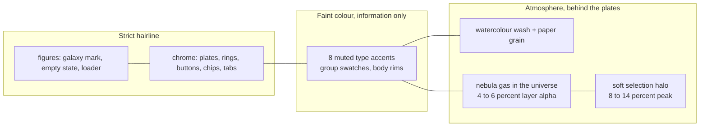
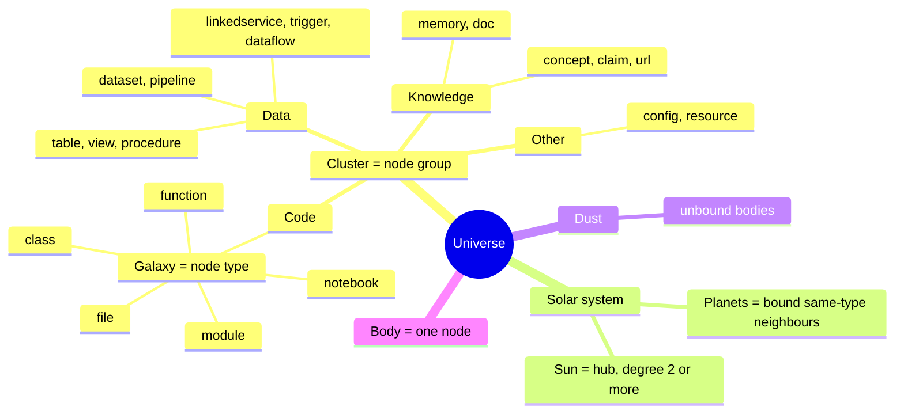
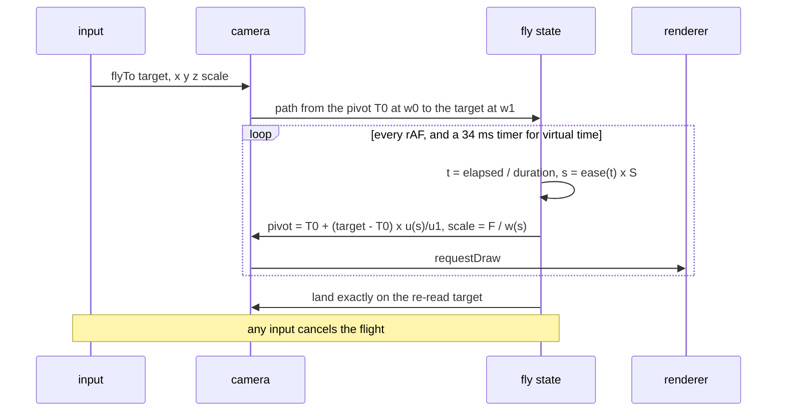
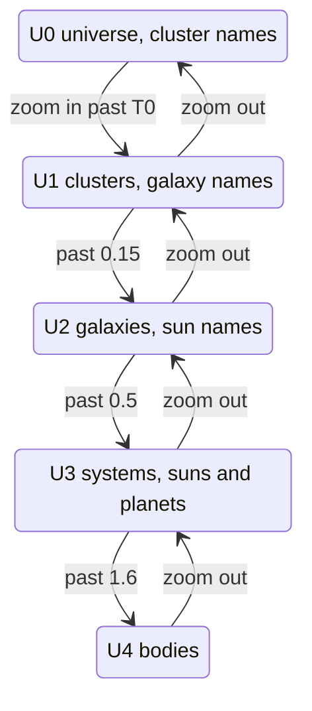

# UI principles

The universe UI is drawn in the **hairline** design language ([github.com/lucasmarkes/hairline](https://github.com/lucasmarkes/hairline),
MIT). Hairline draws rounded solids in a single stroke, in four weights, with one bright stroke as the only
highlight. Matrix follows those rules in its chrome and figures, and bends three of them on purpose, in places where
a knowledge graph needs more than a line drawing. This document records the rules, the bends, and the numbers behind
them, so that changes stay consistent.

**Contents**

- [The hairline rules Matrix keeps](#the-hairline-rules-matrix-keeps)
- [How Matrix bends them](#how-matrix-bends-them)
- [Colour and theme tokens](#colour-and-theme-tokens)
- [Typography](#typography)
- [The universe metaphor](#the-universe-metaphor)
- [Camera model](#camera-model)
- [Fly-to math](#fly-to-math)
- [LOD label bands](#lod-label-bands)
- [Selection and declutter rules](#selection-and-declutter-rules)
- [Motion](#motion)
- [Accessibility](#accessibility)
- [Performance budget](#performance-budget)

---

## The hairline rules Matrix keeps

| Hairline rule | In Matrix |
|---|---|
| **The stroke is the only highlight.** No fills, glows or shadows on a figure; the active edge goes from the silhouette stroke to the bright one. | Selection, search hits, focus rings and the path all use `--line-hi`, the single bright ink, and never a hue. Chips show their pressed state with a bright stroke. |
| **Bright outside, dim inside.** The silhouette is drawn in the edge weight, and the inner crease is one dim line. | Bodies are 1 px rims with a faint interior, never filled discs. Plates have a 1 px ring outside and dim rules inside. |
| **Honest construction: opaque plates.** Plates are filled with the ground colour, and guides sit behind the plate they belong to. | Panels, cards and figure tiles are opaque `--surface` plates. The watercolour wash sits *behind* the plates, never under a figure. |
| **One stroke in four weights.** | `--line-hi`, `--line-edge`, `--line-mid`, `--line-lo`, at a 0.9 px stroke in figures. |
| **Motion: 700 ms on `cubic-bezier(.32,.72,0,1)`** for discrete changes, springs for continuous ones. Nothing linear. | `--ease` and `--dur: 700ms`. Fly-to, the 2D/3D turn and the panel slides all use the lift curve. Dragged systems spring back. |
| **Reduced motion lands everything at once.** | Every duration token collapses to `0ms`, and flights become instant. See [Motion](#motion). |
| **Focus: a 1.5 px solid outline at a 2 px offset.** | `:focus-visible { outline: 1.5px solid var(--focus); outline-offset: 2px }` |

The hairline figure kernel is inlined verbatim in `viz/hairline.js`, with its MIT notice. Matrix draws three things
with it: the **galaxy** mark in the header, a larger galaxy as the inspector's empty state, and **nexus** on the
"Layout settling" loading card. The engine's server-rendered pages redraw the galaxy as a static SVG in Python
(`serve.py` `galaxy_svg`) from the same geometry: a 2:1 isometric view, a dim disc with dashed orbits, two tapered
spiral arms carrying round tiles, and a stepped core with one bright dot.

---

## How Matrix bends them

1. **Faint colour as information.** Hairline is monochrome. A graph with four node groups needs some way to tell
   them apart, so Matrix uses **eight muted accents**, each at least 3:1 against both backgrounds. Four of them are
   group inks. They appear on body rims, type swatches and the inspector's accent, and nowhere else. A colour always
   *means* something. The exact type is never carried by colour alone: it is also in the inspector, the legend and
   the tables.
2. **Watercolour washes.** Behind every plate there are four large, off-centre, half-desaturated radial blooms
   (`#wash`): violet, teal, blue and ochre. Their peak alpha is 9% in light and 11% in dark, blended with `multiply`
   on paper and `screen` in the dark. A fractal-noise **paper grain** (`body::after`) sits on top at 4.5% or 3.5%.
   The wash drifts about 1 px every 2 s on an eased 64 s swing. The script moves it rather than CSS, so the 3D frame
   loop never pays for a full-viewport composite. Inside the universe, `nebula.js` lays faint gas on clusters and
   galaxies at a 4 to 6% layer alpha, depending on the band.
3. **The soft selection halo.** Next to the crisp 1 px selection ring there is a soft, blurred halo that peaks at 14%
   in dark and 8% in light (half that for hover). Its ink is the body's group ink, mixed 50% toward neutral. It is
   the one glow in the UI, and it marks "this one".

Forced colours (Windows High Contrast) and `prefers-reduced-transparency` switch off the wash, the grain, the nebula
and the glows.

---

## Colour and theme tokens

All colours live as CSS custom properties in `viz/app.css`. JavaScript never holds a colour literal: `theme.js`
probes each token through a hidden span and hands RGBA arrays to the canvas and WebGL code. The theme is **dark by
default**. `localStorage` `mx.theme` or `#theme=` overrides it, and `data-theme` on `<html>` is set before first
paint, so the page never flashes.

### The hairline sheet

| Token | Light | Dark | Use |
|---|---|---|---|
| `--bg` | `#fbfbfa` | `#08090a` | The page (paper). The wash sits on it. |
| `--surface` | `#ffffff` | `#0e0f11` | Opaque plates: panels, cards, figure tiles. |
| `--surface-2` | `#f4f4f4` | `#17181b` | Hover and pressed fill. |
| `--surface-glass` | `rgb(255 255 255 / .86)` | `rgb(14 15 17 / .86)` | The floating hint only, with `blur(12px)`. |
| `--line-hi` | `#232327` | `#d0d6e0` | The one bright stroke: selection, path, focus, accent. |
| `--line-edge` | `#a4a4ac` | `#5b5d64` | Silhouettes. |
| `--line-mid` | `#c3c3c9` | `#3e3e44` | Default figure strokes. |
| `--line-lo` | `#e0e0e4` | `#29292d` | Creases, dim guides. |
| `--ring` / `--ring-strong` | `#e3e3e6` / `#c9c9cf` | white 9% / 18% | The inset 1 px control ring, and its hover state. |
| `--rule` | black 7% | white 6% | Inner separators. |
| `--text` | `#0a0a0a` (19.8:1) | `#e8eaee` | Primary text. |
| `--text-2` | `#525252` (7.8:1) | `#b4b7bf` | Secondary text. |
| `--text-3` | `#6b6b6b` (5.3:1) | `#9a9ca4` | Muted text: the floor for readable text. |
| `--text-4` | `#a3a3a3` | `#6e7078` | Decorative only. |
| `--focus` | `#0a0a0a` | `#d0d6e0` | The focus outline. |

### Accents and group inks

| Accent | Base (both themes) | Ink, light | Ink, dark | Group |
|---|---|---|---|---|
| `--acc-7` violet | `#8669b8` | `#674b98` | `#b19ae0` | `--g0` **Code** |
| `--acc-2` teal | `#3d9488` | `#24705f` | `#6fc2b4` | `--g1` **Data** |
| `--acc-4` ochre | `#b8863a` | `#8a611f` | `#dcb06a` | `--g2` **Knowledge** |
| `--acc-8` slate | `#6f8096` | `#4f5f74` | `#a2b1c4` | `--g3` **Other** |
| `--acc-1` blue, `--acc-3` sage, `--acc-5` clay, `--acc-6` rose | `#5e7fb8`, `#78924a`, `#c0674f`, `#b65f7f` | ≥ 5.5:1 | ≥ 5.5:1 | wash and charts |

### Universe inks

| Token family | Purpose |
|---|---|
| `--glow-g0..3`, `--gas-g0..3`, `--gas-g0..3-b` | Per-group gas: the core and the rim tint (a share of each blob's alpha in `nebula.js`). |
| `--glow-thread`, `--glow-thread-hot`, `--glow-filament` | Neutral threads: idle edges, hot edges, and aggregate arcs. |
| `--glow-corona`, `--glow-halo`, `--glow-state` | Faint sun halos, and the bloom under the selection or path. |
| `--cmb-0..2` | The barely-there background haze at U0 (3 to 4% alpha). |
| `--orbit-ring`, `--path-stroke`, `--selection-ring`, `--search-hit-ring` | State rings: all `--line-hi`-based. |
| `--label-ink`, `--label-ink-2`, `--label-halo` | Canvas labels, and their 3 px halo in the page colour. |
| `--prov-*-dash` | Provenance as line grammar: `none` (extracted), `4 3` (inferred), `1 3` (ambiguous). |
| `--glow-blend` | `lighter` in dark (additive light), `source-over` on paper. |

Provenance is **never** a hue. It is shown as solid, dashed or dotted lines, and in charts as a solid fill, a dashed
outline or a dotted outline.

---

## Typography

- **One family for everything:** `--font: Consolas, "Cascadia Mono", "Cascadia Code", "SF Mono", Menlo,
  "DejaVu Sans Mono", "Liberation Mono", monospace`. It applies to the chrome, tables, charts, canvas labels and the
  engine pages. Matrix uses system fonts only; nothing is embedded or fetched. This is a deliberate step away from
  the hairline site, which uses mono only for code.
- **Weights** are 400 and 500 only.
- **Sizes:** body 12.5 px/1.5. Section labels are 11 to 11.5 px, uppercase, tracked `.06em` to `.07em`. Numbers use
  `tabular-nums`.
- **Canvas labels** (`labels.js`):

| Kind | Size / weight | Ink |
|---|---|---|
| Cluster | 11.5 px / 400, caps, tracked 0.7 px, plus a count line | `--label-ink` |
| Galaxy | 11.5 px / 400, "type · count" | `--label-ink` |
| Sun | 11.5 px / 400 | `--label-ink` |
| Planet, dust | 10.5 px / 400 | `--muted` |
| Selection | 12 px / 500 | `--label-ink` |
| Hover tip | 11.5 px / 500, full name and type, on a hairline plate | `--label-ink` |

Every label has a 3 px round-join halo in the page colour. The hover tip is the only label on a plate, and labels
never glow.

---

## The universe metaphor

| Level | Built from | On screen |
|---|---|---|
| Universe | the whole graph | Clusters laid out as loose shells around the centre. |
| Cluster | one of Code, Data, Knowledge, Other | A soft wash of the group ink. Its name is labelled at U0. |
| Galaxy | one node type within a cluster | A disc, spiral or elliptical, with its own inclination, gas body and core glow. Labelled "type · count" at U1. |
| Solar system | a sun and its planets | Its own orbital plane. The sun has a centre pip, and the planets orbit it on rings. |
| Dust | unbound members of a galaxy | A thin band of bodies in the disc. |
| Body | one node | A hairline mark: a 1 px rim in the group ink, with a faint interior. |

The hierarchy is computed once, in Python (`viz.py` `build_universe`), and embedded in the page. The page never
recomputes it. Filtering hides bodies: a hidden sun stays as the empty centre of its visible planets, so the
structure never shifts under you.

---

## Camera model

`render.js` uses a perspective **orbit camera**:

| Parameter | Value |
|---|---|
| Vertical field of view | 40° |
| Default view | yaw −0.35 rad, pitch 0.62 rad (tilted). 2D is yaw = pitch = 0, with every z scaled by 0. |
| Pitch range | ±1.5 rad |
| Orbit | 0.006 rad per dragged pixel; `[` `]` `{` `}` step 15° |
| Focal distance | `D = F / scale`, where `F = (H/2) / tan(fov/2)` |
| Principal point | The centre of the **safe rect**: the canvas minus visible `[data-overlay]` chrome (header, panels, hint). It falls back to the full canvas when the safe rect is under 120 px. |
| Body radius on screen | `world r × scale × D/depth`. True perspective, with a 0.75 px floor (0.6 px in GL), below which a body fades. Small graphs (up to 500 visible bodies, tapering to 2,000) get a 2.75 px floor. |
| Near fade | A body the camera is passing (radius between 0.35 and 0.7 × min(W, H)) fades out and cannot be picked. Lines fade within 0.1 to 0.4 × D. |

Its focal plane keeps the old 2D contract, `screen = view-plane coords × scale + pan + size/2`. Pan, zoom-to-cursor,
fly and fit are therefore one code path in both 2D and 3D.

**Dolly to cursor.** The wheel, pinch, `Ctrl`+drag, `+` and `-` keys and the zoom buttons all call one function:

| Input | Step |
|---|---|
| Wheel | `k = exp(−Δy × 0.0012)`. Line and page deltas are converted to pixels. |
| `Ctrl` + drag | `k = exp(−Δy × 0.01)`, anchored at the point where the drag started. |
| Keys and buttons | ×1.25 in, ×0.8 out, toward the safe-rect centre. |

1. The **anchor depth** is the body under the cursor, else the point where the cursor ray meets the disc plane
   (z = 0), clamped to 4 × D.
2. The eye moves along the cursor ray toward that anchor. In 3D, each step advances at least 0.5 × the closest
   allowed distance, so you can pass *through* a body rather than stall at it.
3. Scale is limited to 12 at the near end. Zooming out stops at 0.35 × the fit-all scale.
4. If no body is left ahead of the eye (you flew past everything), steps inward are damped to `k^0.12`, and a hint
   appears.

**Fit** is a closed-form projected fit. It finds the eye distance at which every visible body, with its radius and
the pixel floor, projects inside the safe rect. In 3D the fit is yaw-invariant: it covers the bodies' bounding
cylinder, sampled in 12 z-bins and 48 yaw angles, so the idle spin can never carry a body out of view.

---

## Fly-to math

Every "go there" action uses a **van Wijk–Nuij smooth zoom-pan** path. That covers selecting a body, the drill keys,
clicks on empty space, Communities "Fly to", minimap clicks and Reset. Short hops glide; long ones pull back partway
and dive in.

With `w` the focal distance (proportional to the visible width), `u` the distance travelled along the target line,
`w₀` and `w₁` the start and end distances, `u₁` the separation, and `ρ = 1.4`:

$$b_0 = \frac{w_1^2 - w_0^2 + \rho^4 u_1^2}{2\,w_0\,\rho^2 u_1},\qquad
b_1 = \frac{w_1^2 - w_0^2 - \rho^4 u_1^2}{2\,w_1\,\rho^2 u_1},\qquad
r_i = -\operatorname{asinh}(b_i)$$

$$S = \frac{r_1 - r_0}{\rho},\qquad
u(s) = \frac{w_0}{\rho^2}\left(\cosh r_0 \tanh(\rho s + r_0) - \sinh r_0\right),\qquad
w(s) = w_0 \frac{\cosh r_0}{\cosh(\rho s + r_0)}$$

When `u₁ ≈ 0` (a pure zoom), `S = |ln(w₁/w₀)| / ρ` and `w(s) = w₀·e^{±ρs}`.

| Property | Value |
|---|---|
| Path parameter | `s = EASE(t) × S`, with `EASE` the hairline lift curve, so the motion stays monotone. |
| Duration | `min(1600, 600 + 260 × S)` ms |
| Target | Re-read every step, because orbits and tweens move it. The flight ends exactly on the target, centred in the safe rect. |
| Body landing scale | `max(current scale, 0.5 × 1.15)`, so a body lands at least inside the U3 band. |
| Container landing scale | `0.88 × min(safe w, safe h) / (2 × radius)` |
| Yaw and pitch | Kept. |
| Cancel | Any pointer, wheel or key input. |
| Instant when | Reduced motion, Motion off, the tab is hidden, a dashboard tab is open, before boot, or the move is under 0.5 px and the scale barely changes. |

---

## LOD label bands

The camera scale picks one of five bands. Each band decides which labels and edges are drawn.

| Band | Scale range | Labels offered | Edges drawn |
|---|---|---|---|
| **U0** universe | `< T0` = min(1.3 × fit-all, 0.15) | Clusters: the name in caps, plus a count line. | At most 6 faint cross-cluster arcs. The CMB haze is on. |
| **U1** clusters | `T0` to 0.15 | Galaxies whose on-screen radius is at least 24 px: "type · count". | Galaxy-pair arcs, at most 16. |
| **U2** galaxies | 0.15 to 0.5 | The sun of each system. | A few galaxy arcs, plus short sun-to-sun threads between on-screen systems (at most 90). |
| **U3** systems | 0.5 to 1.6 | Suns, plus the planets of systems at least 120 px across on screen. | Individual edges, culled to the viewport. |
| **U4** bodies | `≥ 1.6` | As U3. | As U3. |

- Bands switch with **1.1× hysteresis** and crossfade over **250 ms**.
- Dust is labelled only when hovered or selected.
- Forced labels are always offered: the selection, its neighbours, search hits and the path.

---

## Selection and declutter rules

**Selection mark:**

- A crisp 1 px ring at `max(1.2 r, r + 3 px)`.
- A faint dashed guide at 1.65 r.
- A soft halo from r out to 2.8 r, peaking at 14% (dark) or 8% (light), in the group ink mixed 50% toward neutral.
  Hover uses the same mark at half strength.

Selecting a body also does the following:

- Its edges become **hot**. The strongest are drawn crisp, the rest faint, and each is tinted toward the
  neighbour's group ink.
- Every label not in the selection dims to 25% alpha.
- The inspector takes the group accent.
- Labels fade over 150 ms when the selection or hover changes. Under reduced motion the change is instant.

**Label declutter:**

| Rule | Value |
|---|---|
| Placement grid | 100 px cells. Padded boxes (3 px a side) never overlap each other, or a labelled body's disc. |
| Spots tried | 8: above, right, left, below, then the diagonals. A label that fits nowhere is dropped. |
| Budget | `min(36, max(4, W·H / 52,000))` unforced body labels, plus at most 44 forced ones. |
| Ranking | Hover tip, then the selection, then forced labels, then by kind (cluster, galaxy, sun, planet, dust), then by degree. Claim ids such as `ORB-API-007` rank below named bodies. |
| Junk filter | Never drawn: names made only of punctuation, bare numbers, or fewer than 2 visible characters. Leading Markdown markers (`- `, `* `, `# `) are trimmed. |
| Long names | A middle ellipsis past 28 characters. The hover tip shows up to 64. |
| Panning | Placement is reused and translated while you pan within half a screen. |

**Edge declutter:**

- Aggregates (arcs) are few and faint, trimmed at the galaxy rims, and bowed away from the centre.
- At U3 and U4, the alpha of idle edges is scaled by `sqrt(density / edges drawn)`, so a deep zoom into a hub never
  piles into a bright fan.
- An edge with an end behind the camera is dropped.

---

## Motion

| Motion | Timing | Gate |
|---|---|---|
| **Idle spin** | 0.045 rad/s about the target. It starts **8 s after load** if you have not touched anything, and resumes **20 s after your last input**. | WebGL mode, 3D, the Graph tab, motion allowed, nothing selected, focused or on a path, no flight, no drag, no `#cam=`, not under self-test. |
| Orbits | Rings at U1 and in. Periods scale with ring, galaxy and cluster. | WebGL mode, motion allowed. |
| Star twinkle | ±10% at U0 to U2, on a 30 fps timer at U0. | Motion allowed. |
| Fly-to | 600 to 1,600 ms, on the lift curve | Instant when motion is not allowed. |
| 2D / 3D turn | 700 ms, the shortest turn to face-on | Instant when motion is not allowed. |
| Repack after filtering | 300 ms ease-out | Instant when motion is not allowed. |
| Band crossfade | 250 ms | Instant when motion is not allowed. |
| Panel collapse | 700 ms; the camera glides by the shift of the safe-rect centre | Instant when motion is not allowed. |
| Warp streaks | 280 ms on a tab switch, 240 ms on a fly, never more than 300 ms | Off under reduced motion, Motion off, forced colours. |
| Label fade | 150 ms | Instant when motion is not allowed. |
| Hover and stroke changes | 150 to 260 ms | CSS durations go to 0 under reduced motion. |
| Wash drift | about 1 px every 2 s, on a 64 s swing | Motion allowed. |
| Hairline figures | Springs and tours | The kernel's reduced-motion path lands them at once. |

**"Motion allowed"** means all of these hold: the **Motion** button is on (stored in `mx.anim`, or `#anim=0` turns it
off); `prefers-reduced-motion` is not set; the tab is visible; and the Graph tab is open. A dragged system always
springs back. Under reduced motion it lands at once.

---

## Accessibility

| Area | What Matrix does |
|---|---|
| Keyboard | Every action has a key. See the [controls table](GUIDE.md#keyboard). Arrows, `Enter` and `Backspace` give a full drill-down through universe, cluster, galaxy, system and body without a mouse. |
| Canvas semantics | The canvas is `role="application"` with `aria-roledescription="knowledge universe"`. Its `aria-label` summarises the clusters, galaxies, systems, bodies shown and the current level, and it is described by the help dialog. |
| Announcements | A polite live region announces selections ("label, type, N links"), drill moves ("Data cluster, 2 of 4, ..."), search counts, zoom, view and panel changes. Messages are debounced to 300 ms, and a repeat still re-announces. |
| Help dialog | `role="dialog"`, `aria-modal="true"`. It traps focus (Tab and Shift+Tab cycle inside), `Esc` closes it, focus returns to the control that opened it, and a pointer-down outside closes it. |
| Multiverse window | The same focus trap and `Esc`. Focus is kept across re-renders. |
| Search | An ARIA combobox: `aria-expanded`, `aria-activedescendant`, `role="listbox"` and `role="option"`, with arrow navigation and `Esc` to clear. |
| Skip link | The first focusable element. It jumps to the inspector, or to the active dashboard pane when the empty inspector is folded away. |
| Collapsed panels | They become `inert` and `aria-hidden`. Focus follows to the matching expand control. `/` reopens a collapsed sidebar before it focuses search. |
| Charts and tables | Native `<table>` with `aria-sort`. Chart marks are keyboard-reachable (roving tabindex), and values are rendered as text. |
| Contrast | Readable text is ≥ 5.3:1 (`--text-3` and up). Accent inks are ≥ 5.5:1. Accent marks are ≥ 3:1 on both backgrounds. |
| Colour independence | Provenance is line grammar. Type and group are always written out as text in the inspector, legend and tables. |
| Reduced motion | `prefers-reduced-motion: reduce` sets every duration token to 0, makes flights and tweens instant, stops the spin, orbits and twinkle, and lands the hairline figures at once. It is honoured live, without a reload. |
| Reduced transparency, forced colours | The wash, grain, gas and glows are switched off. Forced colours map every token to system colours (`Canvas`, `CanvasText`, `Highlight`, `GrayText`) and switch to the Canvas2D renderer. |
| Letter keys | Case-insensitive. AltGr layouts are respected, and the `Alt+[` / `Alt+]` shortcuts use physical key codes. |

---

## Performance budget

| Budget | Value | Enforced by |
|---|---|---|
| Embedded universe hierarchy | Warn above 120,000 bytes | `viz.py` |
| Whole page | Warn above 3.8 MB | `viz.py` |
| Frames | Drawn only when dirty or animating; U0 on a 30 fps timer | The `render.js` scheduler. |
| Pixel ratio | Capped at 2 (the Canvas2D mesh at 1) | `render.js` |
| First paint | A lite Canvas2D frame (gas, haze, cluster labels) while the WebGL shaders link, then one swap | `render.js` |
| Labels | ≤ 36 unforced + 44 forced, with cached placement | `labels.js` |
| Nebula | A 1,024 px texture, recomposed at most every 250 ms, and only on drift | `nebula.js` |
| Minimap | ≤ 15 fps, only while the camera moves, stops after 1 s still | `minimap.js` |
| Search index | Built on idle, after the first frame | `filter.js` |
| Layout | Closed form, with no force simulation. Repack tweens are 300 ms. | `universe.js` |
| Warp effects | A short-lived rAF loop, alive ≤ 300 ms per warp | `cosmos.js` |
| Wash | Moved by script, about 1 px per 2 s, so there are no per-frame full-viewport composites | `hairline.js`, `app.css` |
